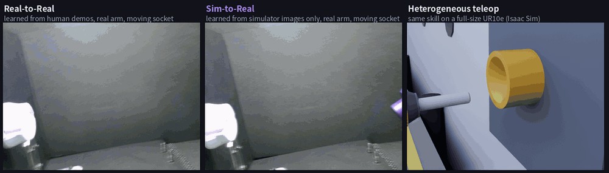
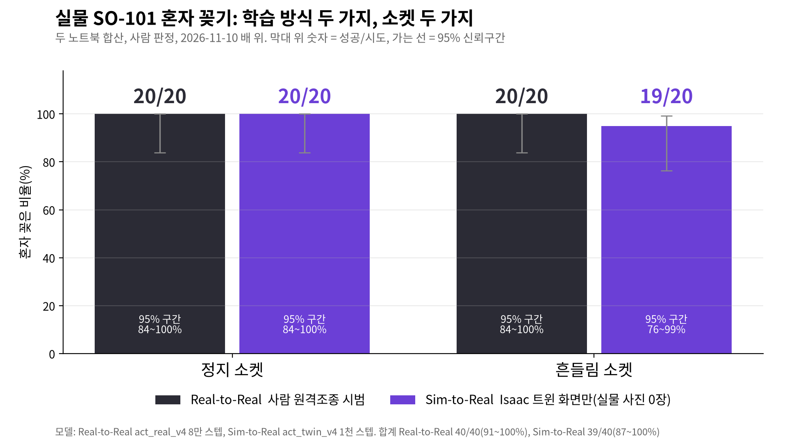
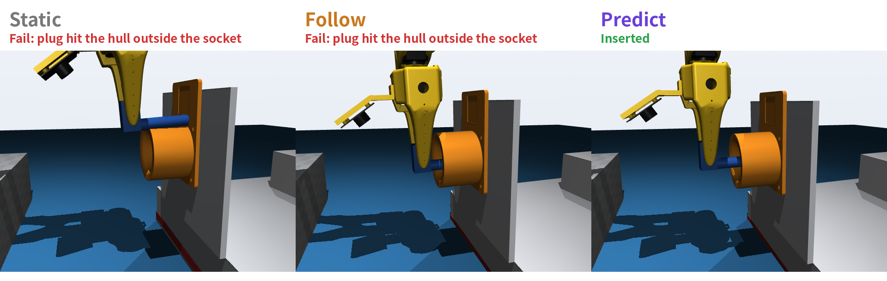
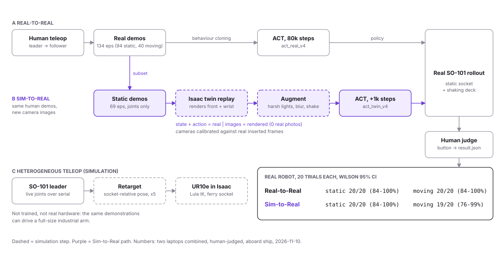
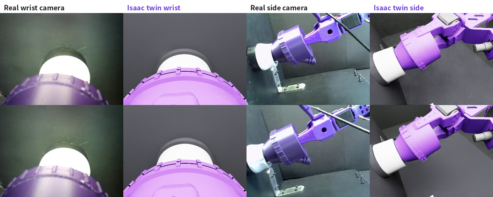
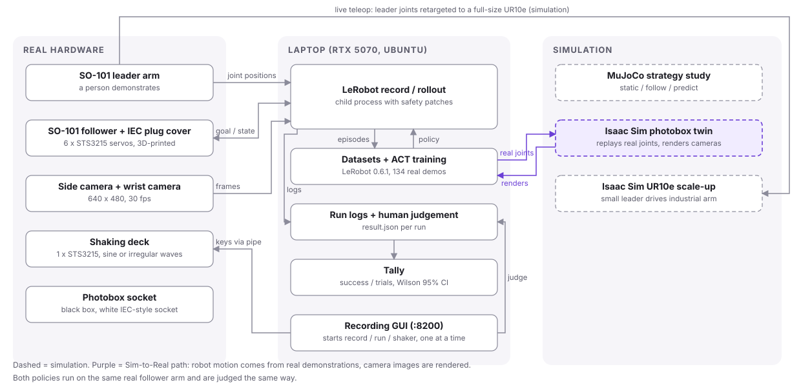
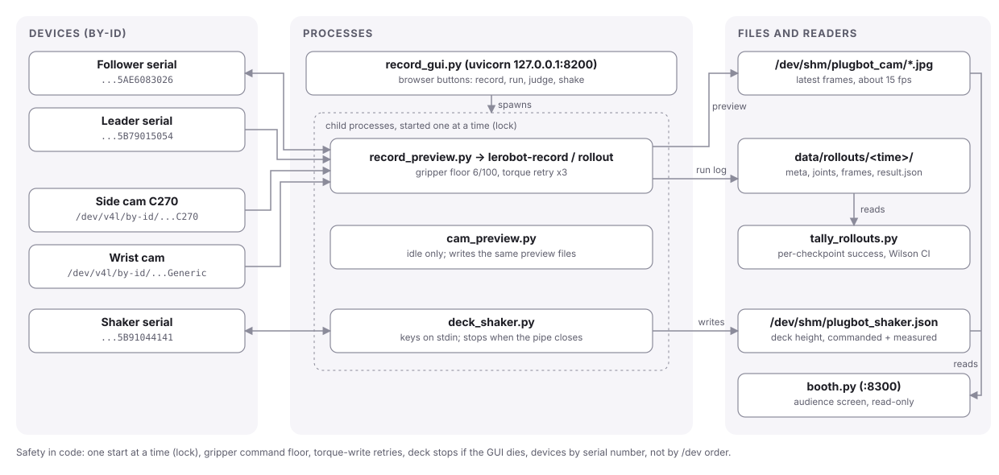
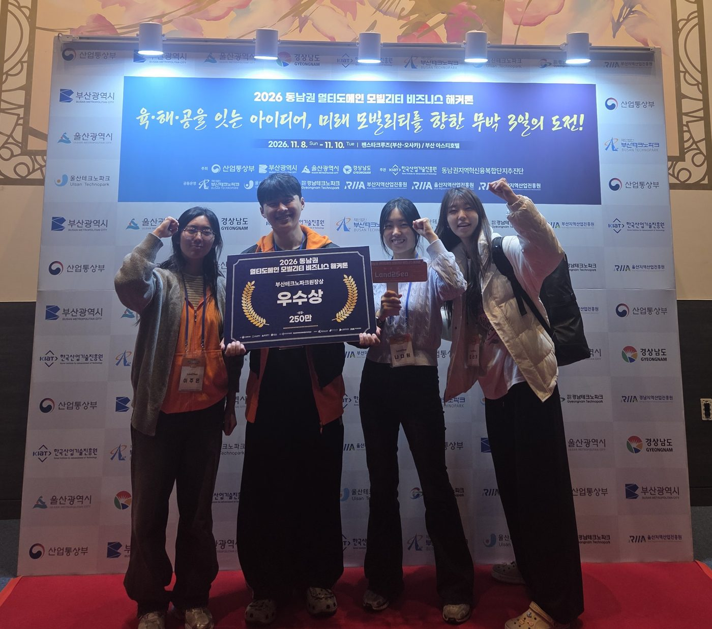

<div align="center">

# PlugBot

### A small robot arm that plugs itself into a moving ship's charging socket

Excellence Award (joint 2nd place of 107 teams), presented by the President of Busan Techno Park, 2026 Southeast Korea Multi-Domain Mobility Business Hackathon

By **Gwangbin Kim** (team lead of Land2Sea; wrote all the software in this repository)

[](#award)
[](#award)
<br>

-ffcc4d)


[Web page](https://gawbi.github.io/plugbot/en/) | [한국어](README.md)



<sub>Left and middle: the real SO-101 running a learned ACT policy on a moving deck. The left policy learned from human demonstrations, the middle one only from simulator renders. Right: the same motion moved onto a full-size UR10e in Isaac Sim, as a kinematic visualization.</sub>

</div>

---

Robots already plug in electric cars, because a parked car holds still. A moored ship doesn't. It keeps moving with the waves, so shore power cables are still connected by hand. In the first year of shore power at Busan New Port, 9 of the 19 ships that applied failed to connect ([Finance Today, 2020-08-05](https://www.fntoday.co.kr/news/articleView.html?idxno=227118), in Korean).

I wanted to see whether a cheap open-source arm, the SO-101, could learn that job. I trained an ACT policy from teleoperated human demonstrations, and then trained a second one only on images re-rendered from the same demonstrations inside an Isaac Sim digital twin. Both were tested on the real arm against a moving deck we set up aboard a ferry. The one trained on human demonstrations plugged in 40 times out of 40. The one that had never seen a real photo plugged in 39 out of 40. The whole thing took 11 days, from the first commit on 2026-10-31 to the last judged run on 2026-11-10, and the last three days were spent on a ferry between Busan and Osaka.

## Results

### Real robot



| Training data | Socket | Inserted on its own | 95% CI (Wilson) |
|---|---|---|---|
| Real-to-Real: human teleop demonstrations | static | 20 / 20 | 84–100% |
| Real-to-Real: human teleop demonstrations | moving deck | 20 / 20 | 84–100% |
| Sim-to-Real: Isaac twin renders only | static | 20 / 20 | 84–100% |
| Sim-to-Real: Isaac twin renders only | moving deck | 19 / 20 | 76–99% |

After every run, a person pressed a success or failure button in the recording UI, which writes a `result.json` for that run. The table is just `tools/tally_rollouts.py` counting those files. The runs were done aboard on 2026-11-09 and 10 on two laptops, and the numbers combine both. The models are `act_real_v4` (80k steps) and `act_twin_v4` (1k steps). Raw numbers are in [`outputs/real_results.json`](outputs/real_results.json).

Twenty out of twenty doesn't mean it always works. With 20 trials, all you can say at 95% confidence is that the success rate is at least 84%, which is why every rate here comes with an interval.

### Simulation: when to plug in



Timing the insertion against a moving socket was a separate study in MuJoCo. I compared three controllers. Static goes to wherever it first saw the socket. Follow keeps chasing the socket's current position. Predict looks 0.3 s ahead, to make up for the camera and servo lag, and aims there.

| Model wave height | Static | Follow | Predict | Only predict / only follow succeeded |
|---|---|---|---|---|
| 4 cm | 76% | 87% | **99%** | 13 / 1 |
| 6 cm | 25% | 46% | **88%** | 45 / 3 |
| 8 cm | 12% | 24% | **60%** | 40 / 4 |

Each cell is 100 runs. All three controllers use the same seeds (1000 to 1099), so they face exactly the same waves. The last column counts waves where only one of the two succeeded: at 6 cm, predict alone got in on 45 waves and follow alone on 3.

The original design also had a gate that waited for a calm moment before inserting. After the hackathon I switched it off, and not a single outcome changed across 300 paired waves. So prediction works because it looks ahead, not because it waits. It also hits the socket much more gently (95th percentile contact force about 37 N against 311 N for follow), though that comes from a rigid contact model and is only good for comparison. This controller exists only in simulation. The real ACT policy doesn't use it yet.

## How it works

<picture>
  <source media="(prefers-color-scheme: dark)" srcset="docs/portfolio/img/arch_pipeline_dark.svg">
  
</picture>

### Learning from human demonstrations (Real-to-Real)

There are two SO-101 arms. A person moves the leader arm by hand, the follower copies it, and two cameras (front and wrist) are recorded along with the joint values. I collected 134 demonstrations this way, 94 on a static socket and 40 on the moving deck, and trained LeRobot's ACT (Action Chunking Transformer) on them. ACT looks at the camera images and joint state and outputs the next chunk of actions.

### Learning from simulator images (Sim-to-Real)

In case collecting more real demonstrations isn't practical, I moved the same demonstrations into Isaac Sim. The photo booth is modelled inside Isaac, the arm is replayed with the recorded joint values, and only the camera images are rendered fresh. The joint states and actions are the real ones; only the pixels are simulated. Each render randomizes lighting, materials and camera pose a little, and adds blur, noise and delay. The policy trained on these images alone plugged in on the real arm without ever seeing a real photo. Getting there involved one big detour, described under [Problems I ran into](#problems-i-ran-into).



### Moving it onto a big arm (simulation)

I also used the small leader arm to drive a full-size UR10e in Isaac Sim, plugging into a socket on the side of a ferry. The leader pose is expressed relative to the socket, scaled up 5x, and solved with Lula IK. It's a visualization of whether the same demonstrations could carry over to an industrial arm. It isn't a learned policy, and there's no real hardware behind it.

## System architecture

<picture>
  <source media="(prefers-color-scheme: dark)" srcset="docs/portfolio/img/arch_overview_dark.svg">
  
</picture>

<picture>
  <source media="(prefers-color-scheme: dark)" srcset="docs/portfolio/img/arch_runtime_dark.svg">
  
</picture>

On the robot side everything goes through one recording UI (FastAPI). Its buttons start recording, policy runs and the moving deck as child processes, behind a single lock so only one runs at a time. Pressing a button twice can't leave two processes driving the same servos.

Devices are opened by serial number (`/dev/serial/by-id`, `/dev/v4l/by-id`), because replugging the USB hub used to reshuffle port numbers and swap the leader and follower. Only the recording process opens the cameras. It writes the latest frame to a file in `/dev/shm`, and the recording UI and the audience screen just read that file.

I didn't patch LeRobot. `act/record_preview.py` wraps it and adds a lower limit on the gripper command (matched to where the printed cover blocks the jaw) and up to three retries for torque writes. `act/deck_shaker.py`, which drives the moving deck, stops the deck if the control program dies.

The verdicts are data too. Every autonomous run saves its joints and frames, and the success or failure button writes `result.json`. Every real-robot number in this README is counted from those files.

The stack is Python, PyTorch, LeRobot 0.6.1 (ACT), NVIDIA Isaac Sim 5.1 (USD, PhysX, RTX), MuJoCo 3.17, FastAPI, OpenCV and CadQuery, on Feetech STS3215 servos.

## Problems I ran into

There's a log of 19 problems with causes and fixes in [`docs/troubleshooting.md`](docs/troubleshooting.md) (in Korean). These are the ones that took the longest.

### The twin-trained model kept jamming 5 mm low and to the right

I trained on images rendered with the uncalibrated cameras up to 20k steps and tried checkpoints on the real arm along the way. The short ones, 5k and 7.5k steps, each got into the static socket once. From 10k steps on, every checkpoint drove the plug into the same spot, about 5 mm below and to the right of the socket, and stopped there (I saw this on site; there are no verdict files for it). My first guess was that the demonstrations never showed a miss followed by a retry, so I built a tool that uses IK to synthesize misses, pauses, backing off and realigning. But the miss was always in the same direction. Random mistakes wouldn't do that, so I started to suspect the virtual cameras. Putting the real and twin images of the inserted pose side by side showed that both cameras were off in position and angle. I tried an automatic search for the camera that maximized overlap of the white socket and the purple cover, and it picked a wrong camera twice: the render was updating one frame late, and the metric itself wasn't a good fit. In the end I wrote a tool (`--try_cams`) that renders several candidate cameras next to the real image and picked one by eye. Re-rendering with the calibrated cameras and training just 1k more steps gave the Sim-to-Real result in the table above. The recovery demonstrations weren't used in the final model. Because calibration and training length changed at the same time, I couldn't tell during the event which one mattered, so I checked that separately [afterwards](#after-the-hackathon).

### Teleoperation dropped as soon as the follower moved

The kernel log showed the USB devices re-enumerating dozens of times. Every time the arms drew current, the whole USB hub reset. I moved the arm controller boards to the laptop's own ports and left only the cameras on the hub.

### The gripper servo overloaded and killed the recording

To let the wrist camera see the contact, I designed and printed a gripper cover that holds the plug 52 to 58 mm forward (the wall went from 2.35 mm to 4.4 mm after a review). The cover stops the jaw at about 8 out of 100, but the leader kept commanding 0, so the servo never got to rest. Both recording and policy runs now clamp the gripper command at 6.

### The front camera had slowly turned

The camera was stuck on with double-sided tape, and its head joint rotated over a few hours. I didn't notice by eye; measuring the image shift per episode with phase correlation is what showed it (+52 px). I added an overlay to the recording UI that ghosts a training frame over the live view, so the camera can be put back.

### Smaller ones

Motor 4 sometimes answered `no status packet` at startup, which went away once torque writes were retried up to three times. The camera sometimes failed to open right before recording because a leftover preview process was still holding it. The preview now runs as its own process, and recording checks with `fuser` that the device is free first.

## How the experiments were set up

All simulation comparisons are paired. The controllers share wave seeds, so instead of comparing averages you can line them up wave by wave. The 45 versus 3 above is counted that way, and an exact McNemar test gives p = 1.3e-10 at 6 cm. Every success rate also gets a Wilson 95% interval. Fewer trials means a wider interval, which matters most for the 20-run real tests.

I also ported the MuJoCo study to Isaac Sim (PhysX). Predict stayed high (97% at 6 cm), but follow went to 100%, so the advantage of prediction did not reproduce in Isaac. Matching Isaac's servo model to MuJoCo's didn't change that, and I still don't know why. I wrote it down as a physics-engine gap ([`outputs/ISAAC_RESULTS.md`](outputs/ISAAC_RESULTS.md)) and let the real-robot tests make the final call.

The twin policy got worse on the real robot the longer it trained. After calibration, the 1k-step checkpoint got all 13 static runs logged on this laptop, while 2k, 3k and 4k steps were each tried once and all failed (one-sided Fisher exact test, p ≈ 0.002). The uncalibrated model showed the same shape: 5k and 7.5k got in, 10k and later missed. There are too few runs per checkpoint to call it a curve, but it looked like fitting the renders more closely moved the policy away from the real camera, so I went with the shortest-trained model.

The two real results (40/40 and 39/40) give Fisher p = 1.0. That means no difference was found, not that they're equal; 40 runs each just can't tell them apart.

## After the hackathon

After the event the wrist camera cable broke, so I couldn't run the robot again. There are no new real-robot numbers. Instead I went back through the logged runs, held-out real episodes and simulation. Code and results are in [`tools/research/`](tools/research/) and [`outputs/research/`](outputs/research/).

The question I most wanted answered was whether the twin model was saved by the calibration or by the short training. I trained control models that start from the same v2 checkpoint (20k steps) and continue for 1k steps with the same augmentation seed, differing only in camera calibration, three seeds each. Fed real images the twin never trained on, and compared on pin-tip position 1 s ahead, the calibrated models were closer to the human demonstration in all three pairs (mean 40.2 mm against 45.6 mm). Their loss from seeing real images instead of a plain gray image was also much smaller (2.5 mm against 10.6 mm). Since training length is the same, this points at the calibration itself. It's still an offline metric, though, and needs a real-robot check.

I also looked at what calibration changed. On 25 real episodes the twin never saw, I measured how much the action 1 s ahead changes when the same joint state is paired with the real image versus the re-rendered twin image. In all 14 twin checkpoints, the calibrated-camera renders gave the smaller change. Within one training run the change grew with training (v2 rank correlation 0.76 to 0.95), which looks like the model gradually fitting the renders.

During the tests aboard, the front camera wasn't where it had been when the demonstrations were recorded ([comparison](outputs/research/front_view_shift.png)). Both policies still got in. Masking inputs one at a time on the test logs, the twin policy's action moved 17 mm when the wrist camera was blanked and 8 mm for the front camera, and shifting the front image by 45 px moved it only 3 to 5 mm. It was leaning mostly on the wrist camera.

Last, I measured in simulation what it costs ACT to execute actions in chunks. The real ACT commits to 3.3 s of actions at a time and doesn't look at the socket again until the chunk is done. On 6 cm MuJoCo waves, replanning every step gave 90% for predict and 47% for follow; replanning every 3.3 s dropped them to 35% and 25% ([figure](outputs/research/chunk_study.png)). That's probably the first thing to fix before the real policy can handle a moving socket well.

## Repository layout

```
act/          real SO-101: recording UI (FastAPI), LeRobot recording and rollout wrappers, ACT training, moving deck, audience screen
isaac/twin/   photo-booth digital twin: export real episodes, twin meshes, randomized rendering, camera calibration, dataset builder
isaac/scaleup UR10e at the ferry socket: replay and live SO-101 leader teleop (retargeting, Lula IK, collision guard)
isaac/        the strategy study ported from MuJoCo to Isaac
plugbot/      shared simulation core: MuJoCo scene, JONSWAP ship motion, IK, AR prediction, insertion state machine
tools/        Wilson tallies, paired strategy comparison, renders and videos, LeRobot conversion, post-hackathon analysis (research/)
cad/          printed parts and the IEC-style gripper cover (CadQuery)
real/         early rule-based pipeline (ArUco tracking, camera and robot calibration), replaced by the learned policy
docs/         problem log, portfolio fact sheet and figures, pre-final simulation study (docs/simulation_study_ko.md)
```

## Running it

```bash
# Simulation study (CPU, Linux or macOS)
uv venv --python 3.12 .venv && uv pip install --python .venv/bin/python mujoco numpy scipy matplotlib pillow
.venv/bin/python tools/compare_predict_follow.py --n 100          # paired predict / follow / static, about 75 s

# Real robot (LeRobot 0.6.1 env, two SO-101s, two cameras; ports in act/env.sh)
bash act/record_gui.sh                                             # http://127.0.0.1:8200 to record, run and judge
bash act/train.sh plug_train_v4 full act_real_v4                   # ACT, 80k steps
~/lerobot_env/bin/python tools/tally_rollouts.py                    # success rate per checkpoint with Wilson intervals

# Sim-to-Real twin (Isaac Sim 5.1, RTX GPU)
~/lerobot_env/bin/python isaac/twin/export_episodes.py              # joint trajectories from real episodes
LD_LIBRARY_PATH=~/isaacsim_compat/lib ~/isaacsim_env/bin/python isaac/twin/run_twin.py --render --rand --variants n --out data/twin_render3
~/lerobot_env/bin/python isaac/twin/build_dataset.py --render data/twin_render3 --repo plug_twin_v4 --aug
```

Notes on getting Isaac Sim running on this laptop (Ubuntu 26.04, driver 580-open) are in [`CLAUDE.md`](CLAUDE.md) and [`isaac/README.md`](isaac/README.md).

## Limitations

The real tests used a model moving deck set up aboard a ship, not an actual ship's socket. Twenty runs per condition give a lower bound on the success rate; they don't prove reliability. Socket-motion prediction is validated only in simulation, and the real policy currently just reacts to what it sees. The UR10e scene is a kinematic visualization with no contact physics. And the 5-axis SO-101 can't roll the plug around the pin axis when inserting sideways, so a keyed multi-pin connector would need a 6-axis arm or a mechanical guide.

## Team and how it was built

Land2Sea was four people. As team lead I did the system architecture, robot software and safety layers, ACT training and evaluation, the MuJoCo study, the Isaac port and digital twin, the hardware integration design (gripper cover CAD, camera placement), and the measurements and problem log. Every commit in this repository is mine. Seon-gi Cho built the hardware (booth, moving deck, camera mounts, socket alignment), Dawon Na put together and gave the presentation, and Jueun Lee researched the market, pricing and business model.

I wrote the code together with an AI coding agent (Claude Code). I decided what to build, how to run the experiments and what counted as success, and I did the hardware debugging myself. The agent wrote a lot of the code within that direction. I checked its numbers and explanations against the log files and threw out the wrong ones. For example, it once explained follow's 100% in Isaac by saying collisions weren't counted as failures, but follow still got 100% with collisions counted, so that explanation went. That's how the four parts (real-robot learning, digital twin, simulation study, industrial-arm teleop) came together in 11 days.

## Award

At the 2026 Southeast Korea Multi-Domain Mobility Business Hackathon, individual track (107 teams), we received the Excellence Award (joint 2nd place), presented by the President of Busan Techno Park. The final was held 2026-11-08 to 10 aboard the Busan to Osaka ferry, and the award was given on November 10.

<p align="center">



</p>

Data sources, terms of use and third-party licenses are in [`docs/data_sources.md`](docs/data_sources.md). The SO-101 model comes from MuJoCo Menagerie (Apache 2.0) and TheRobotStudio SO-ARM100.
