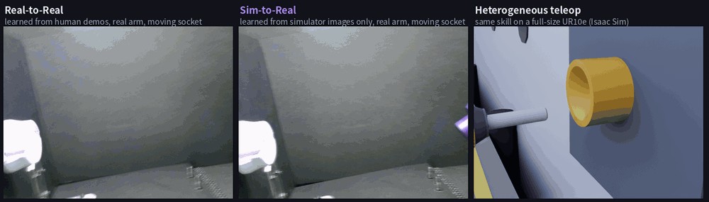
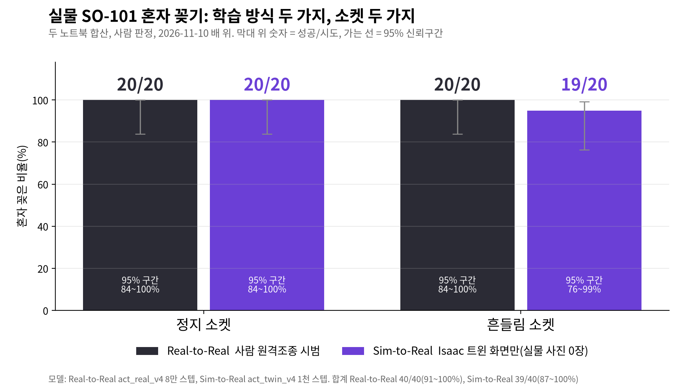
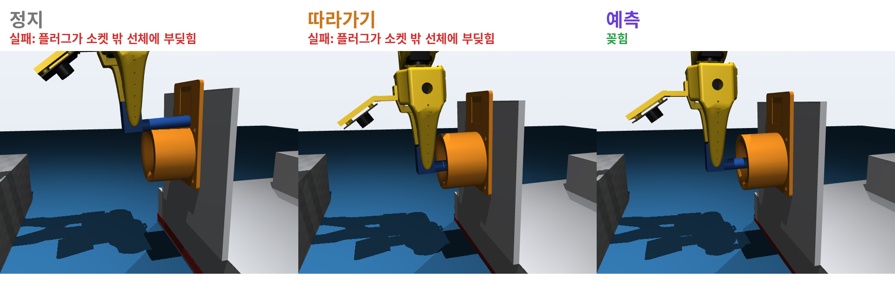
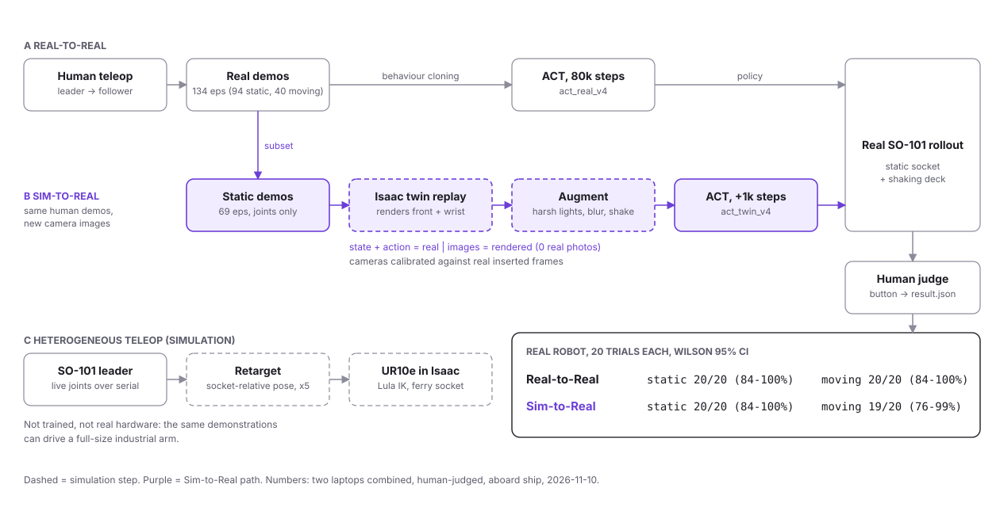
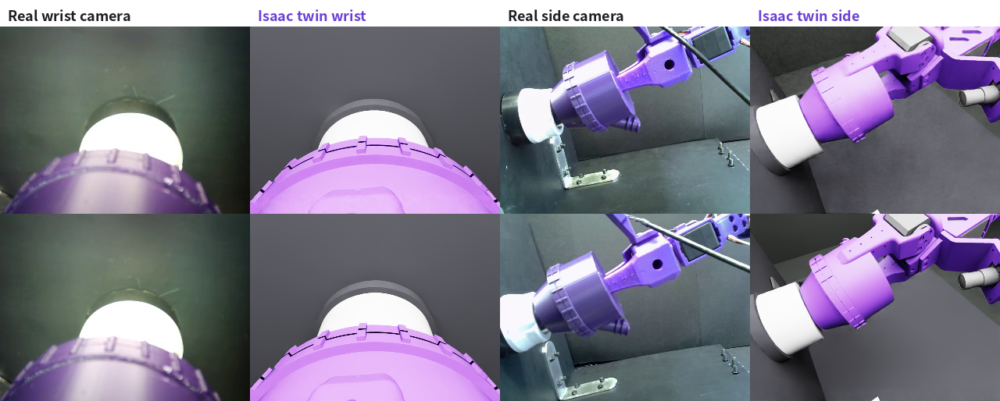
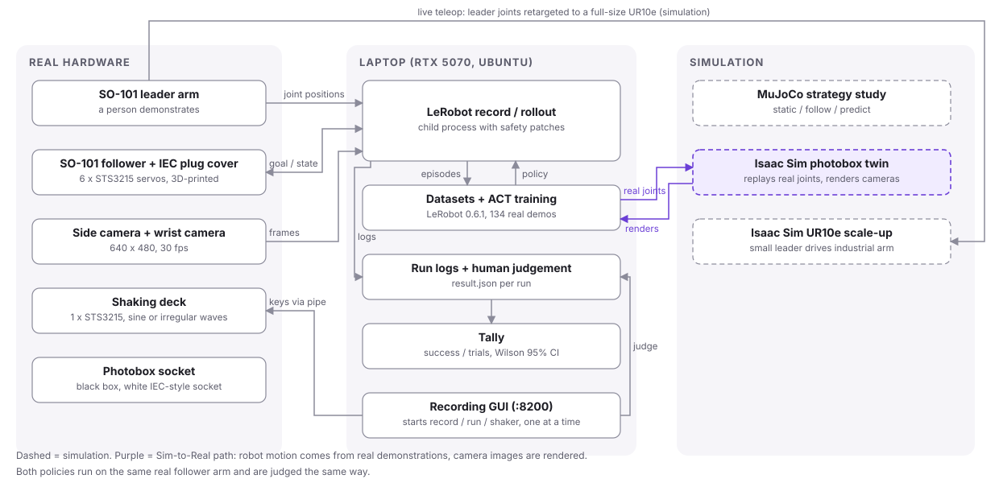
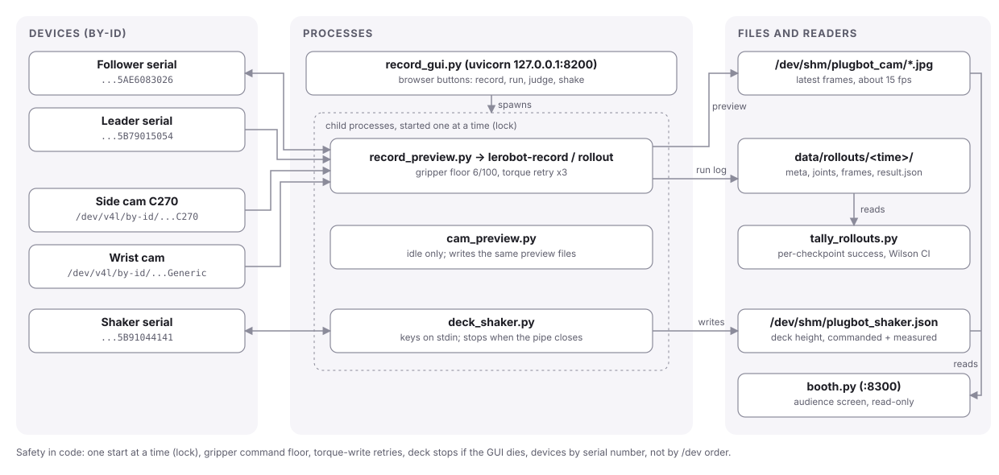
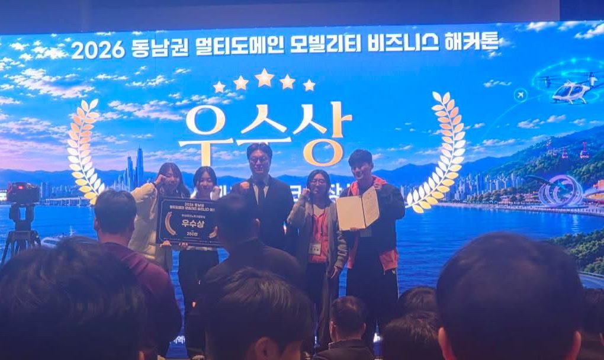
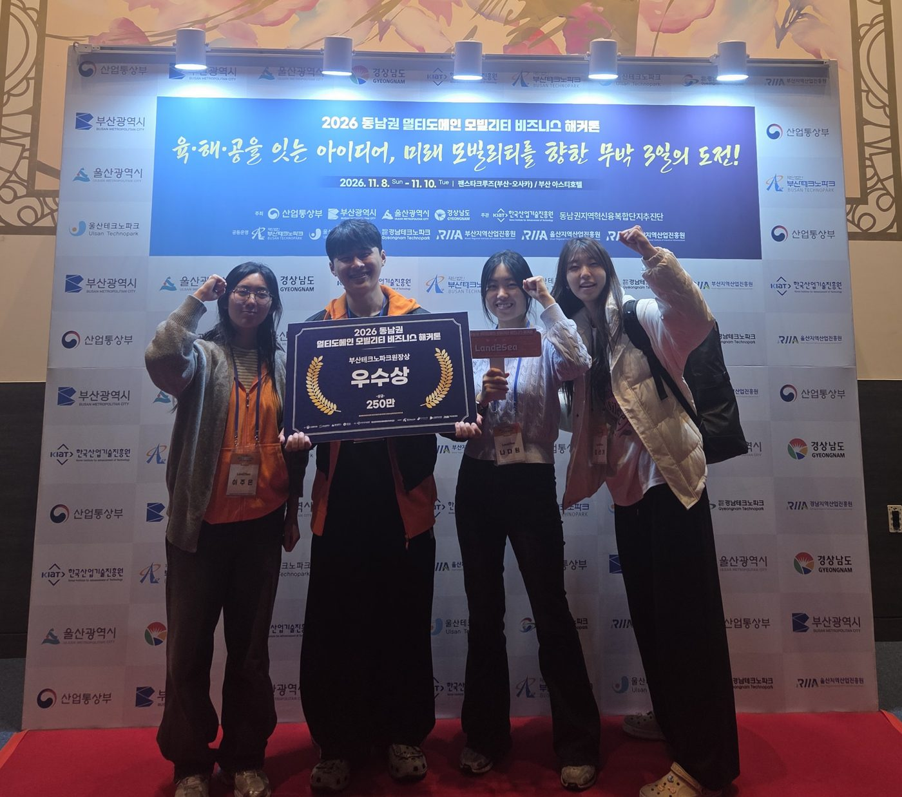
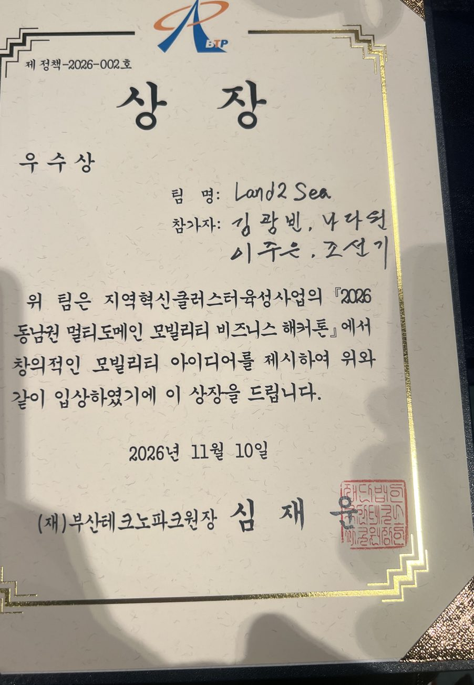

<div align="center">

# PlugBot

### 흔들리는 선박 충전 소켓에 스스로 꽂는 저가형 로봇팔

**사람 시범으로 배우고, 시뮬레이터 화면만으로도 배워서, 배 위 실물 로봇으로 검증했다**

2026 동남권 멀티도메인 모빌리티 비즈니스 해커톤 본선 우수상(공동 2위), (재)부산테크노파크원장상 (107팀 참가)

**김광빈** (Land2Sea 팀장): 시스템 설계와 이 저장소의 소프트웨어 전체 ([팀](#팀과-만든-방식))

[](#수상)
[](#수상)
<br>

-ffcc4d)


[English README](README.md)



<sub>왼쪽과 가운데는 실물 SO-101이 학습한 ACT 정책으로 서보 흔들림 갑판 위 소켓에 꽂는 장면이다. 오른쪽은 Isaac Sim 운동학 시각화다.</sub>

</div>

---

## 한눈에

| | |
|---|---|
| **문제** | 부두에 묶인 배도 파도로 계속 움직여서, 육상전원 플러그는 아직 사람이 꽂는다. 멈춰 있는 전기차는 이미 로봇이 꽂는다. |
| **만든 것** | 시범으로 꽂기를 배우는 작은 로봇팔 시스템, 같은 정책을 렌더 화면만으로 학습시키는 Isaac Sim 포토박스 디지털 트윈, 움직이는 소켓에 언제 꽂아야 하는지에 대한 시뮬레이션 연구 |
| **결과(실물)** | Real-to-Real **40/40**(정지 20/20, 흔들림 20/20). 실물 사진 **0장**으로 학습한 Sim-to-Real **39/40**(정지 20/20, 흔들림 19/20) |
| **결과(시뮬레이션)** | 같은 파도 100회 짝 비교: 소켓 움직임을 **예측 88%**, 따라가기 46% (MuJoCo, 모형 파고 6 cm) |
| **내 역할** | 4인 팀의 팀장, 소프트웨어, 학습, 시뮬레이션, 하드웨어 통합 전담. 첫 커밋(2026-10-31)부터 실물 판정 결과(2026-11-10)까지 11일 |
| **기술** | Python, LeRobot 0.6.1(ACT), PyTorch, NVIDIA Isaac Sim 5.1(USD, PhysX, RTX), MuJoCo 3.17, FastAPI, OpenCV, CadQuery, Feetech STS3215 서보 |

---

## 결과

### 실물 로봇



| 학습 데이터 | 소켓 | 혼자 꽂은 횟수 | 95% 신뢰구간(Wilson) |
|---|---|---|---|
| Real-to-Real: 사람 원격조종 시범 | 정지 | 20 / 20 | 84~100% |
| Real-to-Real: 사람 원격조종 시범 | 흔들림 갑판 | 20 / 20 | 84~100% |
| Sim-to-Real: Isaac 트윈 렌더만 | 정지 | 20 / 20 | 84~100% |
| Sim-to-Real: Isaac 트윈 렌더만 | 흔들림 갑판 | 19 / 20 | 76~99% |

실행마다 사람이 녹화 화면의 버튼으로 판정했고(실행마다 `result.json`), `tools/tally_rollouts.py`로 셌다.
2026-11-09~10 배 위에서 두 노트북 결과를 합쳤다. 모델은 `act_real_v4`(8만 스텝), `act_twin_v4`(1천 스텝). 숫자 원본: [`outputs/real_results.json`](outputs/real_results.json).

### 시뮬레이션: 소켓을 쫓지 말고 예측하라



| 모형 파고 | 정지 | 따라가기 | **예측** | 예측만 성공 / 따라가기만 성공 |
|---|---|---|---|---|
| 4 cm | 76% | 87% | **99%** | 13 / 1 |
| 6 cm | 25% | 46% | **88%** | 45 / 3 |
| 8 cm | 12% | 24% | **60%** | 40 / 4 |

MuJoCo, 칸마다 100회. 세 전략이 같은 시드(1000~1099)를 써서 모든 비교가 같은 파도 위에서 이루어진다.
예측 제어기는 카메라와 서보 때문에 생기는 늦음을 메우려고 소켓 위치를 0.3초 앞까지 내다본다. '잔잔할 때만 꽂기' 조건은 효과가 없었다(꺼도 같은 파도 300쌍에서 결과가 바뀐 파도가 없음). 이점은 내다보기에서 온다. 소켓을 치는 힘도 훨씬 작다(접촉력 95백분위 약 37 N 대 311 N, 강체 접촉 모델이라 비교로만 읽는다). 이 제어기는 시뮬레이션에만 있고, 실물 ACT 정책은 아직 쓰지 않는다.

---

## 어떻게 동작하나: 한 가지 기술로 가는 세 갈래

<picture>
  <source media="(prefers-color-scheme: dark)" srcset="docs/portfolio/img/arch_pipeline_dark.svg">
  
</picture>

**A. Real-to-Real.** 사람이 SO-101 리더 팔을 움직이면 팔로워가 따라 한다. 녹화한 134개 에피소드(정지 94, 흔들림 갑판 40)로 ACT(액션 청크 트랜스포머) 정책을 학습했다. 정책은 카메라 두 대와 관절 상태를 본다.

**B. Sim-to-Real.** 같은 사람 시범을 포토박스를 본뜬 Isaac Sim 안에서 관절값 그대로 재생하고, 카메라 화면만 새로 그린다. 관절 상태와 동작은 실물 값 그대로다. 도메인 무작위화(조명, 재질, 카메라 흔들기)와 화면 손상(흐림, 잡음, 흔들림, 지연)을 더했다. 정책은 실물 사진을 한 장도 보지 않았는데도 실물 팔에서 꽂는다.
보정 전 카메라 화면으로 길게(1만~2만 스텝) 학습한 트윈 체크포인트는 소켓 오른쪽 아래 약 5 mm에 박혔다. 짧게 학습한 5천, 7,500 스텝은 정지 소켓에서 한 번씩 꽂았다. 꽂힌 자세의 실물 화면과 트윈 화면을 비교해 두 가상 카메라를 다시 맞추고, 다시 렌더해서 1천 스텝만 추가 학습한 모델로 판정을 받았다. 보정과 짧은 학습이 함께 바뀌어서 무엇이 효과를 냈는지는 아직 분리하지 못했다(오프라인 분석 중).



**C. 이종 원격조종(시뮬레이션).** 작은 리더 팔로 Isaac Sim 안의 실제 크기 UR10e를 조종해 페리 옆 소켓에 꽂는다. 자세를 소켓 기준으로 잡고 5배 키운 뒤 Lula IK로 푼다. 같은 시범으로 산업용 팔을 움직일 수 있음을 보여 주는 시각화이고, 학습한 것도 실물 하드웨어도 아니다.

---

## 시스템 아키텍처

<picture>
  <source media="(prefers-color-scheme: dark)" srcset="docs/portfolio/img/arch_overview_dark.svg">
  
</picture>

<picture>
  <source media="(prefers-color-scheme: dark)" srcset="docs/portfolio/img/arch_runtime_dark.svg">
  
</picture>

설계 결정:
- **시작은 한 번에 하나.** 녹화 화면은 녹화, 정책 실행, 흔들림 갑판을 잠금 하나 아래 자식 프로세스로 띄운다. 버튼을 두 번 눌러도 두 프로세스가 같은 서보를 움직이지 않는다.
- **장치는 시리얼 번호로.** 포트와 카메라를 `/dev/serial/by-id`, `/dev/v4l/by-id`로 연다. USB 허브를 다시 꽂아도 리더와 팔로워가 뒤바뀌지 않는다.
- **미리보기는 파일로.** 카메라는 녹화 프로세스만 연다. 최신 화면을 `/dev/shm`에 쓰고, 녹화 화면과 관객 화면은 그 파일을 읽는다.
- **안전 장치는 얇은 층에.** `act/record_preview.py`가 LeRobot을 감싸 그리퍼 명령 하한(출력한 덮개가 턱을 막는다)과 토크 쓰기 3번 재시도를 더한다. `act/deck_shaker.py`는 제어 프로그램이 죽으면 갑판을 멈춘다.
- **판정도 데이터.** 자율 실행마다 관절과 화면을 남기고, 사람이 누른 성공/실패 버튼이 `result.json`을 쓴다. 이 README의 숫자는 그 파일에서 Wilson 신뢰구간과 함께 센 것이다.

---

## 부딪힌 문제와 해결

원인과 해결을 적은 문제 기록 19건: [`docs/troubleshooting.md`](docs/troubleshooting.md). 그중 일부:

| 증상 | 원인 | 해결 |
|---|---|---|
| 팔로워가 움직이는 순간 원격조종이 끊김 | 팔이 전류를 끌 때마다 USB 허브가 통째로 리셋(커널 기록에 재연결 수십 번) | 팔 보드는 노트북 본체 포트에 직접, 허브는 카메라만 |
| 그리퍼 서보 과부하로 녹화가 죽음 | 출력한 덮개가 턱을 약 8/100에서 막는데, 리더는 계속 0을 명령 | 녹화와 정책 실행 모두 그리퍼 명령을 6에서 자름 |
| 시작할 때 4번 모터 `no status packet`이 가끔 남 | LeRobot이 토크 쓰기를 한 번만 시도 | 토크 켜기와 끄기를 3번까지 재시도 |
| 녹화 전에 카메라 `Failed to open` | 남은 미리보기 프로세스가 장치를 잡고 있음 | 미리보기를 따로 프로세스로, 녹화 전 `fuser`로 비었는지 확인 |
| 옆면 카메라가 서서히 틀어짐 | 테이프로 고정한 머리가 몇 시간에 걸쳐 돌아감 | 에피소드마다 화면 이동을 위상 상관으로 측정(+52 px), 기준 화면 겹쳐 맞추는 도구 제작 |
| 손목 카메라에 플러그가 안 보임 | 그리퍼가 접점을 가림 | 플러그를 52~58 mm 앞으로 빼는 그리퍼 덮개 CAD, 지적 뒤 벽 2.35 → 4.4 mm |
| 트윈으로 배운 모델이 오른쪽 아래 5 mm에 박힘 | 가상 카메라가 실물과 다름, 길게 학습할수록 나빠짐 | 꽂힌 실물 화면에 맞춰 두 카메라를 보정하고 다시 렌더, 1천 스텝만 추가 학습 |

---

## 실험 설계

- **짝 비교.** 전략들이 같은 파도 시드를 쓴다. 위의 45 대 3은 평균이 아니라 똑같은 파도에서의 결과를 센 것이다.
- **비율마다 불확실성.** 성공률은 Wilson 95% 신뢰구간과 함께 적는다. 20/20은 "항상"이 아니라 "적어도 84%"다.
- **두 번째 물리 엔진.** MuJoCo 연구를 Isaac Sim(PhysX)으로 옮겼다. 예측은 높게 유지됐지만(6 cm 97%) 따라가기도 100%가 되어, 예측이 낫다는 결과는 Isaac에서 **재현되지 않았다**. MuJoCo의 서보 모델로 바꿔도 같았고, 원인은 아직 모른다([`outputs/ISAAC_RESULTS.md`](outputs/ISAAC_RESULTS.md)).
- **시뮬레이션 과적합.** 트윈 정책을 더 오래 학습하면 실물에서 오히려 나빠졌다. 보정 후 1천 스텝은 이 노트북 기록으로 정지 13회를 모두 꽂았고, 2천, 3천, 4천 스텝은 각각 한 번씩 시도해 모두 실패했다(Fisher 정확 검정, 단측 p ≈ 0.002). 보정 전 모델도 5천, 7,500 스텝은 꽂고 1만 스텝 이후는 빗나갔다. 시뮬레이터에 더 맞출수록 실물 카메라에서 멀어졌다.

---

## 대회 뒤 분석: 기록과 시뮬레이션이 말해 주는 것

새 실물 숫자는 없다. 기록된 실행, 학습에 안 쓴 실물 에피소드, 시뮬레이션으로 얻은 결과다(`tools/research/`, `outputs/research/`).
- **보정과 짧은 학습이 함께 바뀌었다.** 보정 전 트윈 모델도 5천, 7,500 스텝은 정지 소켓에서 한 번씩 꽂았고, 1만 스텝부터 빗나갔다. 판정 받은 모델은 카메라 보정과 학습 길이(1천 스텝 이어 학습)가 함께 바뀐 것이라 둘의 효과는 아직 분리되지 않았다. 보정만 다른 대조 모델(같은 출발점, 같은 증강 시드, 1천 스텝, 시드 3쌍)로 오프라인에서 둘을 갈랐다. 학습에 안 쓴 실물 화면에서 보정 후 쪽이 사람 시범에 세 쌍 모두 더 가까웠고(평균 40.2 대 45.6 mm), 회색 화면 대비 실물 화면의 손해도 훨씬 작았다(2.5 대 10.6 mm). 학습 길이를 같게 둔 비교라 보정 자체의 효과로 보인다. 다만 오프라인 지표이고 실물 확인이 남았다.
- **보정은 정책이 느끼는 화면 간극을 줄였다.** 트윈이 본 적 없는 실물 에피소드 25개에서, 같은 state에 실물 화면 대신 다시 그린 트윈 화면을 넣으면 1초 뒤 동작이 바뀌는 정도가 보정 후 카메라 쪽이 더 작았다(트윈 체크포인트 14개 모두). 같은 학습 안에서는 오래 학습할수록 그 차이가 커졌다(v2 순위 상관 0.76~0.95). 렌더에 맞춰지는 신호다.
- **시험 때 앞 카메라는 녹화 때와 다른 자리였다.** 배 위 시험의 앞 카메라 시점이 시범 녹화 때와 달랐다([그림](outputs/research/front_view_shift.png)). 그래도 두 정책 모두 꽂았다. 시험 기록의 입력을 가려 보면 트윈 정책은 손목 카메라를 가릴 때 17 mm, 앞 카메라를 가릴 때 8 mm 동작이 바뀌었고, 앞 화면을 45 px 밀면 3~5 mm만 바뀌었다.
- **예측의 이점은 기다림이 아니라 내다보기에서 온다.** MuJoCo 같은 파도 300쌍에서 '잠잠할 때 기다리기'를 꺼도 결과가 바뀐 파도는 없었다. 계획을 오래 눈 감고 실행할수록 이점이 줄었다. 6 cm에서 매 스텝 다시 계획하면 예측 90%, 따라가기 47%, 실물 ACT처럼 3.3초마다 다시 계획하면 35%, 25%였다([그림](outputs/research/chunk_study.png)).
- **통계.** 예측 대 따라가기 McNemar p = 1.3e-10(6 cm). 실물 트윈 1천 대 2천~4천 13/13 대 0/3, Fisher p = 0.002. Real-to-Real 40/40 대 Sim-to-Real 39/40은 Fisher p = 1.0으로 차이를 찾지 못했다(같다는 뜻은 아니다).

## 저장소 구조

```
act/          실물 SO-101: 녹화 화면(FastAPI), LeRobot 녹화와 실행 덧붙임, ACT 학습 스크립트, 흔들림 갑판, 관객 화면
isaac/twin/   포토박스 디지털 트윈: 실물 에피소드 내보내기, 트윈 메시, 도메인 무작위화 렌더, 카메라 보정, 데이터셋 만들기
isaac/scaleup 페리 소켓의 UR10e: 재생과 SO-101 리더 실시간 원격조종(리타기팅, Lula IK, 충돌 방지)
isaac/        전략 실험의 MuJoCo → Isaac 이식
plugbot/      공통 시뮬레이션 코어: MuJoCo 장면, JONSWAP 선박 운동, IK, AR 예측, 꽂기 상태 기계
tools/        Wilson 신뢰구간 집계, 전략 짝 비교, 렌더와 영상, LeRobot 변환
cad/          3D 출력 부품과 IEC형 그리퍼 덮개(CadQuery)
real/         초기 규칙 기반 파이프라인(ArUco 추적, 카메라와 로봇 보정). 학습 정책으로 대체
docs/         문제 기록, 포트폴리오 사실표와 그림, 본선 전 시뮬레이션 연구(docs/simulation_study_ko.md)
```

## 다시 돌려 보기

```bash
# 시뮬레이션 연구(CPU, 리눅스 또는 맥)
uv venv --python 3.12 .venv && uv pip install --python .venv/bin/python mujoco numpy scipy matplotlib pillow
.venv/bin/python tools/compare_predict_follow.py --n 100          # 예측, 따라가기, 정지 짝 비교, 약 75초

# 실물 로봇(LeRobot 0.6.1 환경, SO-101 두 대, 카메라 두 대. 포트는 act/env.sh)
bash act/record_gui.sh                                             # http://127.0.0.1:8200: 녹화, 실행, 판정
bash act/train.sh plug_train_v4 full act_real_v4                   # ACT 8만 스텝
~/lerobot_env/bin/python tools/tally_rollouts.py                    # 체크포인트별 성공률과 Wilson 신뢰구간

# Sim-to-Real 트윈(Isaac Sim 5.1, RTX GPU)
~/lerobot_env/bin/python isaac/twin/export_episodes.py              # 실물 에피소드 → 관절 궤적
LD_LIBRARY_PATH=~/isaacsim_compat/lib ~/isaacsim_env/bin/python isaac/twin/run_twin.py --render --rand --variants n --out data/twin_render3
~/lerobot_env/bin/python isaac/twin/build_dataset.py --render data/twin_render3 --repo plug_twin_v4 --aug
```

이 노트북(Ubuntu 26.04, 드라이버 580-open)의 Isaac Sim 설정: [`CLAUDE.md`](CLAUDE.md), [`isaac/README.md`](isaac/README.md).

## 한계

- 실물 시험은 배 위의 모형 흔들림 갑판에서 했고, 실제 선박 소켓이 아니다. 칸마다 20회는 성공률의 아래쪽 한계를 줄 뿐 신뢰성을 증명하지 않는다.
- 움직임 예측기는 시뮬레이션에서만 검증했다. 실물 정책은 화면을 보고 반응한다.
- UR10e는 접촉 물리가 없는 운동학 시각화다.
- 5축 SO-101은 옆으로 꽂을 때 플러그를 핀 축 둘레로 돌릴 수 없다. 키가 있는 다핀 커넥터는 6축 팔이나 기계식 안내가 필요하다.

---

## 팀과 만든 방식

팀 Land2Sea, 4인.
- **김광빈(팀장):** 시스템 아키텍처, 로봇 소프트웨어와 안전 장치, ACT 학습과 평가, MuJoCo 연구, Isaac 이식과 디지털 트윈, 하드웨어 통합 설계(그리퍼 덮개 CAD, 카메라 배치), 측정과 문제 기록. 이 저장소의 커밋 전부.
- **조선기:** 하드웨어 제작(부스, 흔들림 갑판, 카메라 고정, 소켓 정렬)
- **나다원:** 발표 구성과 발표
- **이주은:** 시장, 가격, 사업 모델 조사

AI 코딩 에이전트(Claude Code)를 짝 프로그래머로 썼다. 아키텍처와 실험을 정하고, 하드웨어를 직접 디버깅하고, 무엇을 성공으로 볼지 정하고, 모든 주장을 기록된 데이터와 맞춰 본 것은 내가 했다. 코드의 많은 부분은 그 방향 아래에서 에이전트가 썼다. 그렇게 네 하위 시스템(실물 학습, 디지털 트윈, 시뮬레이션 연구, 산업용 팔 원격조종)을 2026-10-31 첫 커밋부터 2026-11-10 실물 판정 결과까지 만들었고, 마지막 사흘은 배 위에서 했다.

## 수상

**2026 동남권 멀티도메인 모빌리티 비즈니스 해커톤** 개인부문(107팀): 본선 우수상(공동 2위), (재)부산테크노파크원장상, 2026-11-10 수상. 본선은 2026-11-08~10 부산~오사카 페리 선상에서 열렸다.

<p align="center">



</p>


데이터 출처, 이용 조건, 제3자 자산의 라이선스: [`docs/data_sources.md`](docs/data_sources.md). SO-101 모델: MuJoCo Menagerie(Apache 2.0), TheRobotStudio SO-ARM100.
