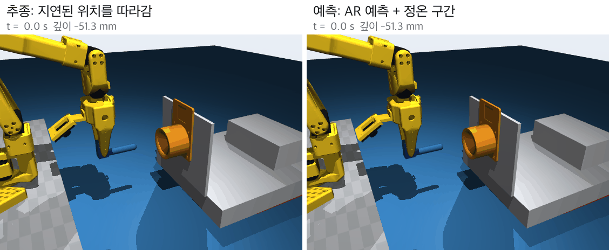
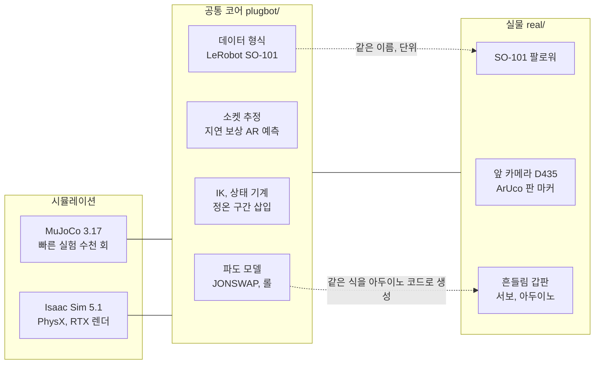
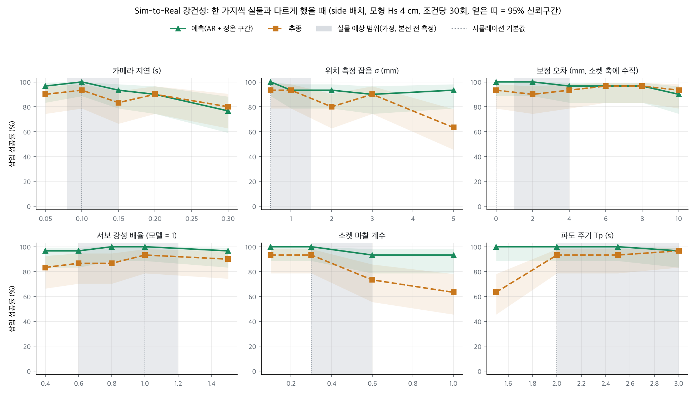
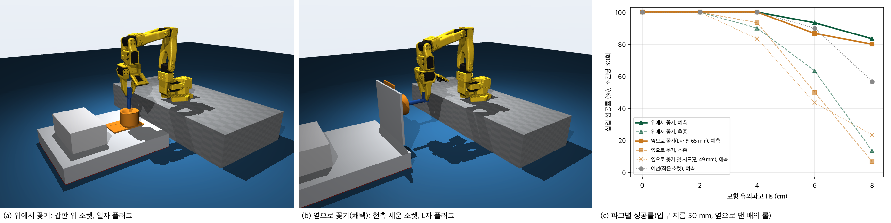
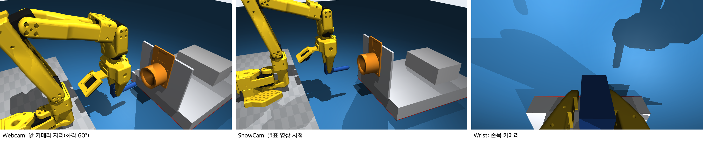
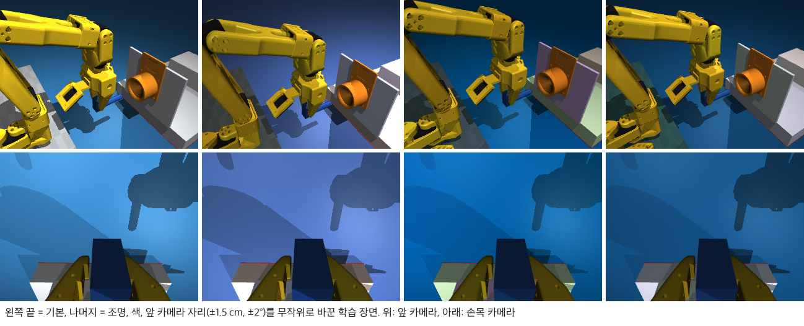
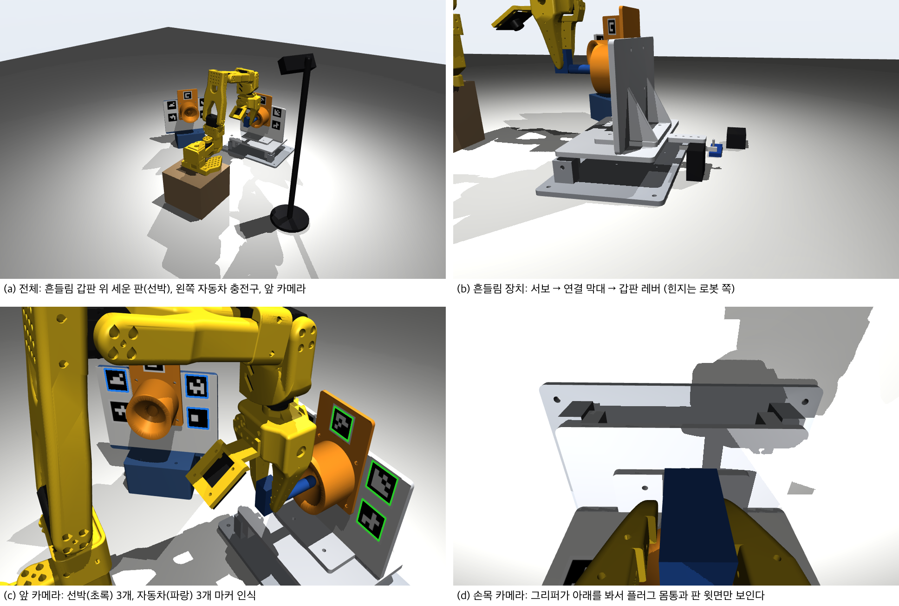

<div align="center">

# PlugBot

### Sim-to-Real 갭을 넘어, 흔들리는 바다 위 전기선박에 스스로 꽂는 충전 로봇팔

**전기차 충전구에서 배운 '꽂기'를 시뮬레이션에서 다듬고, 흔들리는 실물 선박 소켓까지 그대로 옮긴다**

[](#동남권-해커톤)
[](#동남권-해커톤)
<br>




<sub>같은 파도(모형 유의파고 6 cm)에서 왼쪽은 카메라가 본 위치를 그대로 따라가다 소켓을 놓치고, 오른쪽은 0.3초 앞을 예측해 잔잔한 순간에 꽂는다 (MuJoCo)</sub>

</div>

---

## 한눈에

| | |
|---|---|
| **무엇을** | 부두의 로봇팔이 흔들리는 전기선박의 충전 소켓을 카메라로 찾아 스스로 꽂는다 |
| **왜 어려운가** | 소켓이 파도로 계속 움직이고, 카메라는 늦게 보며(약 0.1초), 시뮬레이션에서 되던 것이 실물에서는 안 되는 Sim-to-Real 갭이 크다 |
| **핵심 아이디어** | 시뮬레이션과 실물이 같은 코드, 같은 기하, 같은 파도 식, 같은 데이터 형식을 쓰게 만들고, 남는 차이는 예측 제어와 깔때기 소켓이 흡수하게 설계한다 |
| **검증** | MuJoCo 실험 수천 회, 실물 코드를 렌더 영상으로 끝까지 돌린 모의 실행, 실물이 시뮬레이션과 다를 때의 강건성 시험, Isaac Sim 이식 |
| **결과(시뮬레이션)** | 모형 파고 6 cm에서 성공률 추종 50% → 예측 87%. 카메라 지연 0.2초, 보정 오차 8 mm, 서보 강성 0.6배에서도 예측은 90% 이상 |
| **본선 시연** | 3D 프린트 흔들림 갑판(서보가 같은 파도 식을 재생) 위 세운 소켓에 SO-101이 L자 플러그를 꽂는다 |

---

## 무엇을 해결하는가

### 1. 문제: 전기선박은 충전 중에도 움직인다

- 전기차 충전은 이미 로봇이 꽂는 시대가 왔다. 차는 멈춰 있기 때문이다.
- 전기선박은 부두에 묶여 있어도 파도와 바람, 다른 배가 만든 물결로 **좌우로 흔들리고(롤) 오르내린다**. 소켓이 계속 움직인다.
- 실제 전기 페리 자동충전 설비는 이 문제를 크고 전용인 기계로 푼다. 노르웨이 Ampere호의 Cavotec 장치는 선체 옆 해치 안 소켓에
  윈치로 플러그를 내려 꽂고, Zinus 충전탑은 긴 케이블로 최대 2 m의 표류를 견딘다. 배마다, 부두마다 맞춤 설비가 필요하다.
- 커넥터도 단순하지 않다. 선박용 메가와트 충전(MCS, IEC 63379)은 전력핀 2개와 접지, 통신 핀을 합쳐 7핀이다.
  꽂는 쪽이 위치뿐 아니라 방향까지 맞춰야 한다.

**PlugBot의 질문:** 전기차 충전에서 검증된 작은 범용 로봇팔과 카메라, 소프트웨어로 움직이는 소켓을 꽂을 수 있다면, 소형 선박과
항만 장비까지 자동충전을 싸게 넓힐 수 있지 않을까.

### 2. 진짜 장벽: Sim-to-Real 갭

움직이는 소켓을 실물로 수백 번 시험할 수는 없다. 그래서 시뮬레이션에서 제어기를 만들고 학습 데이터를 모으는데, 시뮬레이션과
실물 사이에는 늘 차이(갭)가 있다. PlugBot은 이 갭이 생기는 곳을 하나씩 짚어 **없애거나, 재거나, 견디게** 만든다.



| 갭이 생기는 곳 | PlugBot이 한 일 | 근거(숫자) |
|---|---|---|
| **로봇 모델** (기구학) | MuJoCo 모델, Isaac용 URDF, 실물 LeRobot 보정 기준을 하나로 맞추고 차이를 잰다. 실물 관절 부호, 영점 확인 도구 | 무작위 자세 20개에서 플러그 끝 0.004 mm, 손목 카메라 0.001° 차이 |
| **물리 엔진** | 같은 실험을 MuJoCo와 Isaac Sim(PhysX) 두 엔진에서 돌린다. 선박 자세, 소켓 계산은 같은 함수를 공유 | 장면의 소켓 입구, 축 차이 0. Isaac 성공률 비교는 GPU 노트북에서 진행 |
| **카메라와 추적** | 실물 추적 코드를 MuJoCo로 렌더한 카메라 영상에 그대로 돌려 검증. 마커 1개 → 판 마커 4개 + 탭 마커, 카메라 자리 최적화 | 추적 오차: 마커 1개 5~18 mm → 판 마커 0.4~0.7 mm. 로봇 옆 카메라는 팔에 가려 3.8 mm → 오른쪽 앞 0.6 mm 이하 |
| **지연** (카메라, 처리) | 최근 3초 관측으로 AR(6) 예측, 지연만큼 앞을 보고, 소켓이 잔잔한 순간(정온 구간)에만 삽입 시작 | 파고 6 cm: 추종 50% → 예측 87%. 지연 0.2초에서도 예측 90% |
| **카메라→로봇 보정** | 플러그를 손으로 끝까지 꽂은 자세 = 보어 바닥이라는 기하로 보정점을 만든다(Kabsch). 남는 오차는 깔때기(포착 반경 19 mm)가 흡수 | 모의 보정 점 오차 0.8 mm. 보정 오차 8 mm에서도 예측 97% |
| **서보, 마찰** | 실물 STS3215 강성, PLA 마찰이 모델과 달라도 되는지 강건성 시험 | 강성 0.4~1.5배 예측 97% 이상, 마찰 1.0까지 93% |
| **파도 운동** | 시뮬레이션의 파도 식(JONSWAP)에서 아두이노 코드를 자동 생성해 실물 흔들림 갑판이 같은 운동을 한다. 힌지 기구까지 시뮬레이션에 모델링 | 시뮬레이션과 아두이노 식 차 0 mm. 갑판 운동으로 정현파 8 mm 100%, 불규칙파 2 cm 90% |
| **소프트웨어 경로** | 실물 로봇과 가짜 로봇이 같은 인터페이스. 실물 삽입 코드 전체를 가짜 카메라, 가짜 로봇으로 끝까지 실행 | 렌더 영상 기반 모의 실행 예측 10/10(정지, 4 cm, 6 cm) |
| **학습 데이터** | 시뮬레이션 시범을 실물 LeRobot 녹화와 같은 이름, 단위로 저장. 조명, 색, 카메라 자리, 물리, 센서 값을 무작위화 | LeRobot 0.6.1로 변환과 다시 읽기 확인 |

### 3. 강건성 시험: 실물이 시뮬레이션과 이만큼 달라도 된다

실물에서 달라질 수 있는 값을 하나씩 바꿔 가며 성공률이 어디까지 버티는지 잰다(`sim2real_robustness.py`, 조건당 30회).
회색 띠는 실물에서 예상하는 범위(가정)이고, 본선 전 키트에서 실제 값을 재어 바꾼다.



- **예측 제어는 실물 예상 범위 전체에서 90% 이상**을 지켰다. 추종 제어는 잡음 5 mm에서 63%, 마찰 1.0에서 63%, 짧은 파도 주기에서 63%까지 떨어졌다.
- 보정 오차에 둘 다 강한 것은 깔때기 덕분이다. 기계 설계(수동 정렬)가 Sim-to-Real 갭의 일부를 맡는다.
- 가장 민감한 값은 **카메라 지연**이다(0.3초에서 77%). 그래서 실물에서 가장 먼저 잴 값이다.

---

## 결과

### 배치 결정: 위에서 꽂기 vs 옆으로 꽂기

실제 충전구는 대부분 세워져 있어 옆으로 꽂기(L자 플러그)를 택했다. 처음에는 Hs 6 cm에서 43%였는데, 원인이 '그리퍼 턱이 깔때기
테두리에 닿는 것'임을 찾아 핀을 49 mm → 65 mm로 늘리고 소켓 자리를 옮겨 위에서 꽂기와 같은 수준으로 올렸다.



| 모형 Hs (실선 환산, 1:10) | static | reactive | **predictive** |
|---|---|---|---|
| 0 cm | 100% | 100% | **100%** |
| 2 cm (0.2 m) | 96.7% | 100% | **100%** |
| 4 cm (0.4 m) | 66.7% | 93.3% | **100%** |
| 6 cm (0.6 m) | 20% | 50% | **86.7%** |
| 8 cm (0.8 m) | 10% | 6.7% | **80%** |

side 배치, 부두에 옆으로 댄 배의 롤, 조건당 30회(`outputs/experiment_side.json`). 자동차(정지) 충전구는 15/15.
삽입 중 접촉력 95백분위 중앙값(Hs 6 cm): 추종 452 N, 예측 38 N. 예측은 소켓을 덜 친다.

### 실물 코드 모의 실행 (`python -m real.dry_run`)

실물에서 쓸 코드(마커 추적 → 보정 → AR 예측 → IK → 로봇 명령)를 MuJoCo가 렌더한 1280 × 720 카메라 영상으로 끝까지 돌렸다.

| 조건(10회) | 추종 | 예측 |
|---|---|---|
| 정지 소켓 | 100% | 100% |
| 모형 파고 4 cm | 70% | 100% |
| 모형 파고 6 cm | 30% | 100% |

---

## Isaac Sim 5.1

MuJoCo에서 만든 실험을 NVIDIA Isaac Sim(PhysX 물리, RTX 렌더)으로 옮겼다. **물리 엔진이 바뀌어도 같은 결과가 나오는지**가
Sim-to-Real로 가는 중간 다리다. 기구학과 장면은 맥에서 MuJoCo와 숫자로 맞췄고, 실행은 GPU 노트북(RTX 5070 Ti)에서 한다.



<sub>Isaac 장면의 세 카메라 자리를 MuJoCo로 그린 것이다(실제 Isaac 렌더는 GPU 노트북에서 `--preview`로 만든다)</sub>

| 기능 | 명령 | 결과 |
|---|---|---|
| 한 번에 설정 | `bash isaac/setup_gpu.sh` | 로봇 USD, 미리보기 사진, 정지 1회, 발표 영상 1개 |
| 미리보기 | `run_plugbot_isaac.py --preview` | `outputs/isaac_preview_side_{Webcam,ShowCam,Wrist}.png` |
| 성공률 실험 | `--hs 0.06 --strategy predictive --trials 30 --headless` | 같은 조건 MuJoCo 성공률과 함께 출력 |
| 발표 영상 | `bash isaac/make_showreel.sh` | 추종과 예측을 같은 파도로 나란히 찍은 mp4, README용 GIF, 세 시점 영상 |
| 학습 데이터 | `--hs 0.06 --dataset 50 --headless` | 앞, 손목 카메라 30 fps 에피소드 → `tools/to_lerobot.py` |

자세한 순서: [isaac/README.md](isaac/README.md)

---

## 학습(ACT)과 도메인 무작위화

예측 제어기는 비교 기준이자 **시범 생성기**다. 시뮬레이션이 만든 시범을 실물 녹화와 같은 형식으로 저장해 ACT 학습에 보탠다.
실물 장면과 달라도 견디도록 에피소드마다 화면, 물리, 센서를 무작위로 바꾼다.



```bash
.venv/bin/python make_sim_dataset.py --episodes 50 --randomize      # MuJoCo 시범 50개(앞, 손목 카메라)
python tools/to_lerobot.py data/sim_side --repo-id <HF아이디>/plugbot_sim_side   # LeRobot 0.6.1 데이터셋
```

- 무작위화: 조명 세기와 방향, 바닥과 선체 색, 앞 카메라 자리(±1.5 cm, ±2°), 서보 강성(0.6~1.4배), 소켓 마찰, 카메라 지연(0.07~0.15 s), 측정 잡음, 보정 오차(최대 3 mm)
- 실물 학습 계획(카메라 2대, 50회 녹화, 우분투 학습): [ACT_PLAN.md](ACT_PLAN.md)

---

## 실물 시연 키트 (본선)



- **로봇**: SO-101 팔로워(5축 + 그리퍼), 리더 팔로 원격 조작 녹화
- **흔들림 갑판**: 3D 프린트 갑판판이 로봇 쪽 힌지를 축으로 기울고, MG996R 서보가 시뮬레이션과 같은 파도 식을 재생(`real/shaker`)
- **소켓**: 입구 지름 50 mm 깔때기, 세운 판에 고정, 판 앞면에 ArUco 마커 4개 + 탭 마커. 자동차 충전구는 마커 번호를 달리해 한 화면에서 구분
- **카메라**: 앞(RealSense D435 컬러, 로봇 오른쪽 앞 40 cm), 손목(키트 카메라)
- **래치**: 핀 끝과 보어 바닥의 네오디뮴 자석. 꽂은 뒤 로봇은 놓고 물러난다(계속 쥐면 선체 운동을 못 따라가 과부하)
- 출력과 조립: [cad/PRINT_GUIDE.md](cad/PRINT_GUIDE.md), 실물 순서: [real/README.md](real/README.md)

### 본선 전에 실물에서 잴 것 (Sim-to-Real 측정 계획)

강건성 그림의 회색 띠를 실제 값으로 바꾼다.

| 잴 값 | 방법 | 시뮬레이션 기준 |
|---|---|---|
| 카메라 지연 | 화면에 시각을 띄워 카메라로 찍고 차이를 읽는다 | 0.1 s (0.2 s까지 예측 90%) |
| 추적 잡음 | 정지 소켓 자세를 30초 기록해 표준편차 | 0.5 mm (3 mm까지 예측 90%) |
| 보정 오차 | `real.calib`의 점별 RMS | 0.8 mm (8 mm까지 예측 97%) |
| 서보 추종 | 명령과 실제 관절값의 차이, 지연 | 모델 강성(0.4배까지 예측 97%) |
| 성공률 | 정지 10회, 흔들림(정현파 4, 8 mm) 각 10회 | 시뮬레이션 같은 갑판 운동 100% |

---

## 빠른 실행

```bash
# 맥 또는 리눅스, GPU 불필요
uv venv --python 3.12 .venv && uv pip install --python .venv/bin/python mujoco numpy scipy matplotlib pillow \
    cadquery opencv-contrib-python trimesh usd-core imageio imageio-ffmpeg

.venv/bin/python run_experiments.py --layout side   # 파고 5단계 × 전략 3개 × 30회 (약 1분)
.venv/bin/python sim2real_robustness.py             # Sim-to-Real 강건성 시험 (약 30초, 병렬)
.venv/bin/python -m real.dry_run                    # 실물 코드를 가짜 카메라, 로봇으로 끝까지
.venv/bin/python make_media.py                      # README 그림과 GIF
.venv/bin/python cad/make_parts.py                  # 3D 프린트 부품(STEP, STL)
.venv/bin/python isaac/build_assets.py              # Isaac Sim용 URDF, USD
```

## 저장소 구조

```
plugbot/      공통 코어: MuJoCo 장면, 파도(JONSWAP, 힌지 갑판), 제어(IK, AR 예측, 상태 기계), 무작위화, 데이터 형식
real/         실물 SO-101 시연: 카메라, ArUco 추적, 보정, 삽입, 모의 실행, 인쇄용 마커, 흔들림 갑판 아두이노 코드
isaac/        Isaac Sim 5.1: 자산 생성(맥), 로봇 USD 변환, 실험, 미리보기, 영상, 학습 데이터(GPU 노트북)
cad/          3D 프린트 부품 설계(CadQuery)와 출력 파일
tools/        LeRobot 변환, 영상 묶기
outputs/      실험 결과(json)와 그림
```

## 한계와 남은 일

- 지금의 숫자는 **시뮬레이션** 결과다. 실물 SO-101 측정(위 표)은 본선 전 키트로 한다.
- Isaac Sim 스크립트는 맥에서 Isaac API 자리에 MuJoCo를 끼운 가짜 모듈로 끝까지 실행해 봤지만, 실제 Isaac에서는 아직 돌리지 않았다.
  Isaac 쪽은 충돌을 실패로 따로 세지 않아 MuJoCo보다 성공률이 조금 높게 나올 수 있다.
- 선박 운동은 실제 RAO가 아닌 근사이고, 축척 1:10(Froude 상사)은 실선 환산을 위한 가정이다.
- 5축 SO-101로 옆으로 꽂으면 그리퍼가 늘 수직이라 플러그의 핀 축 둘레 각도를 따로 맞출 수 없다. 핀이 여러 개인 비대칭 커넥터는
  소켓이 그 축으로 기울지 않아야 한다(6축 팔이나 수동 정렬 키가 필요).
- 접촉력은 강체 접촉 모델 값이라 절대값보다 전략 간 비교로 읽는다.

---

## 동남권 해커톤

**2026 동남권 멀티도메인 모빌리티 비즈니스 해커톤** 개인부문 본선 진출작이다.

- 예선: 기획안과 MuJoCo 시뮬레이션 결과로 통과
- 본선: 2026.11.8~11.10, 부산~오사카 선상 해커톤. 흔들리는 배 위에서 흔들리는 소켓 꽂기를 시연한다
- 팀 PlugBot: 4인, 팀장 김광빈

땅(전기차)과 바다(전기선박)를 잇는 멀티도메인 모빌리티 충전을, 작은 로봇팔과 Sim-to-Real 방법론으로 풀어 보려 한다.

<sub>참고: Cavotec 전기선박 충전(cavotec.com), Zinus 자율 충전 시스템(businessnorway.com), Megawatt Charging System(IEC TS 63379),
UiT 해상 충전 기술 블로그(site.uit.no/ladeteknologi). SO-101 모델: MuJoCo Menagerie(Apache 2.0), TheRobotStudio SO-ARM100.</sub>
