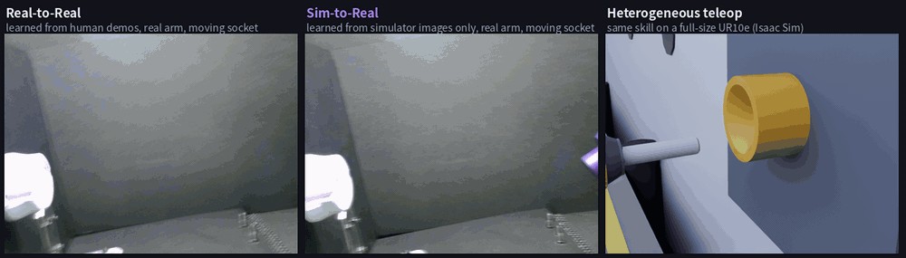
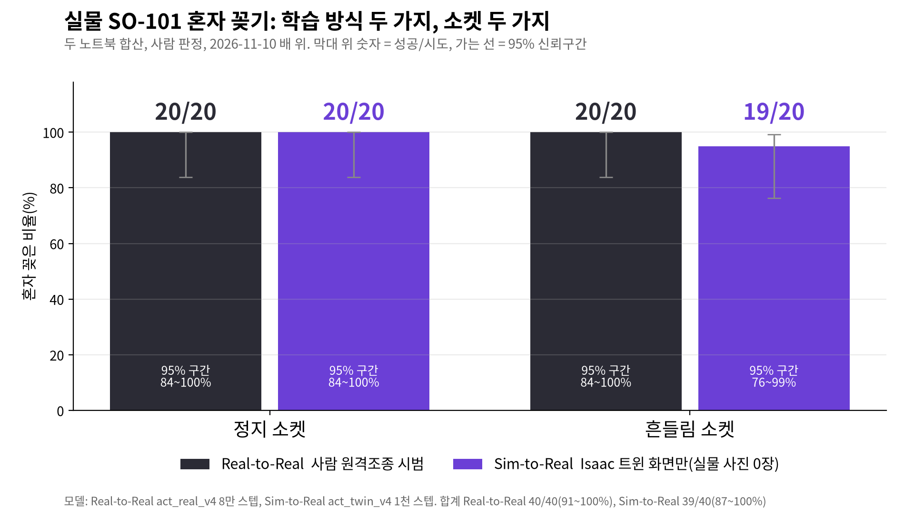
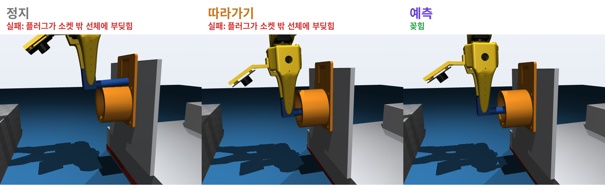
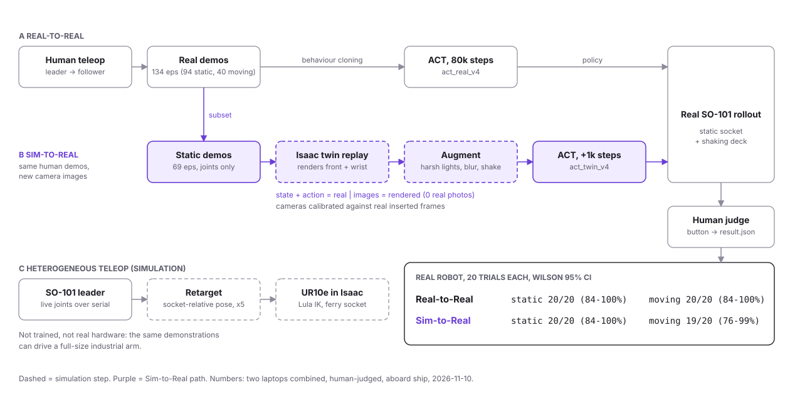
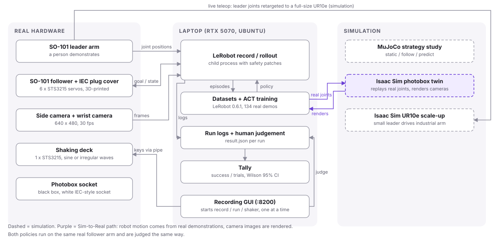
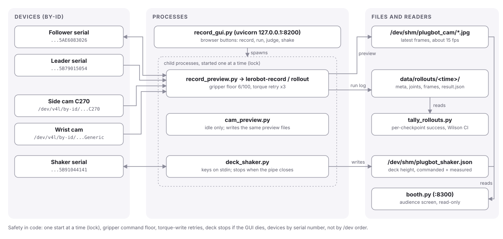
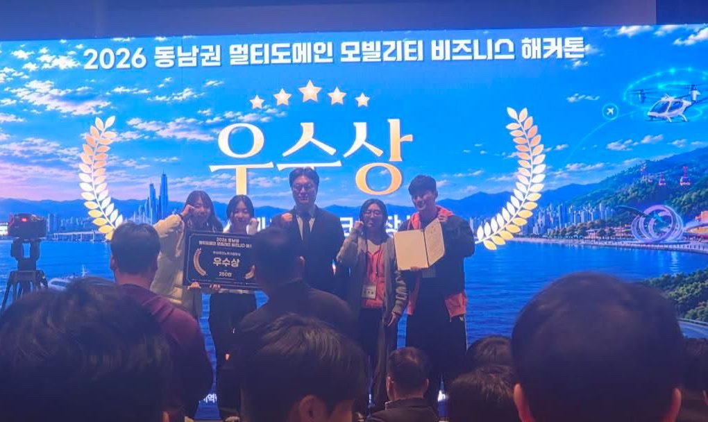
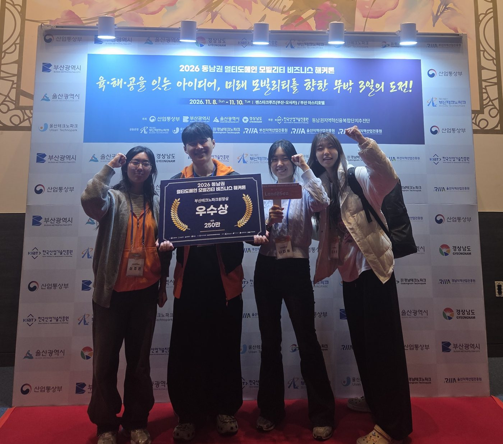
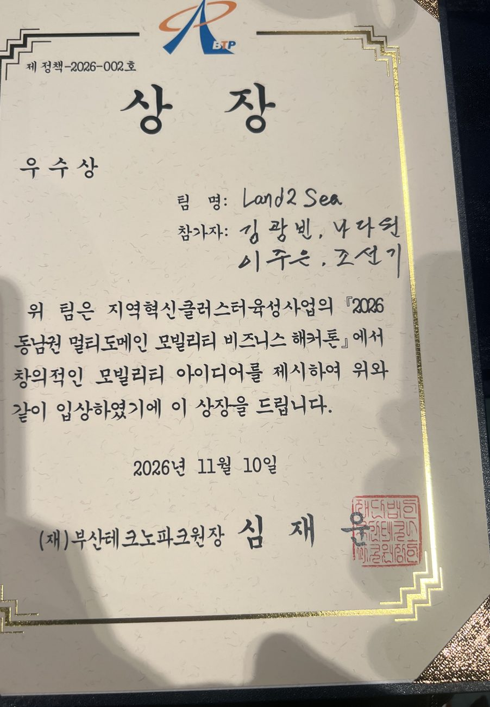

<div align="center">

# PlugBot

### 흔들리는 배의 충전 소켓에 혼자 플러그를 꽂는 작은 로봇팔

2026 동남권 멀티도메인 모빌리티 비즈니스 해커톤 본선 우수상(공동 2위), (재)부산테크노파크원장상 (107팀 참가)

만든 사람 **김광빈** (Land2Sea 팀장, 이 저장소의 소프트웨어 전체를 맡음)

[](#수상)
[](#수상)
<br>

-ffcc4d)


[웹페이지](https://gawbi.github.io/plugbot/) | [English](README.en.md)



<sub>왼쪽은 사람 시범으로, 가운데는 시뮬레이터 화면만으로 학습한 실물 SO-101이 흔들림 갑판 위 소켓에 꽂는 장면입니다. 오른쪽은 같은 동작을 Isaac Sim 안의 실제 크기 UR10e로 옮겨 본 운동학 시각화입니다.</sub>

</div>

---

전기차 충전구에는 이미 로봇이 플러그를 꽂습니다. 차가 가만히 서 있으니까 가능한 일입니다. 배는 부두에 묶여 있어도 파도 때문에 계속 움직여서, 육상전원 케이블은 아직 사람이 직접 연결합니다. 부산 신항에서는 육상전원을 처음 운영한 해에 신청한 배 19척 가운데 9척이 연결에 실패했다는 기사도 있었습니다([파이낸스투데이, 2020-08-05](https://www.fntoday.co.kr/news/articleView.html?idxno=227118)).

이 일을 값싼 오픈소스 로봇팔 SO-101에게 시켜 보는 게 이 프로젝트였습니다. 사람이 원격조종으로 보여 준 시범으로 ACT 정책을 학습시켰고, 같은 시범을 Isaac Sim 디지털 트윈에서 다시 그린 화면만 가지고도 학습시켜 봤습니다. 두 정책 모두 배 위에 차린 흔들림 갑판에서 실물로 시험했는데, 사람 시범으로 배운 쪽은 40번 중 40번, 시뮬레이터 화면으로만 배운 쪽은 40번 중 39번 꽂았습니다. 첫 커밋(2026-10-31)부터 마지막 판정(2026-11-10)까지 11일이 걸렸고, 마지막 사흘은 부산에서 오사카로 가는 페리 안에서 작업했습니다.

## 결과

### 실물 로봇



| 학습 데이터 | 소켓 | 혼자 꽂은 횟수 | 95% 신뢰구간(Wilson) |
|---|---|---|---|
| Real-to-Real: 사람 원격조종 시범 | 정지 | 20 / 20 | 84~100% |
| Real-to-Real: 사람 원격조종 시범 | 흔들림 갑판 | 20 / 20 | 84~100% |
| Sim-to-Real: Isaac 트윈 렌더만 | 정지 | 20 / 20 | 84~100% |
| Sim-to-Real: Isaac 트윈 렌더만 | 흔들림 갑판 | 19 / 20 | 76~99% |

실행이 끝날 때마다 녹화 화면에서 사람이 성공이나 실패 버튼을 눌러 판정했고, 그때마다 `result.json`이 남습니다. 표의 숫자는 `tools/tally_rollouts.py`로 이 파일들을 센 것입니다. 2026-11-09~10 배 위에서 노트북 두 대로 시험한 결과를 합쳤고, 모델은 `act_real_v4`(8만 스텝)와 `act_twin_v4`(1천 스텝)를 썼습니다. 원자료는 [`outputs/real_results.json`](outputs/real_results.json)에 있습니다.

20번 해서 20번 꽂았다고 항상 된다는 말은 아닙니다. 20번으로는 95% 신뢰수준에서 성공률이 84% 이상이라는 정도까지만 말할 수 있어서, 성공률마다 신뢰구간을 같이 적었습니다.

### 시뮬레이션: 언제 꽂을 것인가



흔들리는 소켓에 언제, 어디로 꽂을지는 MuJoCo에서 따로 실험했습니다. 세 가지 방식을 비교했습니다. 정지 방식은 처음 본 소켓 위치로 그냥 가고, 따라가기는 지금 보이는 위치를 계속 쫓아갑니다. 예측은 카메라와 서보가 늦는 만큼을 메우려고 0.3초 뒤의 소켓 위치를 내다보고 움직입니다.

| 모형 파고 | 정지 | 따라가기 | 예측 | 예측만 성공 / 따라가기만 성공 |
|---|---|---|---|---|
| 4 cm | 76% | 87% | **99%** | 13 / 1 |
| 6 cm | 25% | 46% | **88%** | 45 / 3 |
| 8 cm | 12% | 24% | **60%** | 40 / 4 |

칸마다 100번씩 돌렸고, 세 방식 모두 같은 시드(1000~1099)를 써서 똑같은 파도 위에서 비교했습니다. 맨 오른쪽 열은 같은 파도에서 한쪽만 꽂은 횟수입니다. 6 cm 파도에서는 예측만 꽂은 경우가 45번, 따라가기만 꽂은 경우가 3번이었습니다.

처음 설계에는 '잠잠해질 때까지 기다렸다가 꽂기'도 들어 있었습니다. 대회가 끝나고 이 조건을 꺼 봤더니 같은 파도 300쌍에서 결과가 바뀐 경우가 하나도 없었습니다. 예측이 잘된 건 기다려서가 아니라 0.3초 앞을 봤기 때문입니다. 소켓을 치는 힘도 예측 쪽이 훨씬 작았지만(접촉력 95백분위 약 37 N, 따라가기는 311 N), 강체 접촉 모델에서 나온 값이라 크기보다는 둘 사이의 비교로만 봐야 합니다. 이 예측 제어기는 아직 시뮬레이션에만 있고 실물 ACT 정책에는 붙이지 않았습니다.

## 어떻게 만들었나

<picture>
  <source media="(prefers-color-scheme: dark)" srcset="docs/portfolio/img/arch_pipeline_dark.svg">
  
</picture>

### 사람 시범으로 배우기 (Real-to-Real)

SO-101을 두 대 씁니다. 사람이 리더 팔을 손으로 움직이면 팔로워 팔이 그대로 따라 하고, 그동안 카메라 두 대(앞, 손목)의 화면과 관절 값을 녹화합니다. 이렇게 모은 시범 134개(정지 소켓 94개, 흔들림 갑판 40개)로 LeRobot의 ACT(Action Chunking Transformer) 정책을 학습했습니다. ACT는 카메라 화면과 관절 상태를 보고 앞으로 할 동작을 한 묶음씩 내놓습니다.

### 시뮬레이터 화면으로 배우기 (Sim-to-Real)

실물 시범을 더 모으기 어려운 상황을 생각해서 같은 시범을 Isaac Sim으로 옮겼습니다. 포토박스를 Isaac 안에 그대로 본떠 만들고, 녹화해 둔 관절 값으로 팔을 다시 움직이면서 카메라 화면만 새로 렌더했습니다. 관절 상태와 동작은 실물 값 그대로이고 화면만 시뮬레이션인 셈입니다. 렌더할 때마다 조명과 재질, 카메라 위치를 조금씩 바꾸고, 흐림이나 잡음, 지연 같은 화질 손상도 섞었습니다. 이 화면으로만 학습한 정책이 실물 사진을 한 장도 보지 않고 실물 팔로 꽂았습니다. 여기까지 오는 동안 한 번 크게 막혔는데, 그 이야기는 [부딪힌 문제들](#부딪힌-문제들)에 적었습니다.


### 큰 팔로 옮겨 보기 (시뮬레이션)

작은 리더 팔로 Isaac Sim 안의 실제 크기 UR10e를 움직여 페리 옆면 소켓에 꽂아 봤습니다. 리더 팔의 자세를 소켓 기준으로 바꾼 다음 5배로 키우고 Lula IK로 풉니다. 같은 시범이 산업용 팔까지 이어질 수 있는지 보려고 만든 시각화라서, 학습한 정책도 아니고 실물 하드웨어도 아닙니다.

## 시스템 구조

<picture>
  <source media="(prefers-color-scheme: dark)" srcset="docs/portfolio/img/arch_overview_dark.svg">
  
</picture>

<picture>
  <source media="(prefers-color-scheme: dark)" srcset="docs/portfolio/img/arch_runtime_dark.svg">
  
</picture>

실물 쪽 소프트웨어는 녹화 화면(FastAPI) 하나를 중심으로 돌아갑니다. 버튼을 누르면 녹화, 정책 실행, 흔들림 갑판이 자식 프로세스로 뜨는데, 잠금을 하나만 둬서 한 번에 하나만 뜨게 했습니다. 버튼을 두 번 눌러도 두 프로세스가 같은 서보를 잡는 일이 생기지 않습니다.

장치는 모두 시리얼 번호로 엽니다(`/dev/serial/by-id`, `/dev/v4l/by-id`). USB 허브를 뺐다 꽂으면 포트 번호가 바뀌면서 리더와 팔로워가 뒤바뀌곤 했기 때문입니다. 카메라는 녹화 프로세스만 열고, 최신 화면을 `/dev/shm`에 파일로 써 둡니다. 녹화 화면과 관객용 화면은 그 파일을 읽기만 합니다.

LeRobot 코드는 직접 고치지 않고 `act/record_preview.py`에서 한 번 감쌌습니다. 출력한 그리퍼 덮개가 집게를 막는 위치에 맞춘 그리퍼 명령 하한과, 토크 쓰기를 세 번까지 다시 시도하는 처리가 여기에 들어 있습니다. 흔들림 갑판을 움직이는 `act/deck_shaker.py`는 제어 프로그램이 죽으면 갑판을 멈춥니다.

판정 결과도 데이터로 남깁니다. 자율 실행마다 관절과 화면이 저장되고, 사람이 누른 성공이나 실패 버튼이 `result.json`이 됩니다. 이 README의 실물 숫자는 전부 그 파일에서 센 것입니다.

쓴 도구는 Python, PyTorch, LeRobot 0.6.1(ACT), NVIDIA Isaac Sim 5.1(USD, PhysX, RTX), MuJoCo 3.17, FastAPI, OpenCV, CadQuery이고, 서보는 Feetech STS3215입니다.

## 부딪힌 문제들

원인과 해결 과정을 적어 둔 문제 기록이 19건 있습니다([`docs/troubleshooting.md`](docs/troubleshooting.md)). 그중 오래 붙잡고 있었던 것들입니다.

### 트윈으로 배운 모델이 소켓 오른쪽 아래 5 mm에 박혔다

보정 전 카메라로 렌더한 화면으로 2만 스텝까지 학습하면서 체크포인트를 실물에 돌려 봤습니다. 짧게 학습한 5천, 7,500 스텝은 정지 소켓에서 한 번씩 꽂았는데, 1만 스텝 이후 체크포인트는 매번 같은 자리, 소켓 오른쪽 아래 약 5 mm에 플러그를 박고 멈췄습니다(현장에서 본 것이고 판정 파일은 없습니다). 처음에는 빗나갔다가 다시 꽂는 시범이 없어서 그런 줄 알고, IK로 빗나감과 후퇴, 재정렬을 합성하는 도구까지 만들었습니다. 그런데 빗나가는 방향이 늘 같았습니다. 무작위 실수라면 그럴 리가 없어서 가상 카메라를 의심하게 됐습니다. 꽂힌 순간의 실물 화면과 트윈 화면을 나란히 놓고 보니 카메라 두 대 모두 위치와 각도가 어긋나 있었습니다. 흰 소켓과 보라색 덮개 영역이 가장 많이 겹치는 카메라 값을 자동으로 찾게 해 봤지만 두 번 다 엉뚱한 값을 골랐습니다. 렌더가 한 박자 늦게 갱신되는 문제도 있었고 지표 자체도 잘 맞지 않았습니다. 결국 후보 카메라 여러 개를 실물 화면 옆에 나란히 렌더하는 도구(`--try_cams`)를 만들어 눈으로 골랐습니다. 보정한 카메라로 다시 렌더하고 1천 스텝만 이어서 학습한 모델이 위 표의 Sim-to-Real 결과입니다. 회복 시범은 최종 모델에 쓰지 않았습니다. 이때 카메라 보정과 학습 길이가 한꺼번에 바뀌어서 대회 중에는 무엇이 효과를 냈는지 가리지 못했고, 대회 뒤에 따로 비교했습니다([아래](#대회-뒤에-더-본-것)).

### 팔로워가 움직이기 시작하면 원격조종이 끊겼다

커널 로그를 보니 USB 장치가 수십 번 다시 잡혀 있었습니다. 팔이 전류를 당길 때마다 USB 허브가 통째로 리셋된 것이었습니다. 팔 제어 보드는 노트북 본체 포트에 바로 꽂고, 허브에는 카메라만 남겼습니다.

### 그리퍼 서보가 과부하로 꺼지면서 녹화가 죽었다

손목 카메라에 접점이 보이도록 플러그를 52~58 mm 앞으로 내미는 그리퍼 덮개를 CAD로 설계해 출력했습니다(벽 두께는 검토를 거쳐 2.35 mm에서 4.4 mm로 늘렸습니다). 그런데 이 덮개가 집게를 약 8/100 위치에서 막았고, 리더 팔은 계속 0을 명령하니 서보가 쉬지 못했습니다. 녹화와 정책 실행 양쪽에서 그리퍼 명령이 6 아래로 내려가지 않게 잘랐습니다.

### 앞 카메라가 조금씩 돌아가 있었다

양면테이프로 붙여 둔 카메라의 머리 관절이 몇 시간에 걸쳐 돌아갔습니다. 눈으로는 몰랐는데 에피소드마다 화면 이동량을 위상 상관으로 재 보고 알았습니다(+52 px). 학습 때 화면을 반투명으로 겹쳐 보면서 다시 맞추는 기능을 녹화 화면에 넣었습니다.

### 그 밖에

시작할 때 4번 모터가 가끔 `no status packet`으로 응답하지 않던 문제는 토크 쓰기를 세 번까지 다시 시도하게 해서 풀었습니다. 녹화 직전에 카메라가 `Failed to open`으로 안 열리던 건 앞서 띄운 미리보기 프로세스가 장치를 잡고 있어서였고, 미리보기를 따로 떼어 내고 녹화 전에 `fuser`로 장치가 비었는지 확인하게 했습니다.

## 실험은 이렇게 했습니다

시뮬레이션 비교는 모두 짝을 지어서 했습니다. 세 방식이 같은 파도 시드를 쓰기 때문에 평균끼리 견주는 대신 같은 파도에서 누가 성공했는지를 하나씩 맞대어 볼 수 있습니다. 위의 45 대 3이 그렇게 센 숫자이고, McNemar 정확 검정으로 p = 1.3e-10이 나왔습니다(6 cm). 성공률에는 항상 Wilson 95% 신뢰구간을 붙였습니다. 시험 횟수가 적을수록 구간이 넓어지는데, 20번씩 한 실물 결과가 특히 그렇습니다.

MuJoCo 실험은 Isaac Sim(PhysX)으로 옮겨서 다시 돌려 봤습니다. 예측은 6 cm에서 97%로 여전히 높았지만 따라가기도 100%가 나와서, 예측이 낫다는 결과가 Isaac에서는 재현되지 않았습니다. Isaac의 서보 모델을 MuJoCo 값으로 맞춰도 같았고 원인은 아직 찾지 못했습니다. 이 차이는 물리 엔진 갭으로 그대로 기록해 두었고([`outputs/ISAAC_RESULTS.md`](outputs/ISAAC_RESULTS.md)), 그래서 최종 판단은 실물 시험으로 했습니다.

트윈 정책은 오래 학습할수록 실물에서 오히려 나빠졌습니다. 보정 후 1천 스텝 체크포인트는 이 노트북 기록으로 정지 소켓 13번을 모두 꽂았는데, 2천, 3천, 4천 스텝은 한 번씩 돌려서 모두 실패했습니다(Fisher 정확 검정, 단측 p ≈ 0.002). 보정 전 모델도 5천, 7,500 스텝은 꽂았고 1만 스텝부터 빗나갔습니다. 체크포인트마다 시도 횟수가 적어 곡선이라고 하기는 어렵지만, 렌더 화면에 맞출수록 실물 카메라에서 멀어진다고 보고 가장 짧게 학습한 모델로 판정을 받았습니다.

실물 두 결과(40/40과 39/40)는 Fisher 검정에서 p = 1.0이 나와 차이를 찾지 못했습니다. 둘이 같다는 뜻은 아니고, 40번씩으로는 구분할 수 없다는 뜻입니다.

## 대회 뒤에 더 본 것

대회가 끝난 뒤에는 손목 카메라 선이 망가져서 로봇을 다시 돌리지 못했습니다. 그래서 새 실물 숫자는 없고, 남아 있는 실행 기록과 학습에 쓰지 않은 실물 에피소드, 시뮬레이션으로 몇 가지를 더 따져 봤습니다. 코드와 결과는 [`tools/research/`](tools/research/)와 [`outputs/research/`](outputs/research/)에 있습니다.

가장 궁금했던 건 트윈 모델을 살린 게 카메라 보정이었는지 짧은 학습이었는지였습니다. 같은 v2 체크포인트(2만 스텝)에서 출발해 같은 증강 시드로 1천 스텝씩 이어 학습하되 카메라 보정만 다르게 한 모델을 시드 3개씩 만들었습니다. 학습에 안 쓴 실물 화면을 넣어 1초 뒤 핀 끝 위치를 비교해 보면, 보정 후 모델이 세 쌍 모두 사람 시범에 더 가까웠습니다(평균 40.2 mm 대 45.6 mm). 화면 대신 회색 이미지를 넣었을 때와 견준 손해도 보정 후 쪽이 훨씬 작았습니다(2.5 mm 대 10.6 mm). 학습 길이를 같게 둔 비교라 보정 자체가 효과가 있었던 것으로 보입니다. 다만 오프라인 지표일 뿐이어서 실물로 확인하는 일이 남아 있습니다.

보정이 무엇을 바꿨는지도 봤습니다. 트윈이 한 번도 본 적 없는 실물 에피소드 25개에서, 같은 관절 상태에 실물 화면을 넣었을 때와 다시 그린 트윈 화면을 넣었을 때 1초 뒤 동작이 얼마나 다른지 쟀습니다. 트윈 체크포인트 14개 모두에서 보정 후 카메라로 그린 쪽이 차이가 작았습니다. 같은 학습 안에서는 오래 학습할수록 이 차이가 커졌는데(v2 순위 상관 0.76~0.95), 모델이 렌더 화면에 점점 맞춰지고 있었다는 얘기입니다.

배 위에서 시험할 때 앞 카메라는 시범을 녹화할 때와 다른 자리에 있었습니다([비교 그림](outputs/research/front_view_shift.png)). 그런데도 두 정책 모두 꽂았습니다. 시험 기록에서 입력을 하나씩 가려 보니 트윈 정책은 손목 카메라를 가리면 동작이 17 mm, 앞 카메라를 가리면 8 mm 바뀌었고, 앞 화면을 45 px 밀어도 3~5 mm밖에 바뀌지 않았습니다. 손목 카메라에 더 많이 기대고 있었던 겁니다.

마지막으로 ACT가 동작을 묶음으로 실행하는 데 드는 비용을 시뮬레이션으로 쟀습니다. 실물 ACT는 3.3초 분량의 동작을 한 번 정하면 그동안 소켓을 다시 보지 않고 끝까지 실행합니다. MuJoCo 6 cm 파도에서 매 스텝 다시 계획하면 예측 90%, 따라가기 47%였는데, 3.3초마다 다시 계획하게 하자 각각 35%, 25%로 떨어졌습니다([그림](outputs/research/chunk_study.png)). 움직이는 소켓에서 실물 정책을 제대로 쓰려면 이 부분부터 손봐야 할 것 같습니다.

## 저장소 구조

```
act/          실물 SO-101: 녹화 화면(FastAPI), LeRobot 녹화와 실행 덧붙임, ACT 학습 스크립트, 흔들림 갑판, 관객 화면
isaac/twin/   포토박스 디지털 트윈: 실물 에피소드 내보내기, 트윈 메시, 도메인 무작위화 렌더, 카메라 보정, 데이터셋 만들기
isaac/scaleup 페리 소켓의 UR10e: 재생과 SO-101 리더 실시간 원격조종(리타기팅, Lula IK, 충돌 방지)
isaac/        전략 실험을 MuJoCo에서 Isaac으로 옮긴 것
plugbot/      공통 시뮬레이션 코어: MuJoCo 장면, JONSWAP 선박 운동, IK, AR 예측, 꽂기 상태 기계
tools/        Wilson 신뢰구간 집계, 전략 짝 비교, 렌더와 영상, LeRobot 변환, 대회 뒤 분석(research/)
cad/          3D 출력 부품과 IEC형 그리퍼 덮개(CadQuery)
real/         초기 규칙 기반 파이프라인(ArUco 추적, 카메라와 로봇 보정). 지금은 학습 정책으로 대체
docs/         문제 기록, 포트폴리오 사실표와 그림, 본선 전 시뮬레이션 연구(docs/simulation_study_ko.md)
```

## 다시 돌려 보기

```bash
# 시뮬레이션 연구(CPU, 리눅스 또는 맥)
uv venv --python 3.12 .venv && uv pip install --python .venv/bin/python mujoco numpy scipy matplotlib pillow
.venv/bin/python tools/compare_predict_follow.py --n 100          # 예측, 따라가기, 정지 짝 비교, 약 75초

# 실물 로봇(LeRobot 0.6.1 환경, SO-101 두 대, 카메라 두 대. 포트는 act/env.sh)
bash act/record_gui.sh                                             # http://127.0.0.1:8200 에서 녹화, 실행, 판정
bash act/train.sh plug_train_v4 full act_real_v4                   # ACT 8만 스텝
~/lerobot_env/bin/python tools/tally_rollouts.py                    # 체크포인트별 성공률과 Wilson 신뢰구간

# Sim-to-Real 트윈(Isaac Sim 5.1, RTX GPU)
~/lerobot_env/bin/python isaac/twin/export_episodes.py              # 실물 에피소드에서 관절 궤적 뽑기
LD_LIBRARY_PATH=~/isaacsim_compat/lib ~/isaacsim_env/bin/python isaac/twin/run_twin.py --render --rand --variants n --out data/twin_render3
~/lerobot_env/bin/python isaac/twin/build_dataset.py --render data/twin_render3 --repo plug_twin_v4 --aug
```

이 노트북(Ubuntu 26.04, 드라이버 580-open)에서 Isaac Sim을 띄운 방법은 [`CLAUDE.md`](CLAUDE.md)와 [`isaac/README.md`](isaac/README.md)에 적어 두었습니다.

## 한계

실물 시험은 배 위에 올린 모형 흔들림 갑판에서 했고, 실제 선박 소켓은 아닙니다. 조건마다 20번이라 성공률의 아래쪽 한계를 보여 줄 뿐 신뢰성을 증명하지는 못합니다. 소켓 움직임 예측도 시뮬레이션에서만 검증했고, 실물 정책은 지금은 화면을 보고 반응만 합니다. UR10e 장면은 접촉 물리 없이 관절만 움직인 운동학 시각화입니다. 그리고 5축인 SO-101은 옆으로 꽂을 때 플러그를 핀 축 둘레로 돌릴 수 없어서, 키가 있는 다핀 커넥터라면 6축 팔이나 기구 가이드가 있어야 합니다.

## 팀과 작업 방식

Land2Sea는 네 명이었습니다. 저(김광빈)는 팀장으로 시스템 구조, 로봇 소프트웨어와 안전 장치, ACT 학습과 평가, MuJoCo 연구, Isaac 이식과 디지털 트윈, 하드웨어 통합 설계(그리퍼 덮개 CAD, 카메라 배치), 측정과 문제 기록을 맡았고, 이 저장소의 커밋은 모두 제가 했습니다. 조선기 님은 부스와 흔들림 갑판, 카메라 고정, 소켓 정렬 같은 하드웨어 제작을, 나다원 님은 발표 구성과 발표를, 이주은 님은 시장과 가격, 사업 모델 조사를 맡았습니다.

코드는 AI 코딩 에이전트(Claude Code)와 같이 짰습니다. 무엇을 만들지, 실험을 어떻게 할지, 무엇을 성공으로 칠지는 제가 정했고 하드웨어 디버깅도 직접 했습니다. 코드는 그 방향에 맞춰 에이전트가 많이 썼습니다. 에이전트가 내놓은 숫자나 해석은 기록 파일과 대조해서 틀린 것을 고쳤습니다. 예를 들어 "Isaac에서 따라가기가 100%인 건 충돌을 실패로 세지 않아서"라는 설명은, 충돌을 실패로 세도 100%가 나와서 버렸습니다. 이렇게 실물 학습, 디지털 트윈, 시뮬레이션 연구, 산업용 팔 원격조종 네 부분을 11일 동안 만들었습니다.

## 수상

2026 동남권 멀티도메인 모빌리티 비즈니스 해커톤 개인부문(107팀)에서 본선 우수상(공동 2위)과 (재)부산테크노파크원장상을 받았습니다. 본선은 2026-11-08~10 부산~오사카 페리 선상에서 열렸고, 상은 11월 10일에 받았습니다.

<p align="center">



</p>

데이터 출처와 이용 조건, 제3자 자산의 라이선스는 [`docs/data_sources.md`](docs/data_sources.md)에 정리했습니다. SO-101 모델은 MuJoCo Menagerie(Apache 2.0)와 TheRobotStudio SO-ARM100을 썼습니다.
