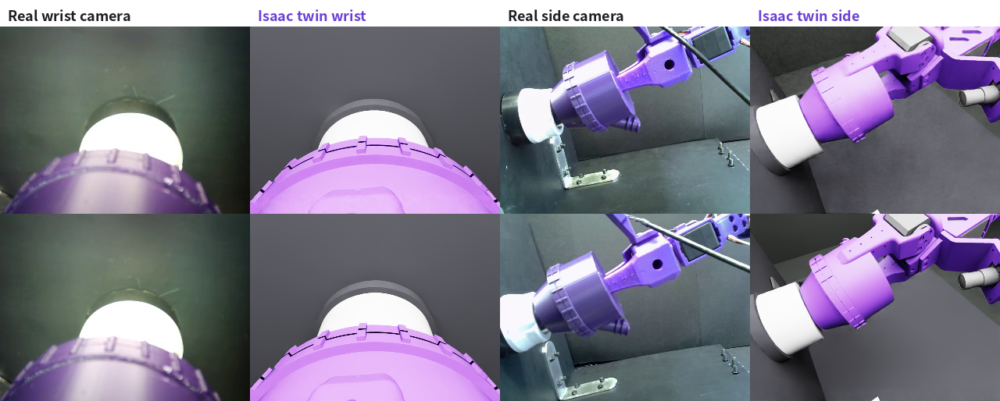

<div align="center">

# PlugBot

### A low-cost robot arm that learns to plug a charging connector into a moving ship socket

**Learned from human demonstrations, and from simulator images only, then verified on a real robot aboard a ship**

Joint 2nd place of 107 teams, and the Busan Techno Park President's Award, 2026 Southeast Korea Multi-Domain Mobility Business Hackathon

By **Gwangbin Kim**, team lead of Land2Sea: system architecture and all of the software in this repository ([team](#team-and-how-this-was-built))

[](#award)
[](#award)
<br>

-ffcc4d)


[한국어 README](README.ko.md)


<sub>Left and middle are the real SO-101 arm running a learned ACT policy on a servo-driven shaking deck. Right is a kinematic Isaac Sim visualization.</sub>

</div>

---

## At a glance

| | |
|---|---|
| **Problem** | Ships at berth keep moving with waves, so shore-power plugs are still connected by hand. Cars already get plugged in by robots because they stand still. |
| **What I built** | A small robot arm system that learns the plug-in skill from demonstrations, a photobox digital twin in Isaac Sim that trains the same policy from rendered images, and a simulation study of when to insert into a moving socket. |
| **Result (real robot)** | Real-to-Real: **40/40** (static 20/20, moving 20/20). Sim-to-Real, trained on **zero real images**: **39/40** (static 20/20, moving 19/20). |
| **Result (simulation)** | Same waves, 100 paired trials: predicting the socket motion **88%** vs following it **46%** (MuJoCo, 6 cm model wave). |
| **My role** | Team lead (4 people) and sole developer of the software, learning, simulation and hardware integration. 11 days from the first commit (2026-10-31) to the judged real-robot result (2026-11-10). |
| **Stack** | Python, LeRobot 0.6.1 (ACT), PyTorch, NVIDIA Isaac Sim 5.1 (USD, PhysX, RTX), MuJoCo 3.17, FastAPI, OpenCV, CadQuery, Feetech STS3215 servos |

---

## Results

### Real robot

<picture>
  
</picture>

| Training data | Socket | Inserted by itself | Wilson 95% CI |
|---|---|---|---|
| Real-to-Real: human teleoperation demos | static | 20 / 20 | 84 to 100% |
| Real-to-Real: human teleoperation demos | moving deck | 20 / 20 | 84 to 100% |
| Sim-to-Real: Isaac twin renders only | static | 20 / 20 | 84 to 100% |
| Sim-to-Real: Isaac twin renders only | moving deck | 19 / 20 | 76 to 99% |

Each run was judged by a person with a button in the recording GUI (`result.json` per run) and tallied with `tools/tally_rollouts.py`.
Measured aboard the ship on 2026-11-09 and 11-10, two laptops combined. Models: `act_real_v4` (80k steps), `act_twin_v4` (1k steps). Raw numbers: [`outputs/real_results.json`](outputs/real_results.json).

### Simulation: predict the socket, do not chase it


| Model wave height | Static | Follow | **Predict** | Only predict succeeded / only follow succeeded |
|---|---|---|---|---|
| 4 cm | 76% | 87% | **99%** | 13 / 1 |
| 6 cm | 25% | 46% | **88%** | 45 / 3 |
| 8 cm | 12% | 24% | **60%** | 40 / 4 |

MuJoCo, 100 trials per cell, seeds 1000 to 1099 shared across the three strategies, so every comparison is on the same wave.
The predictor looks 0.3 s ahead and starts inserting only when the socket goes calm. It also hits the socket far less (contact force p95 about 37 N vs 311 N, rigid-contact model, compare only). This controller exists in simulation; the real ACT policy does not use it yet.

---

## How it works: three paths to one skill

<picture>
  <source media="(prefers-color-scheme: dark)" srcset="docs/portfolio/img/arch_pipeline_dark.svg">
  
</picture>

**A. Real-to-Real.** A person moves the SO-101 leader arm and the follower copies it. 134 recorded episodes (94 static, 40 on the shaking deck) train an ACT policy (action chunking transformer) that sees two cameras and the joint state.

**B. Sim-to-Real.** The same human recordings are replayed joint by joint inside an Isaac Sim copy of the photobox. Only the camera images are rendered; the joint state and actions stay real. Domain randomization (lighting, materials, camera jitter) and image corruptions (blur, noise, shake, latency) are added. The policy never sees a real photo, yet it inserts on the real arm.
The first twin model stopped about 5 mm short of the socket. I compared real and twin frames of the inserted pose, recalibrated both virtual cameras, and re-rendered; that fixed it.



**C. Heterogeneous teleoperation (simulation).** The small leader arm drives a full-size UR10e at a ferry-side socket in Isaac Sim: the pose is taken relative to the socket, scaled by 5, and solved with Lula IK. This is a visualization of how the same demonstrations could drive an industrial arm; it is not trained and not on real hardware.

---

## System architecture

<picture>
  <source media="(prefers-color-scheme: dark)" srcset="docs/portfolio/img/arch_overview_dark.svg">
  
</picture>

<picture>
  <source media="(prefers-color-scheme: dark)" srcset="docs/portfolio/img/arch_runtime_dark.svg">
  
</picture>

Design decisions:
- **One start at a time.** The recording GUI starts recording, policy runs and the shaking deck as child processes behind one lock, so a double click cannot drive the same servos from two processes.
- **Devices by serial number.** Ports and cameras are opened through `/dev/serial/by-id` and `/dev/v4l/by-id`, so replugging a USB hub never swaps the leader and the follower.
- **Previews through files.** Recording owns the cameras; it writes the latest frames to `/dev/shm`, which the GUI and the audience screen read. Nothing else opens the cameras while a run is active.
- **Safety in thin layers.** `act/record_preview.py` wraps LeRobot with a gripper command floor (the printed cover blocks the jaw) and torque writes retried three times; `act/deck_shaker.py` stops the deck when its controller dies.
- **Judgement is data.** Every autonomous run is logged with its joints and frames, and a person's success/fail button writes `result.json`; numbers in this README are tallied from those files with Wilson intervals.

---

## Engineering problems I hit and fixed

19 incidents are logged with cause and fix in [`docs/troubleshooting.md`](docs/troubleshooting.md). A few:

| Symptom | Cause | Fix |
|---|---|---|
| Teleop dropped the moment the follower moved | The USB hub reset whenever the arm drew current (dozens of re-enumerations in the kernel log) | Arm boards straight into the laptop, hub for cameras only |
| Gripper servo overloaded and killed recording | The 3D-printed cover stops the jaw at about 8/100, but the leader kept commanding 0 | Clamp gripper commands at 6 in both recording and policy runs |
| Random `no status packet` on motor 4 at startup | LeRobot tried the torque write once | Retry torque enable and disable up to 3 times |
| `Failed to open` camera before recording | A leftover preview process still held the device | Preview runs as its own process, checked free with `fuser` before recording |
| Side camera slowly drifted | Tape-mounted head rotated over hours | Measured per-episode image shift by phase correlation (+52 px), built an overlay tool to realign |
| Wrist camera could not see the plug | The gripper hid the contact point | CAD gripper cover that moves the plug 52 to 58 mm forward; walls thickened 2.35 to 4.4 mm after review |
| Twin-trained model stopped 5 mm short | Virtual cameras did not match the real ones | Calibrated both cameras against real inserted frames, re-rendered |

---

## Experiment design

- **Paired comparisons.** Strategies share the same wave seeds, so the 45 vs 3 count above compares outcomes on identical waves, not just averages.
- **Uncertainty with every rate.** Success rates are reported with Wilson 95% intervals; 20/20 is stated as "at least 84%", not "always".
- **A second physics engine.** The MuJoCo study was ported to Isaac Sim (PhysX). Predict stayed high (97% at 6 cm), but follow also reached 100%, so the predict-beats-follow result was **not** reproduced there. Swapping in the MuJoCo servo model did not change it; the root cause is still open ([`outputs/ISAAC_RESULTS.md`](outputs/ISAAC_RESULTS.md)).
- **Sim-only overfitting.** Fine-tuning the twin policy longer made it worse on the real arm: the 1k-step checkpoint inserted, the 2k, 3k and 4k checkpoints each failed their one try. More simulator fitting moved it away from the real camera.

---

## Repository map

```
act/          Real SO-101: recording GUI (FastAPI), LeRobot record/rollout wrapper, ACT training scripts, shaking deck, audience screen
isaac/twin/   Photobox digital twin: export real episodes, twin meshes, Isaac render with domain randomization, camera calibration, dataset builder
isaac/scaleup UR10e at a ferry socket: replay and live teleop from the SO-101 leader (retarget, Lula IK, collision guard)
isaac/        MuJoCo-to-Isaac port of the strategy experiments
plugbot/      Shared simulation core: MuJoCo scene, JONSWAP ship motion, IK, AR predictor, insertion state machine
tools/        Tally with Wilson CI, paired strategy comparison, renders and videos, LeRobot conversion
cad/          3D-printed parts and the IEC-style gripper cover (CadQuery)
real/         Earlier rule-based pipeline (ArUco tracking, hand-eye calibration), replaced by the learned policy
docs/         Troubleshooting log, portfolio fact sheet and diagrams, pre-finals simulation study (Korean)
```

## Reproduce

```bash
# Simulation study (CPU, Linux or macOS)
uv venv --python 3.12 .venv && uv pip install --python .venv/bin/python mujoco numpy scipy matplotlib pillow
.venv/bin/python tools/compare_predict_follow.py --n 100          # paired predict/follow/static, about 75 s

# Real robot (LeRobot 0.6.1 env, two SO-101 arms, two cameras; ports in act/env.sh)
bash act/record_gui.sh                                             # http://127.0.0.1:8200: record, train, run, judge
bash act/train.sh plug_train_v4 full act_real_v4                   # ACT, 80k steps
~/lerobot_env/bin/python tools/tally_rollouts.py                    # success per checkpoint with Wilson CI

# Sim-to-Real twin (Isaac Sim 5.1, RTX GPU)
~/lerobot_env/bin/python isaac/twin/export_episodes.py              # real episodes -> joint trajectories
LD_LIBRARY_PATH=~/isaacsim_compat/lib ~/isaacsim_env/bin/python isaac/twin/run_twin.py --render --rand --variants n --out data/twin_render3
~/lerobot_env/bin/python isaac/twin/build_dataset.py --render data/twin_render3 --repo plug_twin_v4 --aug
```

Isaac Sim setup notes for this laptop (Ubuntu 26.04, driver 580-open): [`CLAUDE.md`](CLAUDE.md), [`isaac/README.md`](isaac/README.md).

## Limitations

- Real tests used a model shaking deck aboard the ship, not a real ship's socket. 20 trials per cell bounds the success rate from below, it does not prove reliability.
- The motion predictor is validated only in simulation; the real policy reacts from images.
- The UR10e is a kinematic visualization without contact physics.
- The 5-axis SO-101 cannot rotate the plug about its pin axis when inserting sideways, so keyed multi-pin connectors need a 6-axis arm or a mechanical guide.

---

## Team and how this was built

Team Land2Sea, 4 people.
- **Gwangbin Kim (김광빈), team lead:** system architecture, robot software and safety, ACT training and evaluation, MuJoCo study, Isaac port and digital twin, hardware integration design (gripper cover CAD, camera placement), measurement and the problem log. All commits in this repository.
- **Seon-gi Cho (조선기):** hardware build (booth, shaking deck, camera mounts, socket alignment).
- **Dawon Na (나다원):** pitch and presentation.
- **Jueun Lee (이주은):** market, pricing and business-model research.

I built this with an AI coding agent (Claude Code) as a pair programmer. I set the architecture and experiments, debugged the hardware on the bench, decided what counted as success, and checked every claim against logged data; the agent wrote much of the code under that direction. That is how four subsystems (real-robot learning, digital twin, simulation study, industrial-arm teleop) went from the first commit on 2026-10-31 to a judged real-robot result on 2026-11-10, the last three days aboard the ship.

## Award

**2026 Southeast Korea Multi-Domain Mobility Business Hackathon** (individual track, 107 teams): joint 2nd place in the final and the (Foundation) Busan Techno Park President's Award. The final was held aboard a ferry between Busan and Osaka, 2026-11-08 to 11-10.

Data sources, licenses and third-party assets: [`docs/data_sources.md`](docs/data_sources.md). SO-101 model: MuJoCo Menagerie (Apache 2.0), TheRobotStudio SO-ARM100.
