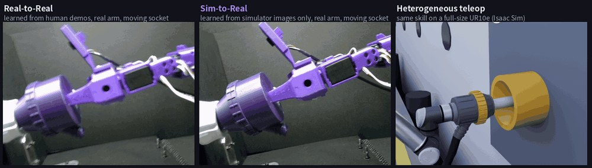
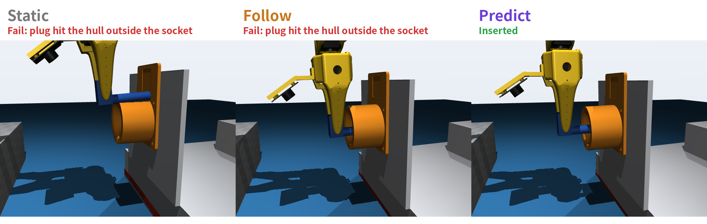
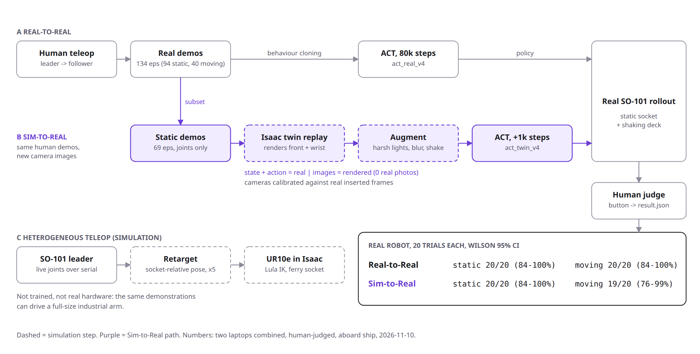
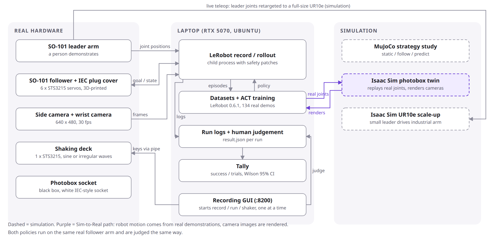
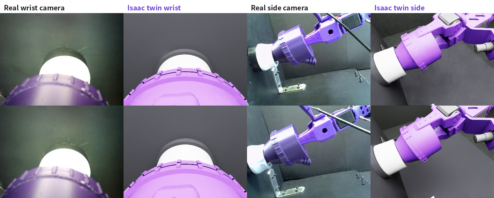
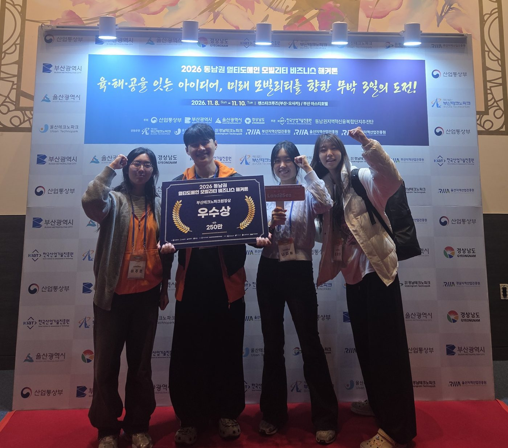

# PlugBot: a small robot arm that plugs itself into a moving ship's socket

<!-- Markdown copy of the web page (docs/en/index.html). Regenerate after editing the page. Numbers come only from docs/portfolio/facts.md. -->

Gwangbin Kim (team lead, Land2Sea). Built in 11 days, 2026-10-31 to 11-10; the last three days were the final aboard a Busan to Osaka ferry. Excellence Award (joint 2nd place of 107 teams), presented by the President of Busan Techno Park, 2026 Southeast Korea Multi-Domain Mobility Business Hackathon.

I taught a cheap SO-101 arm to plug in from human demonstrations and from simulator images, then tested it on the real arm aboard a ferry from Busan to Osaka. Web page: https://gawbi.github.io/plugbot/en/

## Real-robot results

After every run a person pressed a success or failure button. The runs were done aboard on 2026-11-09 and 10 on two laptops, and the numbers combine both.

| Training data | Socket | Inserted on its own | 95% CI (Wilson) |
|---|---|---|---|
| Real-to-Real: 134 human teleop demos | static | 20 / 20 | 84–100% |
| Real-to-Real: 134 human teleop demos | moving deck | 20 / 20 | 84–100% |
| Sim-to-Real: twin renders only, zero real images | static | 20 / 20 | 84–100% |
| Sim-to-Real: twin renders only, zero real images | moving deck | 19 / 20 | 76–99% |

Twenty out of twenty only lets you say the success rate is at least 84%, so every rate comes with one. The models are `act_real_v4` (80k steps) and `act_twin_v4`. The twin model was trained for 20k steps on uncalibrated renders, then for 1k more on images re-rendered with calibrated cameras. Raw data: [real_results.json](https://github.com/gawbi/plugbot/blob/main/outputs/real_results.json).

### Simulation: when to plug in

Timing the insertion against a moving socket was a separate MuJoCo study. Static goes to wherever it first saw the socket. Follow keeps chasing its current position. Predict looks 0.3 s ahead, to make up for camera and servo lag, and aims there. All three faced exactly the same waves.

The final moment of each controller on the same wave (6 cm model wave, seed 1002). MuJoCo simulation.

Predict and follow paired on the same 100 waves (seeds 1000 to 1099) at a 6 cm model wave height. As success rates that's 88% for predict, 46% for follow and 25% for static.

| Model wave | Static | Follow | Predict | Only predict / only follow |
|---|---|---|---|---|
| 4 cm | 76% | 87% | **99%** | 13 / 1 |
| 6 cm | 25% | 46% | **88%** | 45 / 3 |
| 8 cm | 12% | 24% | **60%** | 40 / 4 |

100 runs per cell. At an assumed 1:10 scale, a 6 cm model wave is roughly a 0.6 m sea. The original design also waited for a calm moment before inserting. After the hackathon I switched that off and no outcome changed across 300 paired waves, so prediction works by looking ahead, not by waiting. It also hits the socket far more gently (contact force p95 about 37 N against 311 N), but that's a rigid contact model, so only the comparison means anything. This controller is simulation-only for now; the real ACT policy doesn't use it.

## Ships are still plugged in by hand

Robots already plug in electric cars, because a parked car holds still. A moored ship keeps moving with the waves, so shore power cables are still connected by people, and that goes wrong sometimes. In the first year of shore power at Busan New Port, 9 of the 19 ships that applied failed to connect. Mostly the ship couldn't be berthed exactly at the power station, or the high-voltage cable couldn't be connected in the rain ([Finance Today, 2020-08-05, in Korean](https://www.fntoday.co.kr/news/articleView.html?idxno=227118)).

So I wanted to know two things. Can a cheap arm learn to plug into a moving socket just from human demonstrations? And if real data runs short, can it learn from simulator images alone?

## How it was built

Dashed boxes are simulation steps; purple is the Sim-to-Real path.

### Learning from human demonstrations (Real-to-Real)

There are two SO-101 arms. A person moves the leader arm by hand, the follower copies it, and two cameras (front and wrist) are recorded along with the joint values. I collected 134 demonstrations, 94 on a static socket and 40 on the moving deck, and trained an ACT policy on them. ACT looks at the camera images and the joint state and outputs the next chunk of actions.

### Learning from simulator images (Sim-to-Real)

I moved the same demonstrations into a copy of the photo booth built in Isaac Sim (the digital twin). The arm is replayed with the recorded joint values and only the camera images are rendered fresh, so the joint states and actions are real and only the pixels are simulated. Each render randomizes lighting, materials and camera pose a little, and adds blur, noise and delay. The policy trained on these images plugged in on the real arm without ever seeing a real photo.

### Moving it onto a big arm (simulation)

I also drove a full-size UR10e in Isaac Sim with the small leader arm, plugging into a socket on the side of a ferry. The leader pose is expressed relative to the socket, scaled up 5x and solved with Lula IK. It's a visualization of whether the same demonstrations could carry over to an industrial arm, not a learned policy, and there's no real hardware behind it.

The question of when to plug in is the MuJoCo study shown above.

## System architecture

On the robot side everything goes through one recording UI (FastAPI). Its buttons start recording, policy runs and the moving deck as child processes, behind a single lock so only one runs at a time. Pressing a button twice can't leave two processes driving the same servos.

Devices are opened by serial number (`/dev/serial/by-id`, `/dev/v4l/by-id`), because replugging the USB hub used to reshuffle port numbers and swap the leader and follower. Only the recording process opens the cameras. It writes the latest frame to `/dev/shm`, and the recording UI and the audience screen just read that file.

I didn't patch LeRobot; a thin wrapper adds a lower limit on the gripper command (where the printed cover blocks the jaw) and up to three retries for torque writes. The moving deck stops if its control process dies.

The verdicts are data too. Every autonomous run saves its joints and frames, and the success or failure button writes `result.json`. Every real-robot number in this document is counted from those files.

## Problems I ran into

### The twin-trained model kept jamming 5 mm low and to the right

I trained on images rendered with the uncalibrated cameras up to 20k steps and tried checkpoints on the real arm along the way. The short ones, 5k and 7.5k steps, each got into the static socket once. From 10k steps on, every checkpoint drove the plug into the same spot, about 5 mm below and to the right of the socket, and stopped (I saw this on site; there are no verdict files for it). My first guess was that the demonstrations never showed a miss and a retry, so I built a tool that uses IK to synthesize misses, pauses, backing off and realigning. But the miss was always in the same direction. Random mistakes don't do that, so I started to suspect the virtual cameras rather than the amount of data.

Putting the real and twin images of the inserted pose side by side showed that both cameras were off in position and angle. An automatic search for the camera that maximized overlap (IoU) of the white socket and the purple cover picked a wrong camera twice: the render was updating one frame late, and the metric itself wasn't a good fit. In the end I wrote a tool (`--try_cams`) that renders several candidate cameras next to the real image and picked one by eye. Re-rendering with the calibrated cameras and training just 1k more steps gave the model that got 20/20 static and 19/20 moving. The recovery demonstrations weren't used in it.

Because calibration and training length changed together, I couldn't tell during the event which one mattered. I checked that afterwards with models that differ only in calibration; see after the hackathon.

Real and calibrated twin images at the moment of insertion (wrist and side).

### Fitting the simulator more closely made the real robot worse

Training longer on the same data made the real results worse. After calibration, the 1k-step checkpoint got all 13 static runs logged on this laptop, while 2k, 3k and 4k steps were each tried once and all failed (one-sided Fisher exact test, p ≈ 0.002). The uncalibrated model showed the same shape: 5k and 7.5k got in, 10k and later missed. There are too few runs per checkpoint to call it a curve, but it looked like fitting the renders moved the policy away from the real camera, so I went with the shortest-trained model.

### Teleoperation dropped as soon as the follower moved

The kernel log showed the USB devices re-enumerating dozens of times. Every time the arms drew current, the whole USB hub reset. I moved the arm controller boards to the laptop's own ports and left only the cameras on the hub.

### The gripper servo overloaded and killed the recording

To let the wrist camera see the contact, I designed and printed a gripper cover that holds the plug 52 to 58 mm forward (the wall went from 2.35 mm to 4.4 mm after a review). The cover stops the jaw at about 8 out of 100, but the leader kept commanding 0, so the servo never got to rest. Both recording and policy runs now clamp the gripper command at 6.

### Smaller ones

The front camera was stuck on with double-sided tape, and its head joint turned a little over a few hours. I didn't see it by eye; measuring the image shift per episode with phase correlation showed it (+52 px). The recording UI now ghosts a training frame over the live view so the camera can be put back. The camera sometimes failed to open right before recording because a leftover preview process still held it, so the preview became its own process and recording checks with `fuser` that the device is free. Motor 4 sometimes answered `no status packet` at startup, which went away once torque writes were retried up to three times.

The full log has 19 problems with causes and fixes ([troubleshooting.md](https://github.com/gawbi/plugbot/blob/main/docs/troubleshooting.md), in Korean).

## How the experiments were set up

All simulation comparisons are paired. The controllers share wave seeds, so instead of comparing averages you can line them up wave by wave and say things like "only predict got in on 45 waves, only follow on 3". Every success rate gets a Wilson 95% interval.

I ported the MuJoCo study to Isaac Sim (PhysX). Predict stayed high (97% at 6 cm), but follow went to 100%, so the advantage of prediction did not reproduce in Isaac. Matching Isaac's servo model to MuJoCo's didn't change that, and I still don't know why. I recorded it as a physics-engine gap and let the real-robot tests make the final call.

I also made the conditions worse on purpose in MuJoCo. With camera delay from 0.05 to 0.2 s, noise, calibration error and different servo stiffness, predict mostly stayed at 90% or above (4 cm waves, 30 runs).

Real-robot outcomes are recorded by a person with a button, and the numbers are counted only from those files. This laptop holds 106 logged real runs.

## After the hackathon

After the event the wrist camera cable broke, so I couldn't run the robot again. There are no new real-robot numbers. Instead I went back through the logged runs, held-out real episodes and simulation.

What I most wanted to know was whether the twin model was saved by the calibration or by the short training. I trained control models from the same starting point with the same augmentation seed for 1k steps, differing only in camera calibration, three seeds each. Fed real images they never trained on and compared on pin-tip position 1 s ahead, the calibrated models were closer to the human demonstration in all three pairs (mean 40.2 mm against 45.6 mm). Their loss from seeing real images instead of a plain gray image was also much smaller (2.5 mm against 10.6 mm). Since training length is the same, this points at the calibration itself. It's an offline metric, though, and still needs a real-robot check.

On 25 real episodes the twin never saw, I measured how much the action changes when the same joint state is paired with the real image versus the re-rendered twin image. In all 14 twin checkpoints the calibrated renders gave the smaller change, and the change grew with training ([figure](https://github.com/gawbi/plugbot/blob/main/outputs/research/offline_eval.png)). The model was gradually fitting the renders.

During the tests aboard, the front camera wasn't where it had been when the demonstrations were recorded ([view comparison](https://github.com/gawbi/plugbot/blob/main/outputs/research/front_view_shift.png)). Both policies still got in. Masking inputs one at a time, the twin policy's action moved 17 mm when the wrist camera was blanked and 8 mm for the front camera, so it was leaning mostly on the wrist camera.

Last, I measured in simulation what it costs ACT to execute in chunks. The real ACT commits to 3.3 s of actions and doesn't look at the socket again until the chunk is done. On 6 cm MuJoCo waves, replanning every step gave 90% for predict and 47% for follow; replanning every 3.3 s dropped them to 35% and 25% ([figure](https://github.com/gawbi/plugbot/blob/main/outputs/research/chunk_study.png)).

I also reran the statistics. Predict against follow gives McNemar p = 1.3e-10, and the real twin 1k checkpoint against 2k to 4k gives Fisher p = 0.002. Real-to-Real 40/40 against Sim-to-Real 39/40 gives Fisher p = 1.0, which means no difference was found, not that they're equal; 40 runs each can't tell them apart.

## Limitations and what's next

The real tests used a model moving deck set up aboard a ship, not an actual ship's socket. Twenty runs per condition give a lower bound on the success rate; they don't prove reliability. The UR10e scene is a kinematic visualization with no contact physics. The 5-axis SO-101 can't roll the plug around the pin axis when inserting sideways, so a multi-pin connector would need a 6-axis arm or a mechanical guide.

Socket-motion prediction is validated only in simulation, and the real policy currently just reacts to what it sees. Next I want to give the real policy that prediction and have it replan more often instead of running each chunk to the end. The camera calibration was done by eye in the end, so it needs a way to close the gap between real and twin images automatically. Once the robot is repaired, the first job is to run the calibration-only control models on the real arm and check the offline result. Why Isaac and MuJoCo disagree is also still open.

## Team and how it was built

Land2Sea was four people. As team lead I did the system architecture, robot software and safety layers, ACT training and evaluation, the MuJoCo study, the Isaac port and digital twin, the hardware integration design (gripper cover CAD, camera placement), and the measurements and problem log. Every commit in the repository is mine. Seon-gi Cho built the hardware (booth, moving deck, camera mounts, socket alignment), Dawon Na put together and gave the presentation, and Jueun Lee researched the market, pricing and business model.

I wrote the code together with an AI coding agent (Claude Code). I chose the problem and the layout (sideways insertion at the hull), the three directions, the experiment design and what counted as success, and I did the hardware debugging myself. Switching from recovery demonstrations to camera calibration after seeing the symptom on the real arm was one of those calls. The agent wrote much of the code within that direction: the recording UI, twin rendering, data conversion, experiment scripts and figures.

All numbers are counted from run logs and kept in one fact sheet. I checked the agent's explanations against the logs too. For example, it once explained follow's 100% in Isaac by saying collisions weren't counted as failures, but follow still got 100% with collisions counted, so I corrected it.

That's how the four parts (real-robot learning, digital twin, simulation study, industrial-arm teleop) came together in 11 days: 77 Python files, 11,332 lines and 113 commits on main as of 11/10.

## Timeline

| Date | What happened |
|---|---|
| 10/31 | First commit; sideways insertion at the hull chosen |
| 11/1 | First Isaac Sim 5.1 runs, 30-trial experiments |
| 11/2 | ACT trained on Isaac demos (20/20 inside Isaac), UR10e scale-up visualization, real kit started |
| 11/3 to 5 | Camera and gripper cover fixes, teleop recording, recording GUI |
| 11/6 | First autonomous real insertion (static socket), 56 commits that day |
| 11/8 | Boarding; baseline tag `boarding-20261108` |
| 11/9 | Real-robot tests aboard; photobox Isaac twin built |
| 11/10 | Twin cameras calibrated, Sim-to-Real success, final results, submission |
| Result | Excellence Award (joint 2nd place of 107 teams) |

## Award

At the 2026 Southeast Korea Multi-Domain Mobility Business Hackathon, individual track (107 teams), we received the Excellence Award (joint 2nd place), presented by the President of Busan Techno Park on 2026-11-10 at the final held aboard a Busan to Osaka ferry.

