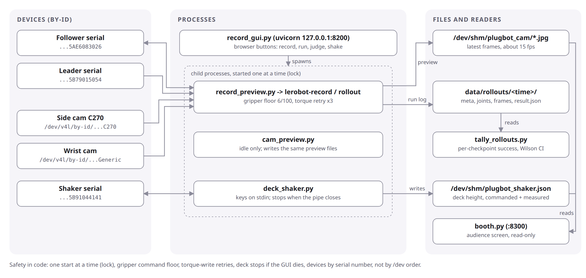
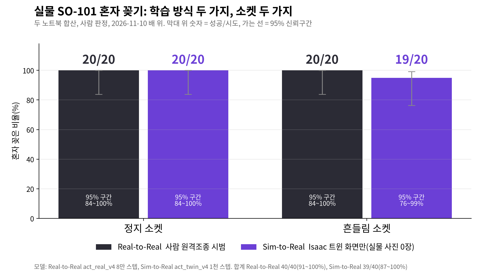

# PlugBot: a low-cost robot arm that plugs into a moving ship socket

<!-- Source text for the web page (docs/en/index.html) and the PDF portfolio. Every number comes from docs/portfolio/facts.md. -->

| | |
|---|---|
| Role | Team lead (4 people). System architecture and all of the software, learning, simulation and hardware integration design |
| Time | First commit 2026-10-31 to judged real-robot result 11-10 (11 days); the last three days aboard the ship during the final |
| Outcome | Excellence Award (joint 2nd place of 107 teams), presented by the President of Busan Techno Park, 2026 Southeast Korea Multi-Domain Mobility Business Hackathon |
| Real robot | Real-to-Real 40/40; Sim-to-Real 39/40, trained on zero real images |
| Simulation | Same waves, 100 paired trials: predicting the socket motion 88%, following it 46% |
| Stack | Python, LeRobot 0.6.1 (ACT), PyTorch, Isaac Sim 5.1, MuJoCo 3.17, FastAPI, OpenCV, CadQuery |

## 1. Problem: ships are still plugged in by hand

Robots already plug in electric cars, because a parked car stands still. A ship at berth keeps moving with the waves, and its shore-power cable is still connected by people. When the connection depends on hands and site conditions, it fails: at Busan New Port, 9 of the 19 ships that applied for shore power in its first year failed to connect, mostly because they could not berth exactly at the outlet, and the high-voltage cable could not be connected in rain ([Finance Today](https://www.fntoday.co.kr/news/articleView.html?idxno=227118), 2020-08-05).

So the question was: **can a cheap robot arm learn to plug into a moving socket from human demonstrations, and, when real data is scarce, from simulator images alone?**

## 2. Approach: one skill, three ways to learn it

- **A. Real-to-Real.** A person moves the SO-101 leader arm and the follower arm copies it. 134 recorded demonstrations (94 on a static socket, 40 on the shaking deck) train an ACT policy, which sees two cameras (front and wrist) plus the joint state and outputs the next chunk of actions.
- **B. Sim-to-Real.** The same human demonstrations are replayed joint by joint inside an Isaac Sim copy of the photobox (a digital twin), and only the camera images are rendered. Joint states and actions stay real; only the pixels are simulated. Lighting, materials and camera pose are randomized, and blur, noise and latency are added. This policy never sees a real photo, and it inserts on the real arm.
- **C. Heterogeneous teleoperation (simulation).** The small leader arm drives a full-size UR10e at a ferry-side socket in Isaac Sim: the pose is taken relative to the socket, scaled by 5 and solved with Lula IK. It shows how the same demonstrations could drive an industrial arm. It is a visualization, not trained and not on real hardware.
- **D. When to insert (simulation study).** In MuJoCo, three strategies (static, follow, predict: forecast the socket 0.3 s ahead; its calm-window gate changed no outcome when switched off) are compared on identical waves.

## 3. System architecture

Design decisions, and why:
- **One start at a time.** The recording GUI (FastAPI) launches recording, policy runs and the shaking deck as child processes behind one lock, so a double click can never have two processes driving the same servos.
- **Devices by serial number.** Ports and cameras are opened through `/dev/serial/by-id` and `/dev/v4l/by-id`, so replugging the USB hub never swaps the leader and the follower.
- **Previews through files.** Only the recording process opens the cameras. It writes the latest frames to `/dev/shm`; the GUI and the audience screen read those files.
- **Safety in thin layers.** A wrapper around LeRobot adds a gripper command floor (where the printed cover blocks the jaw) and retries torque writes three times. The shaking deck stops when its controlling process dies.
- **Judgement is data.** Every autonomous run is logged with joints and frames, and a person's success/fail button writes `result.json`. Every real-robot number here is tallied from those files.

## 4. Results

### Real robot (aboard the ship, 2026-11-09 to 10, two laptops combined, judged by a person)

| Training data | Socket | Inserted by itself | Wilson 95% CI |
|---|---|---|---|
| Real-to-Real: human teleoperation demos | static | 20/20 | 84 to 100% |
| Real-to-Real: human teleoperation demos | moving deck | 20/20 | 84 to 100% |
| Sim-to-Real: Isaac twin renders only | static | 20/20 | 84 to 100% |
| Sim-to-Real: Isaac twin renders only | moving deck | 19/20 | 76 to 99% |

Models: `act_real_v4` (80k steps); `act_twin_v4` (a 20k-step model trained on twin renders, fine-tuned 1k steps on renders from the recalibrated cameras).

### Simulation: predict the socket, do not chase it (MuJoCo, seeds 1000 to 1099 shared, 100 trials per cell)

| Model wave height | Static | Follow | Predict | Only predict / only follow succeeded |
|---|---|---|---|---|
| 4 cm | 76% | 87% | **99%** | 13 / 1 |
| 6 cm | 25% | 46% | **88%** | 45 / 3 |
| 8 cm | 12% | 24% | **60%** | 40 / 4 |

A 6 cm model wave is about 0.6 m at full scale, assuming 1:10 Froude scaling. Predicting also hits the socket far less (contact force p95 about 37 N vs 311 N; rigid-contact model, so compare only). This controller exists only in simulation; the real ACT policy does not use it yet.

## 5. Hard problems and how I solved them

### The twin-trained model jammed 5 mm low and right of the socket
While training on renders from the uncalibrated cameras (up to 20k steps), I ran checkpoints on the real arm. The short-trained 5k and 7.5k checkpoints each inserted on a single static try, but from 10k steps on the plug jammed in the same place every time: about 5 mm low and to the right of the socket (observed on site; no judgement files). My first guess was that it had never seen a recovery, so I built a tool that synthesizes miss, hold, retreat and realign motions with IK. But the miss always had the same direction. That is a bias, not random error, so I stopped adding data and suspected **the virtual cameras did not match the real ones**.

Side by side, real and twin frames of the inserted pose showed both cameras off in position and angle. An automatic search that maximized the overlap (IoU) of the white socket and the purple cover picked nonsense twice: the render updated one frame late, and the metric did not capture the error. So I built a mode (`--try_cams`) that renders a grid of candidate cameras next to the real frame and chose by eye. After re-rendering with the calibrated cameras and fine-tuning only 1k steps, that model was the one judged: 20/20 on the static socket and 19/20 on the moving deck. Calibration and shorter training changed together, so which one mattered is not separated yet; an offline analysis on logged real frames is in progress. The recovery demos were not used in the final model.

### Fitting the simulator longer made the real robot worse
Training longer on the same data hurt on the real arm. The calibrated 1k-step checkpoint inserted on all 13 static tries logged on this laptop, while the 2k, 3k and 4k checkpoints each failed their one try (Fisher exact test, one-sided p ≈ 0.002). The uncalibrated run showed the same shape: 5k and 7.5k inserted, 10k and later missed. With so few tries per checkpoint, that is a signal rather than a curve: fitting the renders more closely moved the policy away from the real camera. The shortest-trained model went to the judged runs.

### Teleoperation dropped the moment the follower moved
The kernel log showed the USB devices re-enumerating dozens of times: the hub reset whenever the arm drew current. The arm boards now plug straight into the laptop, and the hub carries only the cameras.

### The gripper servo overloaded and killed recording
To let the wrist camera see the contact point, I designed a CAD gripper cover that moves the plug 52 to 58 mm forward (walls thickened from 2.35 to 4.4 mm after review). But the cover stops the jaw at about 8/100 while the leader kept commanding 0, so the servo pushed against it. Gripper commands are now clamped at 6 in both recording and policy runs.

### Smaller ones
- Camera `Failed to open` before recording: a leftover preview process still held the device. Preview now runs as its own process, and `fuser` checks the device is free before recording.
- The front camera slowly rotated over hours: per-episode image shift measured by phase correlation (+52 px) exposed it, and an overlay tool realigns it.
- Occasional `no status packet` on motor 4 at startup: torque writes are retried up to 3 times.

All 19 incidents are logged with cause and fix in `docs/troubleshooting.md`.

## 6. Experiment design

- **Paired comparisons.** The three strategies share wave seeds, so outcomes can be matched on identical waves ("only predict succeeded 45 times, only follow 3 times"), which says more than comparing two averages.
- **Uncertainty with every rate.** Success rates come with Wilson 95% intervals; 20/20 is reported as "at least 84%", not "always".
- **A second physics engine.** The MuJoCo study was ported to Isaac Sim (PhysX). Predict stayed high (97% at 6 cm), but follow reached 100% too, so predict-beats-follow was **not reproduced** in Isaac. Swapping in the MuJoCo servo model did not change it, and the root cause is still open. I recorded this as a physics-engine gap and made the real-robot judgement the final evidence.
- **Stress-testing real-world conditions.** In MuJoCo, camera latency (0.05 to 0.2 s), noise, calibration error and servo stiffness were varied; predict mostly stayed above 90% (4 cm waves, 30 trials).
- **Human judgement as a record.** Success is a person's button press saved to a file, and every number is tallied from those files: 106 logged real runs.

## 6-1. After the hackathon: what the logs and simulations say

No new real-robot numbers here; these come from logged runs, held-out real episodes and simulation (`tools/research/`, `outputs/research/`).
- **Calibration and shorter training changed together.** Uncalibrated twin checkpoints at 5k and 7.5k steps had inserted on single static tries; from 10k steps they missed. The judged model changed both camera calibration and training length (1k-step fine-tune), so the two effects are not yet separated. Control fine-tunes that differ only in calibration are trained and wait for a real-robot test.
- **Calibration shrinks the gap the policy sees.** On 25 real episodes the twin never saw, swapping the real image for a re-rendered twin image at the same state changed the 1 s action less with calibrated cameras than with uncalibrated ones, for all 14 twin checkpoints. Within a run the gap grows with training length (rank correlation 0.76 to 0.95 for v2), a sign of fitting the renders.
- **The test camera was not the training camera.** The front camera aboard the ship sat in a different pose from the demonstration recordings ([figure](outputs/research/front_view_shift.png)). Both policies still inserted. Masking inputs on the logged test runs, the twin policy changed its action 17 mm without the wrist camera and 8 mm without the front camera; shifting the front image 45 px changed it 3 to 5 mm.
- **Prediction helps by looking ahead, not by waiting.** Switching off the calm-window gate changed no outcome on 300 paired MuJoCo waves. Executing plans open-loop for longer cuts the gain: at 6 cm, replanning every step gives predict 90% and follow 47%; replanning every 3.3 s, like the real ACT chunks, gives 35% and 25% ([figure](outputs/research/chunk_study.png)).
- **Statistics.** Predict vs follow: McNemar p = 1.3e-10 (6 cm). Twin 1k vs 2k to 4k on the real arm: 13/13 vs 0/3, Fisher p = 0.002. Real-to-Real 40/40 vs Sim-to-Real 39/40: Fisher p = 1.0, no detectable difference (not equivalence).

## 7. Limitations and next research

- Real tests used a model shaking deck aboard the ship, not a real ship's socket. Twenty trials per cell bound the success rate from below; they do not prove reliability.
- The motion predictor is validated only in simulation, and the real policy reacts to images. Next: **add socket-motion prediction to the real policy**.
- The camera calibration ended up manual. Next: **automate twin calibration** by closing the gap between real and rendered frames.
- The UR10e is a kinematic visualization without contact physics.
- The 5-axis SO-101 cannot rotate the plug about its pin axis when inserting sideways; keyed multi-pin connectors need a 6-axis arm or a mechanical guide.
- The cause of the MuJoCo and Isaac disagreement (the physics-engine gap) is still to be found.

## 8. My role, the team, and how I worked

Team Land2Sea, 4 people.
- **Gwangbin Kim (김광빈), team lead:** system architecture, robot software and safety, ACT training and evaluation, MuJoCo study, Isaac port and digital twin, hardware integration design (gripper cover CAD, camera placement), measurement and the problem log. All commits in the repository.
- **Seon-gi Cho (조선기):** hardware build (booth, shaking deck, camera mounts, socket alignment)
- **Dawon Na (나다원):** pitch and presentation
- **Jueun Lee (이주은):** market, pricing and business-model research

I used an AI coding agent (Claude Code) as a pair programmer, with a clear split:
- **What I decided:** the problem and layout (sideways insertion at the hull), the three-path direction, experiment design, what counts as success, hardware debugging, and changing course from what I saw on the real arm (camera calibration instead of recovery demos).
- **What the agent did:** most of the code under that direction (recording GUI, twin rendering, dataset conversion, experiment scripts, figures).
- **How I verified:** every number is tallied from run logs and kept in one fact sheet. The agent's interpretations were checked against the logs too. For example, its explanation that follow reached 100% in Isaac "because collisions are not counted" was wrong: counting collisions as failures, follow is still 100%. It was corrected.

That is how four subsystems (real-robot learning, digital twin, simulation study, industrial-arm teleop) came together in 11 days: 77 Python files, 11,332 lines and 113 commits on main as of 11-10.

## 9. Timeline

| Date | What happened |
|---|---|
| 10/31 | First commit; sideways insertion at the hull chosen |
| 11/1 | First Isaac Sim 5.1 runs, 30-trial experiments |
| 11/2 | ACT trained on Isaac demos (20/20 inside Isaac), UR10e scale-up visualization, real kit started |
| 11/3 to 5 | Camera and gripper cover fixes, teleop recording, recording GUI |
| 11/6 | First autonomous real insertion (static socket), 56 commits that day |
| 11/8 | Boarding; baseline tag `boarding-20261108` |
| 11/9 | Real-robot tests aboard; photobox Isaac twin built |
| 11/10 | Twin cameras calibrated, Sim-to-Real success, final results, submission |
| Result | Excellence Award (joint 2nd place of 107 teams) |
