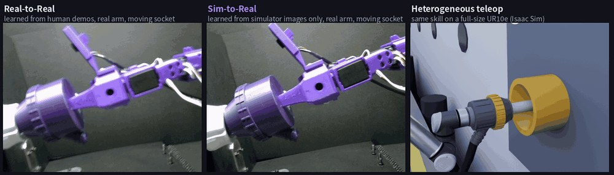
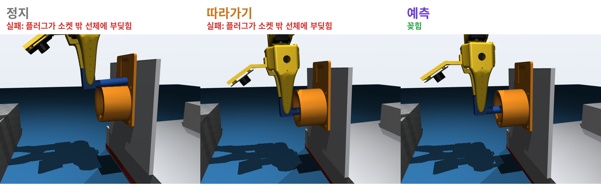
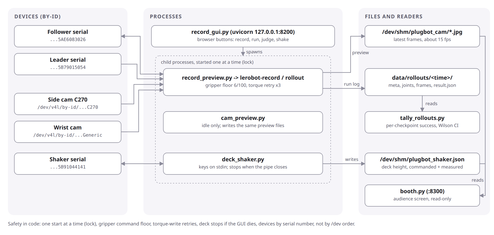
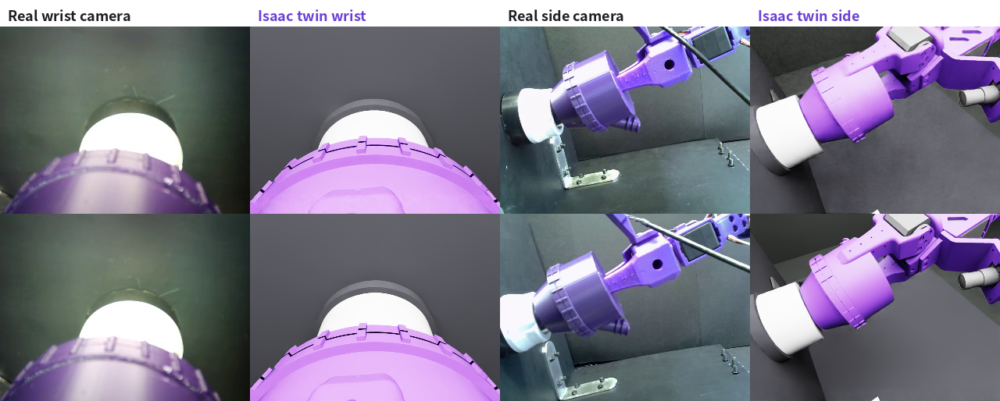
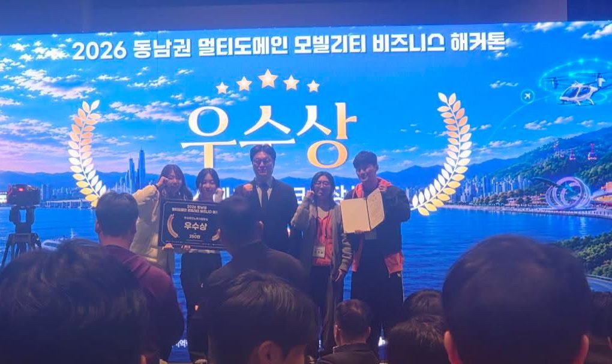
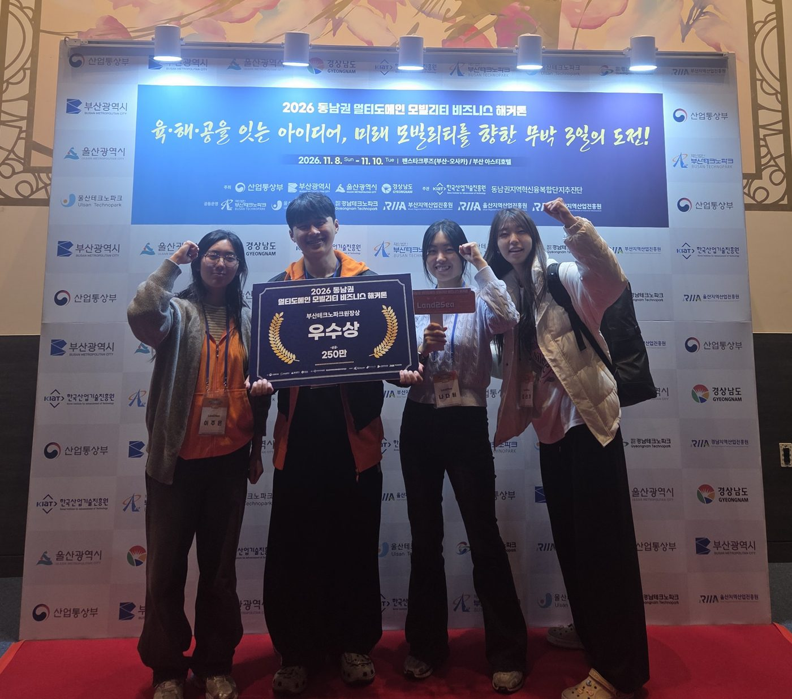
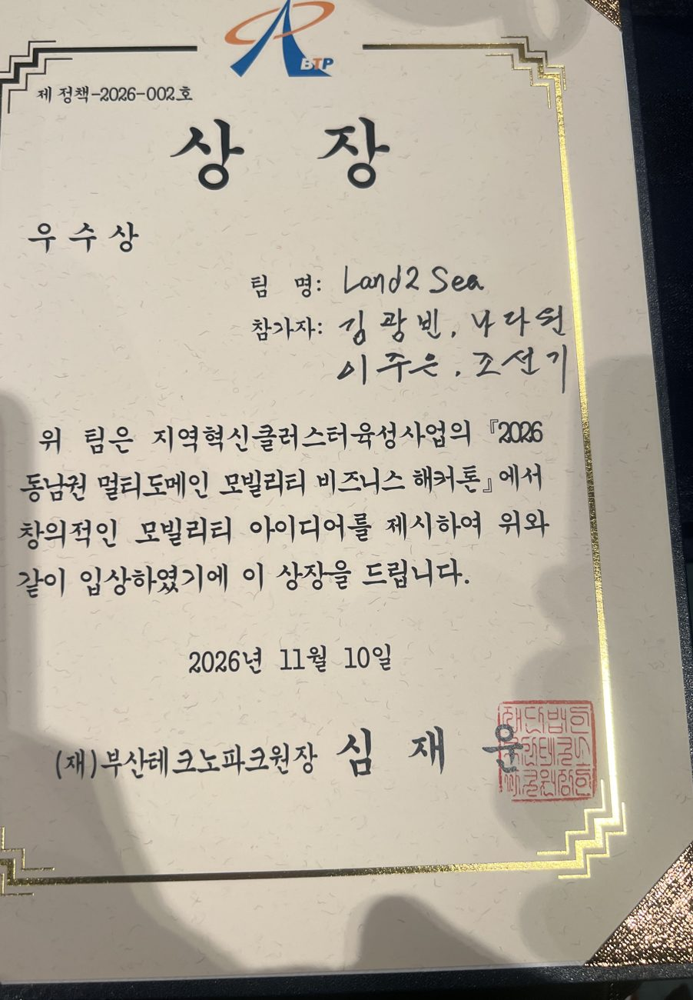

# PlugBot: 흔들리는 배의 충전 소켓에 혼자 꽂는 로봇팔

<!-- 웹페이지(docs/index.html)를 마크다운으로 옮긴 것. 웹페이지를 고친 뒤 다시 만든다. 숫자는 docs/portfolio/facts.md에서만 가져온다. -->

김광빈 (Land2Sea 팀장). 2026-10-31부터 11-10까지 11일 동안 만들었고, 마지막 3일은 부산~오사카 선상 본선이었습니다. 2026 동남권 멀티도메인 모빌리티 비즈니스 해커톤 본선 우수상(공동 2위), (재)부산테크노파크원장상(107팀 참가).

값싼 로봇팔 SO-101에게 사람 시범과 시뮬레이터 화면으로 플러그 꽂는 법을 가르치고, 부산에서 오사카로 가는 페리 위에서 실물로 시험했습니다. 웹페이지: https://gawbi.github.io/plugbot/

## 실물 결과

실행이 끝날 때마다 사람이 버튼을 눌러 성공과 실패를 판정했고, 2026-11-09~10 배 위에서 노트북 두 대로 시험한 결과를 합쳤습니다.

| 학습 데이터 | 소켓 | 혼자 꽂은 횟수 | 95% 신뢰구간(Wilson) |
|---|---|---|---|
| Real-to-Real: 사람 원격조종 시범 134개 | 정지 | 20 / 20 | 84~100% |
| Real-to-Real: 사람 원격조종 시범 134개 | 흔들림 갑판 | 20 / 20 | 84~100% |
| Sim-to-Real: 트윈 렌더만, 실물 사진 0장 | 정지 | 20 / 20 | 84~100% |
| Sim-to-Real: 트윈 렌더만, 실물 사진 0장 | 흔들림 갑판 | 19 / 20 | 76~99% |

20번을 모두 꽂았어도 말할 수 있는 건 성공률이 84% 이상이라는 정도라서 구간을 같이 적었습니다. 모델은 `act_real_v4`(8만 스텝)와 `act_twin_v4`입니다. 트윈 모델은 보정 전 렌더로 2만 스텝 학습한 뒤, 카메라를 보정해 다시 그린 화면으로 1천 스텝을 더 학습했습니다. 원자료는 [real_results.json](https://github.com/gawbi/plugbot/blob/main/outputs/real_results.json)에 있습니다.

### 시뮬레이션: 언제 꽂을 것인가

흔들리는 소켓에 언제 꽂을지는 MuJoCo로 따로 실험했습니다. 정지 방식은 처음 본 위치로 가고, 따라가기는 지금 보이는 위치를 계속 쫓습니다. 예측은 카메라와 서보가 늦는 만큼을 메우려고 0.3초 뒤의 소켓 위치를 내다보고 갑니다. 세 방식을 똑같은 파도에 넣고 비교했습니다.

같은 파도(모형 파고 6 cm, 시드 1002)에서 세 방식의 마지막 순간. MuJoCo 시뮬레이션.

모형 파고 6 cm에서 시드 1000~1099의 같은 파도 100개를 두고 예측과 따라가기를 짝지어 센 결과입니다. 성공률로 보면 예측 88%, 따라가기 46%, 정지 25%입니다.

| 모형 파고 | 정지 | 따라가기 | 예측 | 예측만 / 따라가기만 성공 |
|---|---|---|---|---|
| 4 cm | 76% | 87% | **99%** | 13 / 1 |
| 6 cm | 25% | 46% | **88%** | 45 / 3 |
| 8 cm | 12% | 24% | **60%** | 40 / 4 |

칸마다 100회입니다. 축척을 1:10으로 가정하면 모형 파고 6 cm는 실제 바다의 약 0.6 m 파도에 해당합니다. 처음에는 잠잠해질 때까지 기다렸다가 꽂는 조건도 넣었는데, 대회 뒤에 이 조건을 꺼 봐도 같은 파도 300쌍에서 결과가 하나도 바뀌지 않았습니다. 예측이 잘된 건 기다려서가 아니라 앞을 내다봤기 때문입니다. 소켓을 치는 힘도 예측 쪽이 훨씬 작았지만(접촉력 p95 약 37 N 대 311 N), 강체 접촉 모델에서 나온 값이라 비교로만 봐야 합니다. 이 예측 제어기는 아직 시뮬레이션에만 있고 실물 ACT 정책에는 붙이지 않았습니다.

## 배는 아직 사람이 꽂습니다

전기차 충전구에는 이미 로봇이 플러그를 꽂습니다. 차가 가만히 서 있으니까 가능한 일입니다. 부두에 댄 배는 파도에 계속 흔들려서, 육상전원 케이블은 아직 사람이 직접 연결합니다. 사람 손과 현장 조건에 달린 일이라 실패도 납니다. 부산 신항에서는 육상전원을 처음 운영한 해에 신청한 배 19척 가운데 9척이 연결에 실패했습니다. 대부분은 전원 설비 자리에 배를 정확히 대지 못했거나, 비가 와서 고압 케이블을 꽂지 못한 경우였습니다([파이낸스투데이, 2020-08-05](https://www.fntoday.co.kr/news/articleView.html?idxno=227118)).

그래서 두 가지가 궁금했습니다. 값싼 로봇팔이 사람 시범만 보고 흔들리는 소켓에 꽂는 법을 배울 수 있을지, 그리고 실물 데이터가 모자라면 시뮬레이터 화면만으로도 배울 수 있을지였습니다.

## 만든 방법

점선은 시뮬레이션 단계, 보라색은 Sim-to-Real 경로입니다.

### 사람 시범으로 배우기 (Real-to-Real)

SO-101을 두 대 씁니다. 사람이 리더 팔을 손으로 움직이면 팔로워 팔이 그대로 따라 하고, 그동안 카메라 두 대(앞, 손목)의 화면과 관절 값을 녹화합니다. 이렇게 모은 시범 134개(정지 소켓 94개, 흔들림 갑판 40개)로 ACT 정책을 학습했습니다. ACT는 카메라 화면과 관절 상태를 보고 앞으로 할 동작을 한 묶음씩 내놓습니다.

### 시뮬레이터 화면으로 배우기 (Sim-to-Real)

같은 사람 시범을 Isaac Sim 안에 본떠 만든 포토박스(디지털 트윈)로 옮겼습니다. 녹화해 둔 관절 값으로 팔을 다시 움직이면서 카메라 화면만 새로 렌더했기 때문에, 관절 상태와 동작은 실물 값 그대로이고 화면만 시뮬레이션입니다. 렌더할 때마다 조명과 재질, 카메라 위치를 조금씩 바꾸고 흐림이나 잡음, 지연 같은 화질 손상도 섞었습니다. 이 화면으로만 배운 정책이 실물 사진을 한 장도 보지 않고 실물 팔로 꽂았습니다.

### 큰 팔로 옮겨 보기 (시뮬레이션)

작은 리더 팔로 Isaac Sim 안의 실제 크기 UR10e를 움직여 페리 옆면 소켓에 꽂아 봤습니다. 리더 팔의 자세를 소켓 기준으로 바꾼 다음 5배로 키우고 Lula IK로 풉니다. 같은 시범이 산업용 팔까지 이어질 수 있는지 보려고 만든 시각화라서, 학습한 정책도 실물 하드웨어도 아닙니다.

언제 꽂을지에 대한 연구는 위에서 본 MuJoCo 비교입니다.

## 시스템 구조

실물 쪽 소프트웨어는 녹화 화면(FastAPI) 하나를 중심으로 돌아갑니다. 버튼을 누르면 녹화, 정책 실행, 흔들림 갑판이 자식 프로세스로 뜨는데, 잠금을 하나만 둬서 한 번에 하나만 뜨게 했습니다. 버튼을 두 번 눌러도 두 프로세스가 같은 서보를 잡는 일이 생기지 않습니다.

장치는 모두 시리얼 번호로 엽니다(`/dev/serial/by-id`, `/dev/v4l/by-id`). USB 허브를 뺐다 꽂으면 포트 번호가 바뀌면서 리더와 팔로워가 뒤바뀌곤 했기 때문입니다. 카메라는 녹화 프로세스만 열고 최신 화면을 `/dev/shm`에 파일로 써 둡니다. 녹화 화면과 관객용 화면은 그 파일을 읽기만 합니다.

LeRobot 코드는 직접 고치지 않고 한 번 감쌌습니다. 출력한 그리퍼 덮개가 집게를 막는 위치에 맞춘 그리퍼 명령 하한과, 토크 쓰기를 세 번까지 다시 시도하는 처리가 거기 들어 있습니다. 흔들림 갑판은 제어 프로세스가 죽으면 멈춥니다.

판정 결과도 데이터로 남깁니다. 자율 실행마다 관절과 화면이 저장되고, 사람이 누른 성공이나 실패 버튼이 `result.json`이 됩니다. 이 문서의 실물 숫자는 전부 그 파일들을 센 것입니다.

## 부딪힌 문제와 해결

### 트윈으로 배운 모델이 소켓 오른쪽 아래 5 mm에 박혔습니다

보정 전 카메라로 렌더한 화면으로 2만 스텝까지 학습하면서 체크포인트를 실물에 돌려 봤습니다. 짧게 학습한 5천, 7,500 스텝은 정지 소켓에서 한 번씩 꽂았는데, 1만 스텝 이후 체크포인트는 매번 같은 자리, 소켓 오른쪽 아래 약 5 mm에 플러그를 박고 멈췄습니다(현장에서 본 것이고 판정 파일은 없습니다). 처음에는 빗나갔다가 다시 꽂는 시범이 없어서 그런 줄 알고, IK로 빗나감과 멈춤, 후퇴, 재정렬을 합성하는 도구까지 만들었습니다. 그런데 빗나가는 방향이 늘 같았습니다. 무작위 실수라면 그럴 리 없으니 데이터 양보다는 가상 카메라가 실물과 다르다는 쪽을 의심하게 됐습니다.

꽂힌 순간의 실물 화면과 트윈 화면을 나란히 놓고 보니 카메라 두 대 모두 위치와 각도가 어긋나 있었습니다. 흰 소켓과 보라색 덮개 영역이 가장 많이 겹치는(IoU) 카메라 값을 자동으로 찾게 해 봤지만 두 번 다 엉뚱한 값을 골랐습니다. 렌더가 한 박자 늦게 갱신되는 문제가 있었고, 지표 자체도 잘 맞지 않았습니다. 결국 후보 카메라 여러 개를 실물 화면 옆에 나란히 렌더하는 도구(`--try_cams`)를 만들어 눈으로 골랐습니다. 보정한 카메라로 다시 렌더하고 1천 스텝만 이어서 학습한 모델이 정지 20/20, 흔들림 19/20을 꽂은 모델입니다. 회복 시범은 최종 모델에 쓰지 않았습니다.

이때 카메라 보정과 학습 길이가 한꺼번에 바뀌어서, 대회 중에는 무엇이 효과를 냈는지 가리지 못했습니다. 대회가 끝나고 보정만 다르게 한 모델을 따로 학습해 비교했고, 결과는 대회 뒤에 더 본 것에 적었습니다.

꽂힌 순간의 실물 화면과 보정한 트윈 화면(손목, 옆).

### 시뮬레이션에 더 맞출수록 실물에서 나빠졌습니다

같은 데이터로 학습만 더 했는데 실물 결과가 나빠졌습니다. 보정 후 1천 스텝 체크포인트는 이 노트북 기록으로 정지 소켓 13번을 모두 꽂았고, 2천, 3천, 4천 스텝은 한 번씩 돌려서 모두 실패했습니다(Fisher 정확 검정, 단측 p ≈ 0.002). 보정 전 모델도 5천, 7,500 스텝은 꽂았고 1만 스텝부터 빗나갔습니다. 체크포인트마다 시도 횟수가 적어 곡선이라고 하기는 어렵지만, 렌더 화면에 맞출수록 실물 카메라에서 멀어진다고 보고 가장 짧게 학습한 모델로 판정을 받았습니다.

### 팔로워가 움직이기 시작하면 원격조종이 끊겼습니다

커널 로그를 보니 USB 장치가 수십 번 다시 잡혀 있었습니다. 팔이 전류를 당길 때마다 USB 허브가 통째로 리셋된 것이었습니다. 팔 제어 보드는 노트북 본체 포트에 바로 꽂고, 허브에는 카메라만 남겼습니다.

### 그리퍼 서보가 과부하로 꺼지면서 녹화가 죽었습니다

손목 카메라에 접점이 보이도록 플러그를 52~58 mm 앞으로 내미는 그리퍼 덮개를 CAD로 설계해 출력했습니다(벽 두께는 검토를 거쳐 2.35 mm에서 4.4 mm로 늘렸습니다). 그런데 이 덮개가 집게를 약 8/100 위치에서 막았고, 리더 팔은 계속 0을 명령하니 서보가 쉬지 못했습니다. 녹화와 정책 실행 양쪽에서 그리퍼 명령이 6 아래로 내려가지 않게 잘랐습니다.

### 그 밖에

앞 카메라는 양면테이프로 붙여 둔 탓에 머리 관절이 몇 시간에 걸쳐 조금씩 돌아갔습니다. 눈으로는 몰랐고, 에피소드마다 화면 이동량을 위상 상관으로 재 보고서야 알았습니다(+52 px). 학습 때 화면을 반투명으로 겹쳐 보며 다시 맞추는 기능을 녹화 화면에 넣었습니다. 녹화 직전에 카메라가 안 열리던 건 앞서 띄운 미리보기 프로세스가 장치를 잡고 있어서였고, 미리보기를 따로 떼어 낸 뒤 녹화 전에 `fuser`로 장치가 비었는지 확인하게 했습니다. 시작할 때 4번 모터가 가끔 `no status packet`으로 응답하지 않던 문제는 토크 쓰기를 세 번까지 다시 시도하게 해서 풀었습니다.

원인과 해결을 적어 둔 문제 기록은 모두 19건입니다([troubleshooting.md](https://github.com/gawbi/plugbot/blob/main/docs/troubleshooting.md)).

## 실험은 이렇게 했습니다

시뮬레이션 비교는 모두 짝을 지어서 했습니다. 세 방식이 같은 파도 시드를 쓰기 때문에 평균끼리 견주는 대신, "예측만 성공 45번, 따라가기만 성공 3번"처럼 같은 파도에서 누가 성공했는지를 하나씩 맞대어 볼 수 있습니다. 성공률에는 항상 Wilson 95% 신뢰구간을 붙였습니다.

MuJoCo 실험은 Isaac Sim(PhysX)으로 옮겨서 다시 돌려 봤습니다. 예측은 6 cm에서 97%로 여전히 높았지만 따라가기도 100%가 나와서, 예측이 낫다는 결과가 Isaac에서는 재현되지 않았습니다. Isaac의 서보 모델을 MuJoCo 값으로 맞춰도 같았고 원인은 아직 찾지 못했습니다. 이 차이는 물리 엔진 갭으로 그대로 기록했고, 그래서 최종 판단은 실물 시험으로 했습니다.

MuJoCo 안에서 실물 조건을 일부러 나쁘게도 만들어 봤습니다. 카메라 지연(0.05~0.2 s), 잡음, 보정 오차, 서보 강성을 바꿔도 예측은 대체로 90% 이상을 지켰습니다(파고 4 cm, 30회).

실물 성공 여부는 사람이 버튼으로 남기고, 숫자는 그 파일에서만 셉니다. 이 노트북에 남은 실물 실행 기록은 모두 106회입니다.

## 대회 뒤에 더 본 것

대회가 끝난 뒤에는 손목 카메라 선이 망가져서 로봇을 다시 돌리지 못했습니다. 그래서 새 실물 숫자는 없고, 남아 있는 실행 기록과 학습에 쓰지 않은 실물 에피소드, 시뮬레이션으로 몇 가지를 더 따져 봤습니다.

가장 궁금했던 건 트윈 모델을 살린 게 카메라 보정이었는지 짧은 학습이었는지였습니다. 같은 출발점에서 같은 증강 시드로 1천 스텝씩 이어 학습하되 카메라 보정만 다르게 한 모델을 시드 3개씩 만들었습니다. 학습에 안 쓴 실물 화면을 넣어 1초 뒤 핀 끝 위치를 비교해 보면, 보정 후 모델이 세 쌍 모두 사람 시범에 더 가까웠습니다(평균 40.2 mm 대 45.6 mm). 화면 대신 회색 이미지를 넣었을 때와 견준 손해도 보정 후 쪽이 훨씬 작았습니다(2.5 mm 대 10.6 mm). 학습 길이를 같게 둔 비교라 보정 자체가 효과가 있었던 것으로 보입니다. 다만 오프라인 지표여서 실물 확인이 남아 있습니다.

트윈이 한 번도 본 적 없는 실물 에피소드 25개에서는, 같은 관절 상태에 실물 화면을 넣을 때와 다시 그린 트윈 화면을 넣을 때 동작이 얼마나 달라지는지 쟀습니다. 트윈 체크포인트 14개 모두에서 보정 후 카메라 쪽 차이가 더 작았고, 오래 학습할수록 그 차이가 커졌습니다([그림](https://github.com/gawbi/plugbot/blob/main/outputs/research/offline_eval.png)). 모델이 렌더 화면에 점점 맞춰지고 있었다는 얘기입니다.

배 위에서 시험할 때 앞 카메라는 시범을 녹화할 때와 다른 자리에 있었습니다([시점 비교](https://github.com/gawbi/plugbot/blob/main/outputs/research/front_view_shift.png)). 그래도 두 정책 모두 꽂았습니다. 입력을 하나씩 가려 보니 트윈 정책은 손목 카메라를 가리면 동작이 17 mm, 앞 카메라를 가리면 8 mm 바뀌어서, 손목 카메라에 더 기대고 있었습니다.

마지막으로 ACT가 동작을 묶음으로 실행하는 비용을 시뮬레이션으로 쟀습니다. 실물 ACT는 3.3초 분량의 동작을 한 번 정하면 그동안 소켓을 다시 보지 않습니다. MuJoCo 6 cm 파도에서 매 스텝 다시 계획하면 예측 90%, 따라가기 47%였는데, 3.3초마다 다시 계획하게 하자 각각 35%, 25%로 떨어졌습니다([그림](https://github.com/gawbi/plugbot/blob/main/outputs/research/chunk_study.png)).

통계도 다시 확인했습니다. 예측 대 따라가기는 McNemar 검정 p = 1.3e-10, 실물 트윈 1천 스텝 대 2천~4천 스텝은 Fisher 검정 p = 0.002였습니다. Real-to-Real 40/40과 Sim-to-Real 39/40은 Fisher p = 1.0으로 차이를 찾지 못했는데, 둘이 같다는 뜻이 아니라 40번씩으로는 구분이 안 된다는 뜻입니다.

## 한계와 다음에 할 것

실물 시험은 배 위에 올린 모형 흔들림 갑판에서 했고, 실제 선박 소켓은 아닙니다. 조건마다 20회라 성공률의 아래쪽 한계를 보여 줄 뿐 신뢰성을 증명하지는 못합니다. UR10e 장면은 접촉 물리 없는 운동학 시각화입니다. 5축인 SO-101은 옆으로 꽂을 때 플러그를 핀 축 둘레로 돌릴 수 없어서, 핀이 여러 개인 커넥터라면 6축 팔이나 기구 가이드가 필요합니다.

소켓 움직임 예측은 시뮬레이션에서만 검증했고, 실물 정책은 지금은 화면을 보고 반응만 합니다. 다음에는 실물 정책에 예측을 붙이고, 묶음을 끝까지 실행하는 대신 더 자주 다시 계획하게 해 보려고 합니다. 카메라 보정도 결국 눈으로 했기 때문에 실물과 트윈 화면의 차이를 자동으로 줄이는 방법이 필요합니다. 로봇을 고치면 보정만 다른 대조 모델을 실물로 돌려 대회 뒤 오프라인 결과를 확인하는 것이 먼저입니다. Isaac과 MuJoCo의 결과가 왜 다른지도 아직 풀지 못했습니다.

## 팀과 작업 방식

Land2Sea는 네 명이었습니다. 저(김광빈)는 팀장으로 시스템 구조, 로봇 소프트웨어와 안전 장치, ACT 학습과 평가, MuJoCo 연구, Isaac 이식과 디지털 트윈, 하드웨어 통합 설계(그리퍼 덮개 CAD, 카메라 배치), 측정과 문제 기록을 맡았고, 저장소의 커밋은 모두 제가 했습니다. 조선기 님은 부스와 흔들림 갑판, 카메라 고정, 소켓 정렬 같은 하드웨어 제작을, 나다원 님은 발표 구성과 발표를, 이주은 님은 시장과 가격, 사업 모델 조사를 맡았습니다.

코드는 AI 코딩 에이전트(Claude Code)와 같이 짰습니다. 문제와 배치(현측에 옆으로 꽂기), 세 갈래 방향, 실험 설계, 무엇을 성공으로 칠지는 제가 정했고 하드웨어 디버깅도 직접 했습니다. 실물에서 본 증상을 보고 회복 시범 대신 카메라 보정으로 방향을 바꾼 것도 그런 결정이었습니다. 녹화 화면, 트윈 렌더, 데이터 변환, 실험 스크립트, 그림 같은 코드는 그 방향에 맞춰 에이전트가 많이 썼습니다.

숫자는 전부 실행 기록 파일에서 세고 사실표 한 곳에만 둡니다. 에이전트가 내놓은 해석도 기록과 대조해서 고쳤습니다. 예를 들어 "Isaac에서 따라가기가 100%인 건 충돌을 실패로 세지 않아서"라는 설명은 충돌을 실패로 세도 100%가 나와서 틀린 것으로 정정했습니다.

이렇게 실물 학습, 디지털 트윈, 시뮬레이션 연구, 산업용 팔 원격조종 네 부분을 11일 동안 하나로 묶었습니다. 규모는 Python 77개 파일, 11,332줄, main 커밋 113개입니다(11/10 기준).

## 타임라인

| 날짜 | 한 일 |
|---|---|
| 10/31 | 첫 커밋, 현측 옆 꽂기 배치 결정 |
| 11/1 | Isaac Sim 5.1 첫 실행, 30회 실험 |
| 11/2 | Isaac 시범으로 ACT 학습(시뮬레이션 안 20/20), UR10e 확대 시각화, 실물 키트 시작 |
| 11/3~5 | 카메라와 그리퍼 덮개 문제 해결, 원격조종 녹화, 녹화 화면 |
| 11/6 | 실물 첫 자율 꽂기(정지 소켓), 하루 56커밋 |
| 11/8 | 승선, 기준선 태그 `boarding-20261108` |
| 11/9 | 선상 실물 측정, 포토박스 Isaac 트윈 구축 |
| 11/10 | 트윈 카메라 보정, Sim-to-Real 성공, 최종 결과표, 제출 |
| 결과 | 본선 우수상(공동 2위), (재)부산테크노파크원장상(107팀) |

## 수상

2026 동남권 멀티도메인 모빌리티 비즈니스 해커톤 개인부문(107팀)에서 본선 우수상(공동 2위)과 (재)부산테크노파크원장상을 받았습니다. 2026-11-10, 부산~오사카 페리 선상 본선에서 받은 상입니다.

