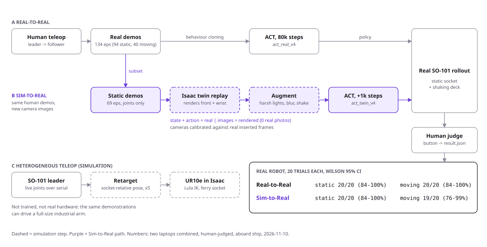
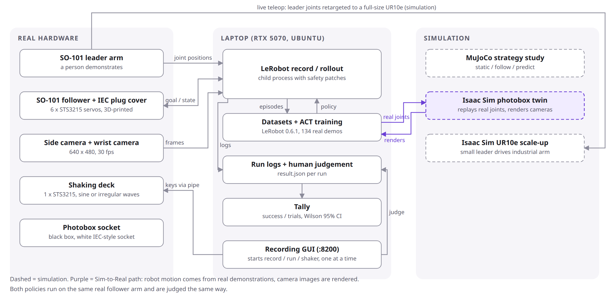

# PlugBot: 흔들리는 선박 소켓에 스스로 꽂는 로봇팔

<!-- 웹페이지(docs/index.html)와 PDF 포트폴리오의 원고. 숫자는 docs/portfolio/facts.md에서만 가져온다. -->

| | |
|---|---|
| 역할 | 팀장(4명). 시스템 설계와 소프트웨어 전체, 학습, 시뮬레이션, 하드웨어 통합 설계 |
| 기간 | 2026-10-31 첫 커밋 → 11-10 실물 판정(11일). 마지막 3일은 부산~오사카 선상 본선 |
| 결과 | 2026 동남권 멀티도메인 모빌리티 비즈니스 해커톤 본선 공동 2위, (재)부산테크노파크 원장상(107팀 참가) |
| 실물 | Real-to-Real 40/40, Sim-to-Real 39/40(실물 사진 0장으로 학습) |
| 시뮬레이션 | 같은 파도 100회: 소켓 움직임을 예측하면 88%, 따라가면 46% |
| 도구 | Python, LeRobot 0.6.1(ACT), PyTorch, Isaac Sim 5.1, MuJoCo 3.17, FastAPI, OpenCV, CadQuery |

## 1. 문제: 배는 아직 사람이 꽂는다

전기차 충전구는 이미 로봇이 꽂는다. 차가 서 있기 때문이다. 부두에 댄 배는 파도에 계속 흔들리고, 육상전원 케이블은 아직 사람이 연결한다. 연결이 사람 손과 현장 조건에 달려 있으니 실패도 난다. 부산 신항 육상전원은 첫해 신청한 19척 중 9척이 연결에 실패했다. 대부분 전원 설비 자리에 배를 정확히 대지 못했고, 비가 오면 고압 케이블을 꽂지 못했다([파이낸스투데이](https://www.fntoday.co.kr/news/articleView.html?idxno=227118), 2020-08-05).

그래서 질문을 이렇게 잡았다. **흔들리는 소켓에 꽂는 기술을, 값싼 로봇팔이 사람 시범으로 배울 수 있나? 실물 데이터가 부족하면 시뮬레이터 화면만으로도 배울 수 있나?**

## 2. 접근: 하나의 기술, 세 갈래 학습

- **A. Real-to-Real.** 사람이 SO-101 리더 팔을 움직이면 팔로워 팔이 따라 한다. 이렇게 녹화한 시범 134개(정지 소켓 94, 흔들림 갑판 40)로 ACT 정책을 학습했다. 정책은 카메라 두 대(앞, 손목)와 관절 상태를 보고 다음 동작 묶음을 낸다.
- **B. Sim-to-Real.** 같은 사람 시범을 Isaac Sim 안의 포토박스 복제본(디지털 트윈)에서 관절 단위로 다시 재생하고, 카메라 화면만 렌더했다. 관절 상태와 동작은 실물 그대로이고 화면만 시뮬레이션이다. 조명, 재질, 카메라 흔들림을 무작위로 바꾸고(도메인 무작위화) 흐림, 잡음, 지연 같은 화질 손상을 더했다. 이 정책은 실물 사진을 한 장도 보지 않고 실물 팔로 꽂았다.
- **C. 이종 원격조종(시뮬레이션).** 작은 리더 팔로 Isaac Sim 안의 실제 크기 UR10e를 움직여 페리 옆 소켓에 꽂는다. 소켓 기준 자세를 5배 확대하고 Lula IK로 푼다. 같은 시범으로 산업용 팔을 움직일 수 있는지 보여 주는 시각화이고, 학습이나 실물 하드웨어는 아니다.
- **D. 언제 꽂을지(시뮬레이션 연구).** MuJoCo로 정지, 따라가기, 예측(0.3초 앞을 보고 소켓이 잠잠해질 때 넣기) 세 전략을 같은 파도에서 비교했다.

## 3. 시스템 아키텍처

설계 결정과 이유:
- **시작은 한 번에 하나만.** 녹화 화면(FastAPI)은 녹화, 정책 실행, 흔들림 갑판을 자식 프로세스로 띄우고 하나의 잠금 뒤에 둔다. 버튼을 두 번 눌러도 두 프로세스가 같은 서보를 잡지 않는다.
- **장치는 시리얼 번호로.** 포트와 카메라를 `/dev/serial/by-id`, `/dev/v4l/by-id`로 연다. USB 허브를 다시 꽂아도 리더와 팔로워가 바뀌지 않는다.
- **미리보기는 파일로.** 카메라는 녹화 프로세스만 연다. 최신 화면을 `/dev/shm`에 쓰고, 녹화 화면과 관객용 화면은 그 파일을 읽는다.
- **안전 장치는 얇게.** LeRobot을 감싸서 그리퍼 명령 하한(인쇄 덮개가 집게를 막는 지점)과 토크 쓰기 3회 재시도를 넣었다. 흔들림 갑판은 제어 프로세스가 죽으면 멈춘다.
- **판정은 데이터로.** 자율 실행마다 관절과 화면을 남기고, 사람이 성공/실패 버튼을 누르면 `result.json`이 생긴다. 이 문서의 실물 숫자는 그 파일들을 집계한 것이다.

## 4. 결과

### 실물 로봇 (선상, 2026-11-09~10, 노트북 두 대 합산, 사람 판정)

| 학습 데이터 | 소켓 | 스스로 꽂음 | Wilson 95% 신뢰구간 |
|---|---|---|---|
| Real-to-Real: 사람 원격조종 시범 | 정지 | 20/20 | 84~100% |
| Real-to-Real: 사람 원격조종 시범 | 흔들림 갑판 | 20/20 | 84~100% |
| Sim-to-Real: Isaac 트윈 렌더만 | 정지 | 20/20 | 84~100% |
| Sim-to-Real: Isaac 트윈 렌더만 | 흔들림 갑판 | 19/20 | 76~99% |

모델: `act_real_v4`(8만 스텝), `act_twin_v4`(트윈 렌더로 2만 스텝 학습한 모델에서 보정 후 렌더로 1천 스텝 추가 학습).

### 시뮬레이션: 소켓을 쫓지 말고 예측하라 (MuJoCo, 같은 시드 1000~1099, 칸마다 100회)

| 모형 파고 | 정지 | 따라가기 | 예측 | 예측만 성공 / 따라가기만 성공 |
|---|---|---|---|---|
| 4 cm | 76% | 87% | **99%** | 13 / 1 |
| 6 cm | 25% | 46% | **88%** | 45 / 3 |
| 8 cm | 12% | 24% | **60%** | 40 / 4 |

모형 파고 6 cm는 축척 1:10을 가정하면 실선 약 0.6 m다. 예측은 소켓도 덜 친다(접촉력 p95 약 37 N 대 311 N, 강체 접촉 모델이라 비교로만 본다). 이 예측 제어기는 시뮬레이션에만 있고, 실물 ACT 정책은 아직 쓰지 않는다.

## 5. 어려웠던 문제와 해결

### 트윈으로 배운 모델이 소켓 5 mm 앞에서 멈췄다
Sim-to-Real 첫 모델은 실물에서 매번 같은 곳, 소켓 오른쪽 아래 약 5 mm에 플러그를 박고 멈췄다. 처음에는 빗나간 뒤 다시 꽂는 회복 시범이 없어서라고 보고, IK로 빗나감, 멈춤, 후퇴, 재정렬을 합성하는 도구를 만들었다. 그런데 학습을 더 돌려도 빗나가는 방향이 늘 같았다. 무작위 실수가 아니라 치우침이었다. 그래서 데이터 양이 아니라 **가상 카메라가 실물과 다르다**고 의심했다.

꽂힌 순간의 실물 화면과 트윈 화면을 나란히 놓고 보니 두 카메라 모두 위치와 각도가 어긋나 있었다. 흰 소켓과 보라 덮개 영역의 겹침(IoU)이 가장 큰 카메라 값을 찾는 자동 탐색은 두 번 엉뚱한 값을 골랐다. 렌더가 한 박자 늦게 갱신됐고, 지표도 맞지 않았다. 결국 후보 카메라 여러 개를 실물 화면 옆에 나란히 렌더하는 도구(`--try_cams`)를 만들어 눈으로 골랐다. 보정한 카메라로 다시 렌더하고 1천 스텝을 더 학습한 모델은 정지 20/20, 흔들림 19/20으로 꽂았다. 회복 시범은 최종 모델에 쓰지 않았다.

### 시뮬레이션에 더 맞추면 실물에서 나빠졌다
같은 데이터로 학습만 더 하자 실물 결과가 나빠졌다. 1천 스텝 체크포인트는 꽂았고, 2천, 3천, 4천 스텝은 각 1회 시도에서 모두 실패했다. 시도 수가 적어 결론보다는 신호로 본다. 렌더 화면에 더 맞출수록 실물 카메라에서 멀어진다는 뜻으로 읽고, 가장 짧게 학습한 모델로 판정을 받았다.

### 팔로워가 움직이는 순간 원격조종이 끊겼다
커널 로그에 USB 장치가 수십 번 다시 잡힌 기록이 있었다. 팔이 전류를 당길 때마다 USB 허브가 리셋되고 있었다. 팔 제어 보드는 노트북에 바로 꽂고, 허브에는 카메라만 남겼다.

### 그리퍼 서보 과부하로 녹화가 죽었다
손목 카메라가 접점을 보게 하려고 플러그를 52~58 mm 앞으로 내미는 그리퍼 덮개를 CAD로 설계해 인쇄했다(검토 뒤 벽 두께 2.35 → 4.4 mm). 그런데 덮개가 집게를 약 8/100에서 막는데 리더 팔은 0을 명령해 서보가 계속 힘을 썼다. 녹화와 정책 실행 양쪽에서 그리퍼 명령을 6 아래로 내려가지 않게 막았다.

### 그 밖에
- 녹화 전 카메라 열기 실패: 남은 미리보기 프로세스가 장치를 잡고 있었다. 미리보기를 별도 프로세스로 두고, 녹화 전에 `fuser`로 비었는지 확인한다.
- 앞 카메라가 몇 시간에 걸쳐 조금씩 돌아갔다: 에피소드마다 화면 이동량을 위상 상관으로 재서(+52 px) 드러냈고, 겹쳐 보며 다시 맞추는 도구를 만들었다.
- 시작할 때 4번 모터에서 가끔 `no status packet`: 토크 쓰기를 최대 3회 재시도한다.

원인과 해결을 적은 문제 기록은 모두 19건이다(`docs/troubleshooting.md`).

## 6. 실험을 어떻게 설계했나

- **짝 비교.** 세 전략이 같은 파도 시드를 쓴다. 그래서 "예측만 성공 45번, 따라가기만 성공 3번"처럼 같은 파도에서 결과를 맞대어 비교할 수 있다. 평균만 비교하는 것보다 차이가 분명하다.
- **비율마다 불확실성.** 성공률에는 Wilson 95% 신뢰구간을 붙인다. 20/20은 "항상 성공"이 아니라 "84% 이상"이라고 쓴다.
- **두 번째 물리 엔진.** MuJoCo 실험을 Isaac Sim(PhysX)으로 옮겼다. 예측은 높게 남았지만(6 cm에서 97%) 따라가기도 100%가 나와서, 예측이 낫다는 결과는 Isaac에서 **재현되지 않았다**. Isaac의 서보 모델을 MuJoCo 값으로 바꿔도 같았다. 원인은 아직 찾지 못했다. 이것을 물리 엔진 갭으로 그대로 기록했고, 그래서 실물 판정을 최종 근거로 삼았다.
- **실물 조건 흔들기.** MuJoCo에서 카메라 지연(0.05~0.2 s), 잡음, 보정 오차, 서보 강성을 바꿔 보았다. 예측은 대체로 90% 이상을 지켰다(파고 4 cm, 30회).
- **사람 판정도 기록으로.** 성공 여부는 사람이 버튼으로 남기고, 숫자는 그 파일에서만 집계한다. 실행 기록은 모두 106회다.

## 7. 한계와 다음 연구

- 실물 시험은 배 위에 놓은 흔들림 갑판(모형)으로 했다. 실제 선박 소켓이 아니다. 칸마다 20회라 성공률의 아래쪽 한계를 보일 뿐 신뢰성을 증명하지는 않는다.
- 예측 제어기는 시뮬레이션에서만 검증했다. 실물 정책은 화면을 보고 반응한다. 다음 단계는 **실물 정책에 소켓 움직임 예측을 붙이는 것**이다.
- 카메라 보정은 결국 손으로 했다. 실물과 트윈 화면의 차이를 자동으로 줄이는 **보정 자동화**가 다음 과제다.
- UR10e는 접촉 물리 없는 운동학 시각화다.
- 5축 SO-101은 옆으로 꽂을 때 플러그를 핀 축으로 돌릴 수 없다. 핀 여러 개짜리 커넥터에는 6축 팔이나 기구 가이드가 필요하다.
- Isaac과 MuJoCo의 결과 차이(물리 엔진 갭)의 원인을 찾는 것도 남아 있다.

## 8. 내 역할, 팀, 일하는 방식

팀 Land2Sea, 4명.
- **김광빈(팀장)**: 시스템 아키텍처, 로봇 소프트웨어와 안전 장치, ACT 학습과 평가, MuJoCo 연구, Isaac 이식과 디지털 트윈, 하드웨어 통합 설계(그리퍼 덮개 CAD, 카메라 배치), 측정과 문제 기록. 저장소 커밋 전부.
- **조선기**: 하드웨어 제작(부스, 흔들림 갑판, 카메라 고정, 소켓 정렬)
- **나다원**: 발표 구성과 발표
- **이주은**: 시장, 가격, 사업 모델 조사

AI 코딩 에이전트(Claude Code)를 페어 프로그래머로 썼다. 역할은 이렇게 나눴다.
- **내가 정한 것**: 문제와 배치(현측에 옆으로 꽂기), 세 갈래 방향, 실험 설계, 무엇을 성공으로 볼지, 하드웨어 디버깅, 실물에서 본 증상으로 방향 바꾸기(회복 시범 대신 카메라 보정).
- **에이전트가 한 것**: 그 방향 아래에서 코드 대부분(녹화 화면, 트윈 렌더, 데이터 변환, 실험 스크립트, 그림).
- **검증 방식**: 모든 숫자는 실행 기록 파일에서 집계하고, 하나의 사실표에만 둔다. 에이전트가 내놓은 해석도 기록과 대조해 고쳤다. 예를 들어 "Isaac에서 따라가기가 100%인 것은 충돌을 세지 않아서"라는 설명은, 충돌을 실패로 세도 100%라서 틀린 것으로 정정했다.

그 결과 하위 시스템 네 개(실물 학습, 디지털 트윈, 시뮬레이션 연구, 산업용 팔 원격조종)를 11일 만에 하나로 묶었다. 규모는 Python 77개 파일, 11,332줄, main 커밋 113개(11/10 기준)다.

## 9. 타임라인

| 날짜 | 한 일 |
|---|---|
| 10/31 | 첫 커밋, 현측 옆 꽂기 배치 결정 |
| 11/1 | Isaac Sim 5.1 첫 실행, 30회 실험 |
| 11/2 | Isaac 시범으로 ACT 학습(시뮬레이션 안 20/20), UR10e 확대 시각화, 실물 키트 시작 |
| 11/3~5 | 카메라와 그리퍼 덮개 문제 해결, 원격조종 녹화, 녹화 화면 |
| 11/6 | 실물 첫 자율 꽂기(정지 소켓), 하루 56커밋 |
| 11/8 | 승선, 기준선 태그 `boarding-20261108` |
| 11/9 | 선상 실물 측정, 포토박스 Isaac 트윈 구축 |
| 11/10 | 트윈 카메라 보정, Sim-to-Real 성공, 최종 결과표, 제출 |
| 결과 | 본선 공동 2위, 부산테크노파크 원장상(107팀) |
