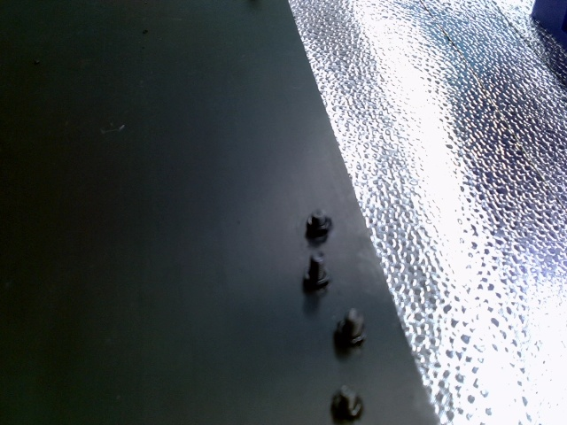
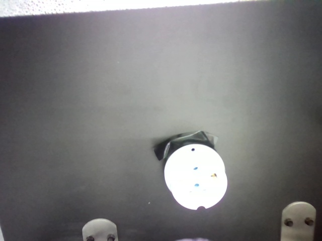
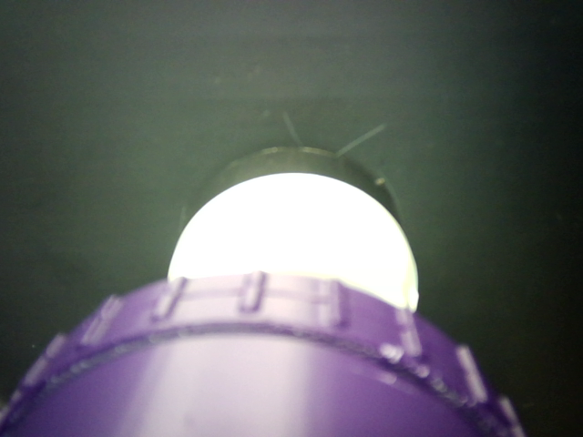
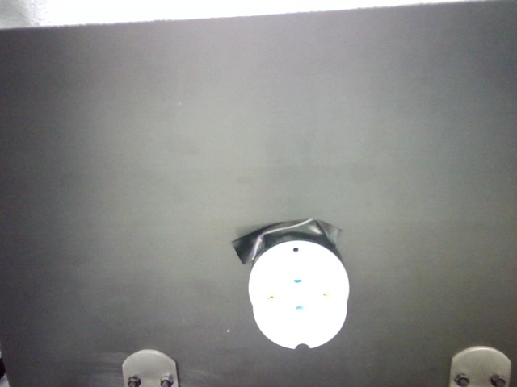
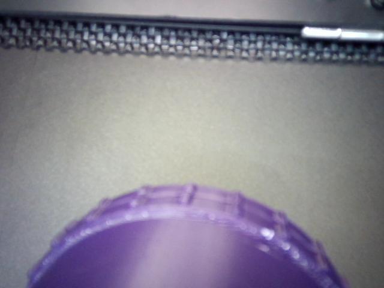
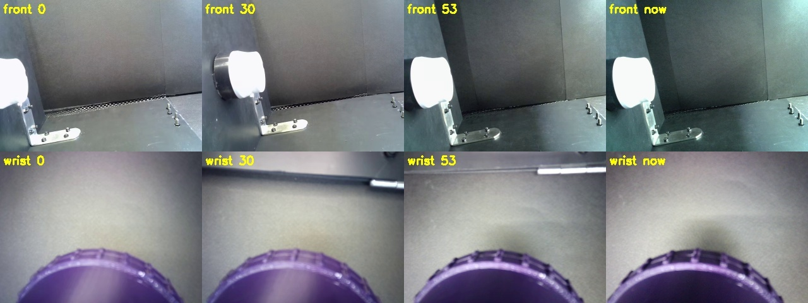
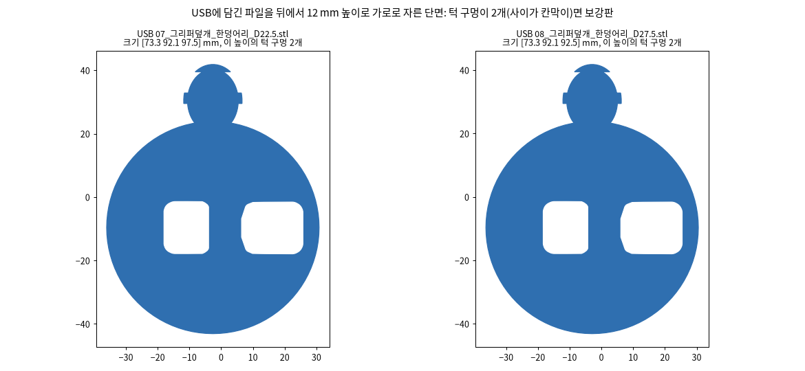

# 실물 키트 문제 해결 기록 (우분투 GPU 노트북, 2026-11-02 ~)

실물 SO-101, 카메라, 그리퍼 덮개, 녹화 화면을 다루며 실제로 겪은 문제와 해결. 그림은 `docs/troubleshooting/`.
짧은 표는 `act/README.md`의 '문제 해결'에도 있다. 새 문제가 생기면 여기에 증상, 원인, 해결, 그림을 이어 쓴다.

## 로봇 연결

### 1. 원격조종이 켜지자마자 끊김 (`There is no status packet`, `No such device`) [2026-11-02]
- 원인: 리더, 팔로워 보드를 카드 리더 달린 USB 허브에 꽂았다. 팔로워에 힘이 들어가는 순간 허브가 통째로 리셋됐다(커널 기록에 허브 재연결 수십 번).
- 해결: 두 보드를 **노트북 본체 USB 포트에 하나씩 직접**. 허브는 카메라에만.

### 2. 팔로워 USB가 아예 안 잡힘 [2026-11-05]
- 증상: `/dev/serial/by-id/`에 리더 하나만 있다. `lsusb`에도 `1a86:55d3`(QinHeng USB Single Serial)이 하나뿐. 커널 기록에 새 장치 연결 흔적이 없다.
- 원인: 케이블 또는 단자. 이 USB 칩은 USB 전원만으로 잡히므로 12 V 어댑터와는 상관없다.
- 해결: 케이블을 다시 끝까지 꽂아 해결(충전 전용 케이블이면 데이터선 있는 것으로 바꾼다. 다른 본체 포트도 시험).
- 확인 명령: `ls -l /dev/serial/by-id/` (팔로워 `...5AE6083026`, 리더 `...5B79015054`)

### 3. 리더 포트는 있는데 모터 0개 응답 [2026-11-05]
- 원인: 리더 5 V 어댑터 전원이 꺼져 있었다.
- 해결: 어댑터, 멀티탭 스위치 확인. 정상이면 리더 5.2 V, 팔로워 12.3 V, 각각 모터 6개 응답.

### 4. 그리퍼(6번 모터) 과부하로 녹화가 죽음 [2026-11-05]
```
RuntimeError: Failed to write 'Torque_Enable' on id_=6 with '0' after 6 tries. [RxPacketError] Overload error!
```
- 원인: 그리퍼 덮개를 문 턱은 그리퍼 값 약 8(0~100 눈금, 0 = 완전히 닫힘)에서 칸막이에 닿는다.
  리더 손잡이를 닫으면 팔로워가 0까지 닫으려고 계속 눌러 과부하 보호가 걸렸다(LeRobot은 그리퍼 힘을 50%, 오래 누르면 25%로 제한).
- 해결: 리더 그리퍼 값을 **하한 6 아래로 내려가지 않게** 자른다(`act/record_preview.py`, `GRIP_MIN=6`).
  기록되는 행동과 보내는 명령이 같고, 칸막이는 살짝만 누른다. 로봇이 혼자 실행할 때(rollout)도 같은 하한을 쓴다.
- 과부하 중에 찍힌 에피소드 1개는 `~/.cache/huggingface/lerobot/local/plug_static_bad_overload_20261105`로 옮겨 쓰지 않는다.
- 확인: 6번 모터 Status(65) = 0, Torque_Enable(40), Present_Position(56) 원값 2148 = 그리퍼 약 8.

### 14. 녹화 시작 직후 `Failed to write 'Lock' on id_=4 with '1' after 1 tries. [TxRxResult] There is no status packet!` [2026-11-05]
- 언제: 연결 단계(팔로워 설정 뒤 토크를 다시 켤 때). 녹화 화면에는 "끝남(코드 1)", 저장된 에피소드 0.
- 바로 뒤에 두 팔 모터 6개씩 세 번 물어보니 모두 응답했다. 한 번 패킷이 빠진 것(간헐)이다. LeRobot은 이 쓰기를 한 번만 시도한다.
- 해결: `act/record_preview.py`가 토크 켜기, 끄기를 3번까지 다시 시도하게 했다. 그래도 자주 나면 팔로워 4번(손목 굽힘) 모터 앞뒤 3핀 케이블을 끝까지 다시 꽂는다.
- 참고: 같은 시각 커널 기록의 `usb 5-1.1: reset`은 카메라 허브의 C270이다(로봇 보드는 본체 포트, 버스 3과 7).

## 카메라

### 5. 옆면 카메라에 은색 벽 반사, 소켓이 화면 밖 [2026-11-03]
| 처음(은색 벽, 소켓 없음) | 소켓이 화면 밖 | 고정한 자리 |
|---|---|---|
|  |  |  |
- 해결: 30~40 cm 떨어뜨리고 위로 들어 소켓 전체가 왼쪽 위 1/3에 들어오게. 배경에 검은 천. 기준 사진 `outputs/camera_ref/side_ref_20261105.png`.

### 6. 손목 카메라에 엔드이펙터가 안 보임 [2026-11-03]
| 원통만 집었을 때(아래 끝에 보라색만 조금) | 덮개를 끼운 뒤(결합 링이 아래 1/3) |
|---|---|
|  |  |
- 원인: 키트의 손목 카메라 받침이 위로 젖혀져 있어 턱 끝이 화면 바로 아래에 걸린다.
- 해결: 원통을 턱 끝보다 52~58 mm 앞으로 빼는 그리퍼 덮개(`cad/make_gripper_cover.py`). ACT가 접점과 소켓을 한 화면에서 본다.

### 7. 손목 카메라가 너무 밝음, 수동 노출은 검은 화면 [2026-11-03]
| 수동 노출 60(거의 검정) | 자동 노출 |
|---|---|
|  |  |
- OpenCV로 `CAP_PROP_AUTO_EXPOSURE=1`, `EXPOSURE` 30~250을 줘도 평균 밝기 1~3(거의 검정). 이 카메라의 수동 노출 단위를 아직 못 맞췄다(v4l-utils 미설치).
- 지금: 자동 노출 그대로. 소켓 가운데가 하얗게 날아가면 조명을 소켓에서 비켜 둔다. 녹화와 실행 때 조명을 같게.

### 8. 녹화 시작하면 `Failed to open OpenCVCamera(... C270 ...)` [2026-11-05]
- 원인: 녹화 화면의 평소 미리보기가 카메라를 붙잡은 채로 녹화 프로그램이 같은 카메라를 열려고 했다.
  (미리보기를 스레드로 돌렸더니 끈 뒤에도 장치를 놓지 않았고, 예전 서버 프로세스가 몇 개 남아 있었다.)
- 해결: 미리보기를 따로 프로세스(`act/cam_preview.py`)로 돌리고, 녹화 전에 끝내고 `fuser`로 장치가 비었는지 확인한 뒤 녹화를 시작한다.
- 확인 명령: `fuser /dev/video4 /dev/video6` (출력이 없으면 비어 있음). 녹화 화면 서버는 하나만: `pgrep -af "uvicorn act.record_gui"`

### 15. 녹화 중 손목 카메라가 잠깐 멈춘 것처럼 보임 [2026-11-05, 확인 중]

- 18:01 확인 때는 손목 영상이 계속 바뀌고 있었다(1.5초 간격 두 장의 차이 있음, 정리 시간이라 바닥을 봄). 4개 저장된 상태.
- 의심: 카메라 두 대가 같은 USB 허브(Genesys, 버스 5)에 있고, 그 허브의 C270이 17:53~17:57 사이 4번 재연결됐다(`usb 5-1.1: reset`).
- 권장: 카메라를 허브 대신 노트북 본체 포트에 하나씩 직접. 녹화 뒤 `bash act/view.sh static <번호>`로 영상이 끊긴 에피소드가 있는지 본다.

### 16. 녹화가 끝난 뒤 녹화 화면의 손목 카메라 칸이 검게 멈춤 [2026-11-05]
- 노트북 쪽 영상 파일은 정상(밝기 141, 계속 갱신). 브라우저의 긴 영상 스트림(MJPEG)이 녹화와 미리보기가 바뀌는 순간 끊겨 다시 붙지 않았다.
- 같은 이유로 서버를 끄려 해도 열린 스트림 때문에 예전 서버가 안 꺼져 몇 개씩 남았고, 새 서버가 포트를 못 잡았다.
- 해결: 화면이 0.1초마다 최신 사진 한 장(`/frame/<이름>`)을 받아 가게 바꿨다(끊겨도 스스로 다시 받는다).
  서버를 다시 켤 때는 예전 것을 확실히 끈다: `ss -ltnp | grep 8200`으로 pid 확인 후 `kill -9 <pid>`.
- 주의: `pkill -f "cam_preview"`처럼 명령 문자열에 같은 글자가 있으면 셸 자신이 죽는다(exit 144). `grep "[c]am_preview"`로 찾는다.

### 17. 녹화 중에 녹화 화면 서버를 다시 켜서 녹화가 주인 없이 남음 [2026-11-05]
- 서버를 바꾸려고 끈 순간 사용자가 막 녹화를 시작한 상태였다. 녹화 프로그램은 따로 떠 있어 계속 돌았지만 버튼(n, r, q)을 받을 길이 끊겼다.
- 처리: 그 프로세스에 Ctrl+C(SIGINT)를 보내 정상 종료(데이터셋 마무리). 진행 중이던 에피소드는 저장되지 않았고 기존 36개는 그대로(다시 열어 확인).
- 규칙: 서버를 다시 켜기 전에 `curl -s 127.0.0.1:8200/state`의 `"running": false`를 확인하고, true면 다시 켜지 않는다.
  남은 녹화 프로세스 찾기: `ps -eo pid,cmd | grep "[r]ecord_preview"` → `kill -INT <pid>`

### 18. 옆면 카메라가 밀림(왼쪽 보충 녹화 중) [2026-11-06]

- 위 줄 왼쪽부터 0번, 30번, 53번 에피소드 첫 장면, 지금 화면(옆면). 아래 줄은 손목.
- 에피소드마다 0번과 비교한 화면 이동(윤곽선 위상 상관): 0~45번은 4 px 안. 46~51번 약 (-12, +10) px, 52~53번 약 +52 px. 지금도 +52 px.
  (39, 41~43번 큰 값은 조명을 바꾼 장면이라 계산이 틀린 것)
- 원인: C270을 3M 양면테이프로 아크릴판에 붙였지만, 카메라 머리(관절)가 돌아갈 수 있다.
- 영향: 학습 데이터 대부분(0~51번)과 다른 시점으로 시험하면 정책이 엉뚱하게 갈 수 있다. act_real_v2 학습 데이터에는 52~53번이 이미 들어갔다.
- 해결: 녹화 화면의 '학습 때 화면 겹쳐 보기'(20번 에피소드 첫 장면을 반투명으로 겹침)로 맞춘 뒤 머리 관절을 고정한다.

### 19. 녹화 시작하자 `Failed to open OpenCVCamera(... C270 ...)` (미리보기가 주인 없이 남음) [2026-11-06]
```
ConnectionError: Failed to open OpenCVCamera(/dev/v4l/by-id/usb-046d_C270_HD_WEBCAM_200901010001-video-index0).
```
- 원인: [카메라 켜기]로 미리보기(`act/cam_preview.py`)를 켠 채 녹화 화면 서버를 다시 켜서, 미리보기 두 개가 주인 없이 남아 카메라를 잡고 있었다(`fuser -v /dev/video*`).
- 해결: 남은 미리보기를 끄고, 서버가 켜질 때와 미리보기를 끌 때 이전 서버가 남긴 `cam_preview.py`도 끄게 고침(`_kill_stray_previews`).
  카메라 켜기 → 서버 다시 켜기를 해 보고 미리보기가 0개로 정리되는 것을 확인.

## 그리퍼 덮개

### 9. 덮개가 마찰로만 끼워져 빠질 수 있음 → 그리퍼가 무는 구조로 [2026-11-03]
- 처음 덮개는 안쪽 사방 0.5 mm 여유. 뽑을 때 덮개가 빠질 수 있었다.
- 해결: 고정 턱 칸과 움직이는 턱 칸을 나누고 사이에 쐐기 칸막이. 그리퍼를 닫으면 칸막이를 물어 고정.

### 10. 벽이 얇다는 지적 → 보강 [2026-11-04]
| USB 파일 단면 확인(구멍 2개 = 칸막이 있음) | 칸막이 단면 |
|---|---|
|  |  |
- 바깥벽 최소 2.35 → 4.4 mm, 칸막이 최소 3.1 → 4.3 mm(`WALL=4.5`, `Q_CLAMP=-0.135`). 지름 약 73 → 79 mm.
- STL을 float32로 저장할 때 넓이 0인 삼각형 조각이 생겨 '닫힌 몸체' 검사에 걸림 → manifold3d로 정리(`_simplify`).

## 소프트웨어

### 11. `Failed to find Rerun Viewer executable in PATH` [2026-11-02]
- 해결: `act/env.sh`가 `~/lerobot_env/bin`을 PATH에 넣는다. 녹화 화면에서는 Rerun을 끄고 화면 안에 카메라를 띄운다.

### 12. 보정 때 팔로워가 안 움직임(토크 걸림) [2026-11-02]
- 기존 보정 파일이 있으면 LeRobot이 먼저 '쓸지 새로 할지' 묻는데, 그동안 토크가 켜져 있다. 그 질문에 `c` + Enter(팔을 받친 채).

### 13. 녹화 프로그램이 키 입력을 못 받음(Wayland) [2026-11-05]
- LeRobot은 Wayland에서 전역 키 입력(pynput)을 못 쓰고, 표준 입력이 터미널이면 터미널에서 n(다음), r(다시), q(끝)를 받는다.
- 녹화 화면은 녹화 프로그램을 가짜 터미널(pty) 안에서 돌리고 버튼이 n, r, q를 보낸다(`act/record_gui.py`).
