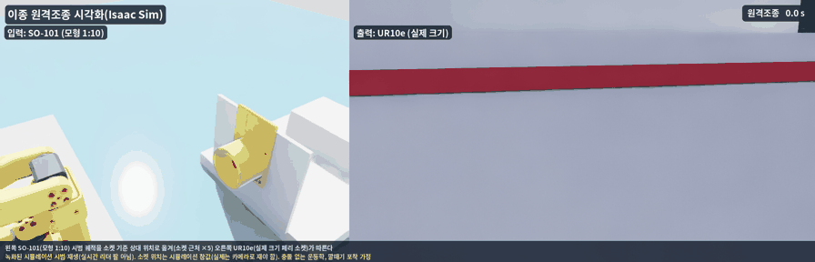

# 실제 크기 확장 시각화 (발표용 부가 장면)


<sub>실제 크기 확장 시각화(Isaac Sim) 편집본: 바다 시점 → 넓은 시점 → 소켓 근접 → 넓은 시점. 파고 0.6 m, 시드 8: 접근 → 잔잔한 순간 대기 → 삽입 → 13.4 s에 연결(패널 표시등이 초록으로)</sub>

산업용 로봇 UR10e(Isaac Sim 5.1 기본 자산)가 실제 크기 전기 페리의 현측 충전 소켓에 플러그를 꽂는 장면이다.
**메인 주제(실물 SO-101 + ACT)의 결과가 아니다.** 모형 실험의 방법(지연 관측, AR 예측, 정온 구간 삽입)을 실제 크기로 키우면
어떻게 보이는지 보여 주는 그림이다. 학습 정책이 아니라 규칙 기반 예측 제어기이고, 물리 충돌은 계산하지 않는다.

```bash
cd ~/plugbot
# 처음 한 번(인터넷 필요): UR10e와 하늘 HDR을 ~/isaacsim_assets에 받는다. 그 뒤로는 인터넷 없이 돈다
OMNI_KIT_ACCEPT_EULA=YES LD_LIBRARY_PATH=~/isaacsim_compat/lib ~/isaacsim_env/bin/python isaac/scaleup/fetch_assets.py
OMNI_KIT_ACCEPT_EULA=YES LD_LIBRARY_PATH=~/isaacsim_compat/lib ~/isaacsim_env/bin/python isaac/scaleup/run_scaleup.py --seed 8 --headless
~/plugbot/.venv/bin/python isaac/scaleup/make_media.py        # 자막, mp4, GIF
OMNI_KIT_ACCEPT_EULA=YES LD_LIBRARY_PATH=~/isaacsim_compat/lib ~/isaacsim_env/bin/python isaac/scaleup/run_scaleup.py --trials 10   # 렌더 없이 횟수 세기
```

결과: `outputs/scaleup_edit.mp4`(편집본, 발표용), `scaleup_sea.mp4`, `scaleup_wide.mp4`, `scaleup_close.mp4`, `scaleup_side_by_side.mp4`, `scaleup.gif`(편집본).
mp4와 프레임(`data/scaleup_frames/`)은 커밋하지 않는다. UR10e(USD 레이어 29개)와 하늘 HDR은 `fetch_assets.py`로 `~/isaacsim_assets`에
받아 두며(103 MB, 저장소 밖), 로컬 사본이 있으면 그것을, 없으면 Isaac 자산 서버를 쓴다.

장면: 부두(받침, 펜더, 계선주, 충전 캐비닛과 늘어진 충전 케이블), 페리(선체, 둥근 창, 난간, 선실, 마스트, 현측 패널과 상태등), 출렁이는 바다 메시
(파도 성분 5개, 주기 2.4~8.1 s), HDR 하늘. 연결되면 패널과 캐비닛의 상태등이 주황에서 초록으로 바뀐다. 카메라는 바다 시점(선미 바깥),
넓은 시점(천천히 다가감), 소켓 근접 셋이다.

## 이종 원격조종 시각화 (재생 모드)



<sub>왼쪽: SO-101(모형 1:10) Isaac 시범(에피소드 49, 모형 파고 5.0 cm). 오른쪽: UR10e(실제 크기, 파고 0.6 m, 시드 8)가 같은 상대 동작으로 7.7 s에 연결</sub>

작은 SO-101로 산업용 UR10e를 조종하는 구성을 보여 준다. 지금은 리더 팔 대신 **녹화된 SO-101 시범 궤적**을 재생한다.

```bash
OMNI_KIT_ACCEPT_EULA=YES LD_LIBRARY_PATH=~/isaacsim_compat/lib ~/isaacsim_env/bin/python isaac/scaleup/run_scaleup.py \
    --seed 8 --headless --replay data/isaac_side/episode_0049 --frames-dir data/scaleup_replay
~/plugbot/.venv/bin/python isaac/scaleup/make_media.py --frames data/scaleup_replay    # outputs/scaleup_teleop.mp4, .gif
```

1. SO-101 관절(데이터의 상태, 30 fps) → MuJoCo SO-101 순기구학으로 핀 끝 위치와 핀 방향
2. 그 시각의 모형 소켓(같은 파도 시드로 다시 계산) 기준 상대 위치와 방향(소켓 좌표계: z = 축 바깥, x = 위쪽에 가깝게)
3. 소켓 5 cm 안은 커넥터 배율 ×5, 그 밖은 덜 키워(5 cm 넘는 만큼 ×2) UR10e 작업 범위에 넣는다
4. 실제 크기 소켓(흔들리는 페리) 기준으로 옮겨 UR10e IK, 자동 모드와 같은 매끄러운 추종
- 사람은 소켓 기준으로만 움직이고 배 운동은 시스템이 보정한다는 구성이다. **소켓 위치는 시뮬레이션 참값**이며, 실제로는 카메라로 재야 한다.
- 시작할 때 UR10e를 SO-101 첫 자세에 대응하는 자세에 둔다(멀리서 따라오느라 늦지 않게). 포착 뒤 옆 방향은 자동 모드와 같은 깔때기 포착 가정을 쓰고 깊이는 시범을 따른다.
  이 가정이 없을 때는 시범이 끝난 뒤 2 s 늦게(9.3 s) 연결됐다. 가정을 넣으면 시범 끝(7.3 s) 뒤 0.4 s에 연결(유지 판정 0.63 s 포함).

## 실시간 이종 원격조종 (리더 팔 입력, `--live-leader`)

리더 팔을 손으로 움직이면 UR10e가 실시간으로 따라간다. 배율은 재생 모드와 같다(`leader_source.py`가 관절값을 소켓 기준 위치로 바꾼다).
학습 정책이 아니라 사람이 움직이는 것이고, 소켓 위치는 시뮬레이션 참값이다. 물리 접촉은 계산하지 않고, 충돌 방지는 아래의 기하 근사다.

```bash
PY=~/isaacsim62_env/bin/python   # Isaac Sim 6.2 환경. feetech-servo-sdk, mujoco, scipy 필요
OMNI_KIT_ACCEPT_EULA=YES $PY isaac/scaleup/fetch_assets.py   # 처음 한 번, 인터넷 필요(103 MB). 선상에 가기 전에
# 팔 없이 시험: 실물 시범 54번을 입력으로
OMNI_KIT_ACCEPT_EULA=YES $PY isaac/scaleup/run_scaleup.py --live-leader fake:isaac/scaleup/sample_traj_ep54.npz --live-seconds 20 --lowmem --live-cam /World/CamClose
# 리더 팔 확인(Isaac 없이), 그다음 체험(Ctrl+C로 끝)
$PY isaac/scaleup/leader_source.py /dev/ttyACM0
OMNI_KIT_ACCEPT_EULA=YES $PY isaac/scaleup/run_scaleup.py --live-leader /dev/ttyACM0 --lowmem
```

- 화면: 실물과 같은 카메라 2대를 나란히 띄운다. 왼쪽 앞 카메라 `/World/CamFront`, 오른쪽 손목 카메라 `/World/CamWrist`, 아래 상태 줄(`Teleop`, `CONNECTED`, `HOLD: collision guard (...)`). 왼쪽은 `--live-cam /World/CamWide`나 `/World/CamClose`로 바꿀 수 있다.
  - 앞 카메라: 실물 D435 자리(정면 60, 오른쪽 220, 받침 위 300 mm)를 ×4 한 시선 방향 그대로 팔이 닿지 않는 곳까지 물렸다. 손목 카메라: 플러그 위에 달았고 세로 화각 61°는 실물과 같다.
- 배치(실시간 조종에서만, 다른 모드는 그대로): 로봇을 0.15 m 뒤로(접은 리더 자세의 목표가 어깨 위로 오면 플러그가 팔, 받침과 부딪히고 IK 특이점에 걸린다), 캐비닛을 로봇 옆으로(뒤에 두면 케이블이 받침을 가로지른다).
- 충돌을 막는 세 겹(`collision.py`, `python isaac/scaleup/collision.py`로 자체 시험):
  1. 가상 울타리: 목표를 소켓 기준 안전 구역으로 제한한다(실물 시범의 범위를 덮고 약간 넓힘, 핀 각도 60°까지). 리더 팔을 어떻게 움직여도 UR10e는 이 안에 머문다.
  2. 연속 추종(감쇠 최소제곱): 전역 IK는 도달 한계에서 다른 자세의 해를 돌려줘 팔이 바닥 아래로 뒤집혔다(-686 mm). 현재 자세에서 조금씩 다가가므로 뒤집히지 않고, 못 닿는 목표에서는 가장 가까이 머문다.
  3. 충돌 방지: Isaac의 UR10e 충돌 구에 플러그와 카메라 구를 더해 바닥, 받침, 캐비닛, 카메라 기둥, 현측, 소켓, 자기 자신과의 여유를 매 프레임 잰다. 3 cm 안으로 들어가는 움직임은 막고 되는 관절만 움직인다. 포착된 핀은 깔때기 포착 가정대로 보어 바닥만 본다. `--no-guard`로 끄고 비교할 수 있다.
- 여분 팔 등 다른 리더 팔은 먼저 보정한다. 모터 ID가 1~6으로 설정돼 있어야 하고, 보정은 호밍 오프셋을 모터에 쓴다. JSON은 `LEADER_CALIB`로 지정한다(저장소의 `plug_leader.json`은 그대로 둔다):
  ```bash
  ~/miniforge3/envs/lerobot/bin/lerobot-calibrate --teleop.type=so101_leader --teleop.port=/dev/ttyACM0 --teleop.id=spare_leader --teleop.calibration_dir=isaac/scaleup/calib
  LEADER_CALIB=isaac/scaleup/calib/spare_leader.json $PY isaac/scaleup/leader_source.py /dev/ttyACM0
  ```
- CH340 계열 포트가 안 보이면 brltty가 잡은 것일 수 있다(이 노트북에 설치돼 있다): `sudo apt remove brltty`.
- `--live-seconds`로 끝나면 `[live]` 줄에 충돌 방지 정지 프레임, 최소 여유와 위치, 평균 프레임, 목표에 못 닿은 프레임이 나온다. 프레임이 목표보다 낮으면 UR10e가 늦게 따라오므로 `--fps 20`으로 낮춘다. Ctrl+C는 Isaac이 바로 종료해서(exit 0) 이 줄이 나오지 않는다.
- 메모리: `--lowmem`(창 960x540, 안티에일리어싱 끔)을 쓴다. 더 필요하면 브라우저 등을 끈다.
- 체험 전에 화면 잠금을 끈다: `gsettings set org.gnome.desktop.session idle-delay 0`. 리더 팔을 움직이는 것은 키보드 입력이 아니라서 유휴로 잡혀 화면이 꺼진다.

확인한 것(2026-11-06, ROG Strix G16, RTX 5070 Ti로 보이는 12 GB GPU, 램 14 GiB, 스왑 32 GB, Ubuntu 24.04, 드라이버 595, Isaac Sim 6.2, fake 입력 3회):
- 코드의 Isaac API는 5.1에서 고칠 곳 없이 6.2에서 돌았다. 고친 것은 로컬 자산 폴더가 5.1로 고정돼 있던 것뿐이다(버전을 읽어 정한다).
- 3회 모두 연결 9.9 s(GPU 노트북 녹화 재생과 같은 시각). 평균 29.7 프레임/s(목표 30, 측정 1회).
- 네트워크를 끊고(`unshare -n`) 로컬 자산으로 끝까지 돌았다.
- 메모리: Isaac 프로세스 최대 8.3 GB, VS Code와 크롬을 켠 채로 시스템 '사용 가능' 최저 3.5 GB.
- GUI 창에서 CamClose와 CamWide로 삽입과 표시등 켜짐을 눈으로 확인했다.
- 시리얼 경로: 시범 54번을 리더 모터 원값으로 거꾸로 풀어 가상 포트의 가짜 Feetech 모터(시험용 임시 코드, 저장소에 없음)로 보냈다. SDK, 토크 끄기, 원값 변환, IK까지 네트워크 없이 돌아 9.9 s에 연결, Ctrl+C로 종료(exit 0). 진짜 모터 응답이 아니다.

충돌 방지 시험(가짜 입력, 렌더 없음, `run_scaleup.py`. 여유는 구 모델 기준이고 물리 접촉 계산이 아니다):

| 입력 | 방지 끔 | 방지 켬 |
|---|---|---|
| 실물 시범 54번, 시드 2 | 연결 9.9 s, 최소 여유 -11 mm(플러그와 위팔) | 연결 9.9 s, 정지 73/538 프레임, 최소 여유 +8 mm(플러그와 소켓) |
| 리더 관절 범위 전체 40 s, 시드 2 | 최소 여유 -154 mm(플러그와 어깨) | 최소 여유 +30 mm, 정지 706/1188 프레임 |

- 입구 앞 대기, 밀어 넣기, 빼기를 되풀이하는 가짜 조작(사람의 눈 피드백 없음, 파고 0.6 m): 시드 0~9 모두 연결, 첫 연결 9.3~12.0 s.
- 범위 전체를 30 s 쓸어 본 뒤 같은 조작: 파고 0에서는 9.4 s 만에 연결.
- 평균 약 29.6 프레임/s(목표 30). GUI 두 화면 `--lowmem`: Isaac 프로세스 최대 8.1 GB, 시스템 '사용 가능' 최저 5.2 GB, GPU 메모리 최대 3.1 GB.

알려진 한계:
- **파도 속에서 범위 전체를 30 s 쓸어 본 뒤에는 그다음 40 s 안에 다시 꽂지 못했다**(정지 1067/2080 프레임). 원인은 확정하지 못했다(이상한 자세에 머무는 것으로 추정). 이렇게 되면 Ctrl+C 뒤 다시 시작한다.
- 파도가 있을 때 켠 상태에서도 음수 여유가 남는다(시드 1에서 -118 mm 보어 바닥, 시드 4와 9에서 -30 mm 소켓). 핀이 보어나 입구에 있을 때의 값이라 배 운동 탓으로 보지만 시드별로 확인하지는 않았다. 팔을 멈추는 방식이라 다가오는 배를 피하지는 못한다.
- 케이블은 보이기 위한 곡선이라 충돌 방지에 넣지 않았다. 팔을 접은 자세 근처에서 팔과 겹칠 수 있다(시범 54번 최소 -9 mm, 범위 전체 -229 mm).

아직 안 한 것: **실물 리더 팔 입력**(실제 포트, 모터 응답, 보정값, 사람이 움직일 때의 지연과 조작감)은 시험하지 않았다. 저장소 보정값(`calib/plug_leader.json`)은 GPU 노트북에서 보정한 그 팔 기준이다.

## 정한 치수와 이유

| 항목 | 값 | 이유 |
|---|---|---|
| 커넥터 배율 | 모형의 **5배** | 모형 핀 Ø12 mm → Ø60 mm(선박용 대전류 커넥터 핀 굵기 수준으로 잡은 값). 장면 배율(10배)을 쓰면 핀 Ø120 mm, 입구 Ø500 mm로 UR10e 끝에 달기에 지나치게 크다 |
| 핀 | Ø60 mm, 길이 250 mm, 끝 모따기 | 삽입 깊이(아래 145 mm)보다 충분히 길게 |
| 커넥터 몸통 | Ø144 mm(결합 링 Ø172), 길이 200 mm | 핀 굵기에 맞춘 손잡이 크기. 모양은 실물 그리퍼 덮개(`cad/make_gripper_cover.py` iec)와 같은 구조: 선박 육상전원 표준(IEC 62613) 플러그를 흉내 낸 결합 링, 앞면 핀 구멍 6개, 아래로 나온 케이블 부싱(`make_plug_mesh.py` → `plug_iec.npz`, `--plug simple`이면 예전 원통). 특정 선박의 실제 플러그가 아니다 |
| 플랜지 어댑터 | Ø100 mm, 두께 20 mm | UR10e 공구 플랜지(ISO 9409-1-50-4-M6, Ø63)를 덮는 크기 |
| 소켓 입구(깔때기 위) | **Ø250 mm** | `cad/make_parts.py` 깔때기(Ø50) × 5. 과제의 200~300 mm 범위 |
| 보어 | Ø80 mm, 깊이 125 mm | 반경 여유 10 mm = 모형 2 mm × 5(핀 반지름 대비 여유 비율 1/3 그대로) |
| 깔때기 높이, 바깥 반지름, 바닥 | 85, 155, 20 mm | 모형 17, 31, 4 mm × 5. 소켓 전체 높이 230 mm |
| 포착 반경 | 95 mm | 깔때기 입구 반지름 125 - 핀 반지름 30(모형 19 mm × 5) |
| 목표 삽입 깊이 | 입구에서 145 mm | 모형 29 mm × 5(보어 안 60 mm) |
| 파도, 선박 운동 | `ShipMotion(0.06, berth="alongside")`를 길이 ×10, 시간 ×√10, 각도 그대로 | Froude 상사. 모형 Hs 6 cm = 실제 0.6 m, 첨두 주기 2.0 s → 6.3 s |
| 페리 | 폭 12 m, 보이는 길이 40 m, 건현(부두 위) 2.2 m, 흘수 2.3 m | 연안 전기 여객선, 관공선 크기의 일부만 |
| 배치 | 로봇 받침 0.6 m, 소켓 입구는 로봇 앞 1.2 m, 받침보다 0.4 m 위 | UR10e 도달 거리 1.3 m 안에서 삽입 자세가 나오게. 모형(앞 30 cm)의 10배는 도달 범위 밖 |
| 제어 시간 인자 | 지연 0.32 s, 관측 9.5 Hz, AR 창 9.5 s, 정온 구간 판정 속도 0.038 m/s, 삽입 속도 0.126 m/s | 모형 값 × √10(관측 주기도 늘려 AR이 모형과 같은 걸음 수로 앞을 본다). 길이 인자(대기 거리 150 mm, 정렬 허용 20 mm)는 커넥터 배율 × 5 |
| 관절 속도, 가속도 제한 | 1.5 rad/s, 6 rad/s² | UR10e 정격(큰 관절 120°/s = 2.1 rad/s)보다 느리게, 매끄럽게 가속, 감속 |
| 목표 필터 시정수 | 접근과 대기 0.25 s, 삽입 0.12 s, 포착 뒤 0.08 s | 관측 잡음과 9.5 Hz 관측 계단 때문에 팔이 떨리던 것을 편다. 삽입 때는 늦지 않게 짧게 |
| 관절 추종 | 목표 관절 속도 앞먹임 + 비례(6/s) | 비례만 쓰면 0.3 m/s로 움직이는 소켓을 약 5 cm 늦게 따라가 보어(여유 1.2 cm)를 벗어났다 |

## 가정 (그대로 밝힌다)

- **충돌 없는 운동학 재생**: UR10e 관절은 IK(Isaac Lula, 끝 프레임 tool0) 목표를 속도 제한으로 따라가며, 물리 힘이나 접촉은 없다.
- **깔때기 포착**: 핀 끝이 입구 면을 지나는 순간 옆 오차가 포착 반경(95 mm) 안이면 포착으로 본다. 그 뒤로는 깔때기와 순응 손목(RCC)이
  옆 오차를 흡수한다고 가정해 핀이 실제 소켓 축을 따른다. 모형 실험에서는 이것을 물리 접촉이 했다. 포착 반경 밖이면 실패로 센다.
- **연결 뒤 유지**: 실제 장치는 래치가 플러그를 잡고 팔은 놓는다. 여기서는 플러그가 팔에 붙어 있어, 연결 뒤에도 팔이 소켓을 따라간다.
- 판정은 모형 실험과 같다: 핀 끝이 목표 깊이에 있고 옆 오차가 반경 여유(10 mm) + 2 mm 안인 상태를 0.63 s(모형 0.2 s × √10) 유지.

## 돌린 결과 (횟수 그대로)

`run_scaleup.py --trials 10`(시드 0~9, 렌더 없음, 매끄러운 움직임 적용 뒤): **10번 중 10번 연결**. 연결 시각 7.4~25.8 s(`trials.json`).
위 가정(충돌 없음, 깔때기 포착) 아래의 시각화 기준이라 **실제 크기 장치가 된다는 검증이 아니다.**
과정: 처음(필터 없음) 10/10이었으나 팔이 떨렸다. 필터와 가속도 제한만 넣으니 늦어져 2/10, 앞먹임을 넣어 8/10, 삽입 때 필터를 짧게 해 10/10. 영상은 시드 8.

## 못 한 것

- (b) 실시간 원격조종 코드는 fake 입력으로만 확인했다. **실물 리더 팔로는 아직 돌리지 않았다**(위 '실시간 이종 원격조종' 절).
- 플러그와 소켓의 물리 접촉, 케이블, 래치 동작, 실제 커넥터 규격(MCS 7핀 방향 맞춤)은 다루지 않았다.
- 실제 페리 선형, RAO 기반 선박 운동, 계류줄은 근사(상자 선체, 모형 파도 식을 Froude로 확대)다.
