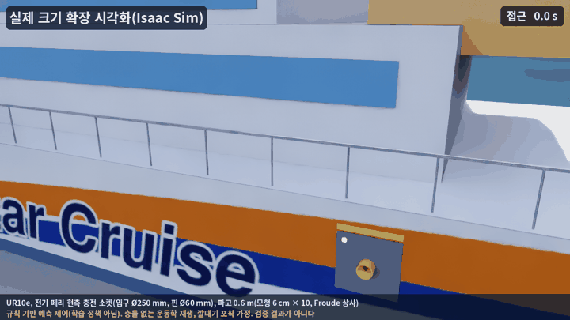

# 실제 크기 확장 시각화 (발표용 부가 장면)



<sub>실제 크기 확장 시각화(Isaac Sim) 편집본: 바다 시점 → 넓은 시점 → 소켓 근접 → 넓은 시점. 파고 0.6 m, 시드 8: 접근 → 잔잔한 순간 대기 → 삽입 → 13.4 s에 연결(패널 표시등이 초록으로)</sub>

산업용 로봇 UR10e(Isaac Sim 5.1 기본 자산)가 실제 크기 전기 페리의 현측 충전 소켓에 플러그를 꽂는 장면이다.
**메인 주제(실물 SO-101 + ACT)의 결과가 아니다.** 모형 실험의 방법(지연 관측, AR 예측, 정온 구간 삽입)을 실제 크기로 키우면
어떻게 보이는지 보여 주는 그림이다. 학습 정책이 아니라 규칙 기반 예측 제어기이고, 물리 충돌은 계산하지 않는다.

```bash
cd ~/plugbot
# 처음 한 번(인터넷 필요): UR10e와 하늘 HDR을 ~/isaacsim_assets에 받는다. 그 뒤로는 인터넷 없이 돈다
OMNI_KIT_ACCEPT_EULA=YES LD_LIBRARY_PATH=~/isaacsim_compat/lib ~/isaacsim_env/bin/python isaac/scaleup/fetch_assets.py
OMNI_KIT_ACCEPT_EULA=YES LD_LIBRARY_PATH=~/isaacsim_compat/lib ~/isaacsim_env/bin/python isaac/scaleup/run_scaleup.py --seed 8 --headless
~/plugbot/.venv/bin/python isaac/scaleup/make_media.py        # 자막, mp4, GIF
OMNI_KIT_ACCEPT_EULA=YES LD_LIBRARY_PATH=~/isaacsim_compat/lib ~/isaacsim_env/bin/python isaac/scaleup/run_scaleup.py --trials 10   # 렌더 없이 횟수 세기
```

결과: `outputs/scaleup_edit.mp4`(편집본, 발표용), `scaleup_sea.mp4`, `scaleup_wide.mp4`, `scaleup_close.mp4`, `scaleup_side_by_side.mp4`, `scaleup.gif`(편집본).
mp4와 프레임(`data/scaleup_frames/`)은 커밋하지 않는다. UR10e(USD 레이어 29개)와 하늘 HDR은 `fetch_assets.py`로 `~/isaacsim_assets`에
받아 두며(103 MB, 저장소 밖), 로컬 사본이 있으면 그것을, 없으면 Isaac 자산 서버를 쓴다.

장면: 부두(받침, 펜더, 계선주, 충전 캐비닛과 늘어진 충전 케이블), 페리(선체, 둥근 창, 난간, 선실, 마스트, 현측 패널과 상태등), 출렁이는 바다 메시
(파도 성분 5개, 주기 2.4~8.1 s), HDR 하늘. 연결되면 패널과 캐비닛의 상태등이 주황에서 초록으로 바뀐다. 카메라는 바다 시점(선미 바깥),
넓은 시점(천천히 다가감), 소켓 근접 셋이다.

## 이종 원격조종 시각화 (재생 모드)


<sub>왼쪽: SO-101(모형 1:10) Isaac 시범(에피소드 49, 모형 파고 5.0 cm). 오른쪽: UR10e(실제 크기, 파고 0.6 m, 시드 8)가 같은 상대 동작으로 7.7 s에 연결</sub>

작은 SO-101로 산업용 UR10e를 조종하는 구성을 보여 준다. 지금은 리더 팔 대신 **녹화된 SO-101 시범 궤적**을 재생한다.

```bash
OMNI_KIT_ACCEPT_EULA=YES LD_LIBRARY_PATH=~/isaacsim_compat/lib ~/isaacsim_env/bin/python isaac/scaleup/run_scaleup.py \
    --seed 8 --headless --replay data/isaac_side/episode_0049 --frames-dir data/scaleup_replay
~/plugbot/.venv/bin/python isaac/scaleup/make_media.py --frames data/scaleup_replay    # outputs/scaleup_teleop.mp4, .gif
```

1. SO-101 관절(데이터의 상태, 30 fps) → MuJoCo SO-101 순기구학으로 핀 끝 위치와 핀 방향
2. 그 시각의 모형 소켓(같은 파도 시드로 다시 계산) 기준 상대 위치와 방향(소켓 좌표계: z = 축 바깥, x = 위쪽에 가깝게)
3. 소켓 5 cm 안은 커넥터 배율 ×5, 그 밖은 덜 키워(5 cm 넘는 만큼 ×2) UR10e 작업 범위에 넣는다
4. 실제 크기 소켓(흔들리는 페리) 기준으로 옮겨 UR10e IK, 자동 모드와 같은 매끄러운 추종
- 사람은 소켓 기준으로만 움직이고 배 운동은 시스템이 보정한다는 구성이다. **소켓 위치는 시뮬레이션 참값**이며, 실제로는 카메라로 재야 한다.
- 시작할 때 UR10e를 SO-101 첫 자세에 대응하는 자세에 둔다(멀리서 따라오느라 늦지 않게). 포착 뒤 옆 방향은 자동 모드와 같은 깔때기 포착 가정을 쓰고 깊이는 시범을 따른다.
  이 가정이 없을 때는 시범이 끝난 뒤 2 s 늦게(9.3 s) 연결됐다. 가정을 넣으면 시범 끝(7.3 s) 뒤 0.4 s에 연결(유지 판정 0.63 s 포함).

## 정한 치수와 이유

| 항목 | 값 | 이유 |
|---|---|---|
| 커넥터 배율 | 모형의 **5배** | 모형 핀 Ø12 mm → Ø60 mm(선박용 대전류 커넥터 핀 굵기 수준으로 잡은 값). 장면 배율(10배)을 쓰면 핀 Ø120 mm, 입구 Ø500 mm로 UR10e 끝에 달기에 지나치게 크다 |
| 핀 | Ø60 mm, 길이 250 mm, 끝 모따기 | 삽입 깊이(아래 145 mm)보다 충분히 길게 |
| 커넥터 몸통 | Ø160 mm, 길이 200 mm | 핀 굵기에 맞춘 손잡이 크기 |
| 플랜지 어댑터 | Ø100 mm, 두께 20 mm | UR10e 공구 플랜지(ISO 9409-1-50-4-M6, Ø63)를 덮는 크기 |
| 소켓 입구(깔때기 위) | **Ø250 mm** | `cad/make_parts.py` 깔때기(Ø50) × 5. 과제의 200~300 mm 범위 |
| 보어 | Ø80 mm, 깊이 125 mm | 반경 여유 10 mm = 모형 2 mm × 5(핀 반지름 대비 여유 비율 1/3 그대로) |
| 깔때기 높이, 바깥 반지름, 바닥 | 85, 155, 20 mm | 모형 17, 31, 4 mm × 5. 소켓 전체 높이 230 mm |
| 포착 반경 | 95 mm | 깔때기 입구 반지름 125 - 핀 반지름 30(모형 19 mm × 5) |
| 목표 삽입 깊이 | 입구에서 145 mm | 모형 29 mm × 5(보어 안 60 mm) |
| 파도, 선박 운동 | `ShipMotion(0.06, berth="alongside")`를 길이 ×10, 시간 ×√10, 각도 그대로 | Froude 상사. 모형 Hs 6 cm = 실제 0.6 m, 첨두 주기 2.0 s → 6.3 s |
| 페리 | 폭 12 m, 보이는 길이 40 m, 건현(부두 위) 2.2 m, 흘수 2.3 m | 연안 전기 여객선, 관공선 크기의 일부만 |
| 배치 | 로봇 받침 0.6 m, 소켓 입구는 로봇 앞 1.2 m, 받침보다 0.4 m 위 | UR10e 도달 거리 1.3 m 안에서 삽입 자세가 나오게. 모형(앞 30 cm)의 10배는 도달 범위 밖 |
| 제어 시간 인자 | 지연 0.32 s, 관측 9.5 Hz, AR 창 9.5 s, 정온 구간 판정 속도 0.038 m/s, 삽입 속도 0.126 m/s | 모형 값 × √10(관측 주기도 늘려 AR이 모형과 같은 걸음 수로 앞을 본다). 길이 인자(대기 거리 150 mm, 정렬 허용 20 mm)는 커넥터 배율 × 5 |
| 관절 속도, 가속도 제한 | 1.5 rad/s, 6 rad/s² | UR10e 정격(큰 관절 120°/s = 2.1 rad/s)보다 느리게, 매끄럽게 가속, 감속 |
| 목표 필터 시정수 | 접근과 대기 0.25 s, 삽입 0.12 s, 포착 뒤 0.08 s | 관측 잡음과 9.5 Hz 관측 계단 때문에 팔이 떨리던 것을 편다. 삽입 때는 늦지 않게 짧게 |
| 관절 추종 | 목표 관절 속도 앞먹임 + 비례(6/s) | 비례만 쓰면 0.3 m/s로 움직이는 소켓을 약 5 cm 늦게 따라가 보어(여유 1.2 cm)를 벗어났다 |

## 가정 (그대로 밝힌다)

- **충돌 없는 운동학 재생**: UR10e 관절은 IK(Isaac Lula, 끝 프레임 tool0) 목표를 속도 제한으로 따라가며, 물리 힘이나 접촉은 없다.
- **깔때기 포착**: 핀 끝이 입구 면을 지나는 순간 옆 오차가 포착 반경(95 mm) 안이면 포착으로 본다. 그 뒤로는 깔때기와 순응 손목(RCC)이
  옆 오차를 흡수한다고 가정해 핀이 실제 소켓 축을 따른다. 모형 실험에서는 이것을 물리 접촉이 했다. 포착 반경 밖이면 실패로 센다.
- **연결 뒤 유지**: 실제 장치는 래치가 플러그를 잡고 팔은 놓는다. 여기서는 플러그가 팔에 붙어 있어, 연결 뒤에도 팔이 소켓을 따라간다.
- 판정은 모형 실험과 같다: 핀 끝이 목표 깊이에 있고 옆 오차가 반경 여유(10 mm) + 2 mm 안인 상태를 0.63 s(모형 0.2 s × √10) 유지.

## 돌린 결과 (횟수 그대로)

`run_scaleup.py --trials 10`(시드 0~9, 렌더 없음, 매끄러운 움직임 적용 뒤): **10번 중 10번 연결**. 연결 시각 7.4~25.8 s(`trials.json`).
위 가정(충돌 없음, 깔때기 포착) 아래의 시각화 기준이라 **실제 크기 장치가 된다는 검증이 아니다.**
과정: 처음(필터 없음) 10/10이었으나 팔이 떨렸다. 필터와 가속도 제한만 넣으니 늦어져 2/10, 앞먹임을 넣어 8/10, 삽입 때 필터를 짧게 해 10/10. 영상은 시드 8.

## 못 한 것

- (b) 원격조종은 녹화 궤적 재생까지 했다. **실시간 리더 팔 입력은 아직 없다**(리더 팔을 연결하는 날 관절값을 받아 같은 매핑에 넣는다).
- 플러그와 소켓의 물리 접촉, 케이블, 래치 동작, 실제 커넥터 규격(MCS 7핀 방향 맞춤)은 다루지 않았다.
- 실제 페리 선형, RAO 기반 선박 운동, 계류줄은 근사(상자 선체, 모형 파도 식을 Froude로 확대)다.
